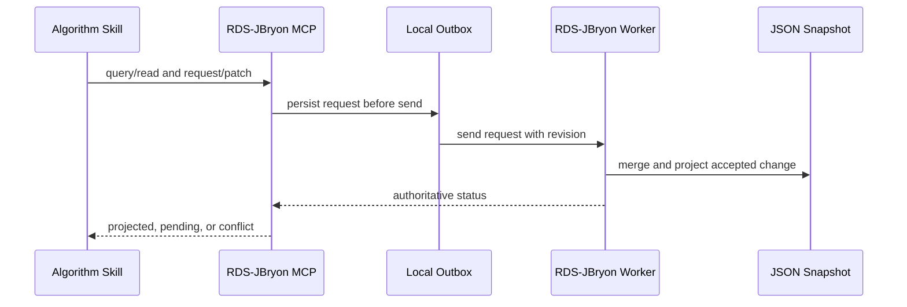

# Algorithm Learning

面向 LeetCode、Hot 100 和同类算法题的中文学习 Skill。它优先理解并保留用户自己的思路，在此基础上做代码诊断、渐进提示、完整题解、复杂度分析和个性化复习。

## 什么时候使用

- 代码出现编译错误、越界、死循环、答案错误或超时。
- 只想获得提示，不希望立即看到完整答案。
- 需要完整题解、可提交代码和复杂度分析。
- 想专项学习动态规划、回溯、树、图、滑动窗口、二分或剪枝。
- 想记录完成情况，生成后续每日练习。

## 长期学习快照

每次学习完成后，只根据明确证据向 JSON 快照追加记录。明确完成、错误、未掌握或主动打卡会保留；证据不足时用中性的 `consulted`，不臆测弱点。跨会话链路通过 `rds` MCP 读取与更新 `knowledge/algorithm-learning/学习快照.json`。



只有状态查询返回 `projected` 才表示快照已经可读。完整规则见 [RDS-JBryon 合同](../references/rds-jbryon-runtime.md) 与 [算法学习快照字段](./references/algorithm-profile-contract.md)。

## 工作方式

用户提供代码时，Skill 会沿用原编程语言，并按理解现有思路、判断路线、定位错误、构造反例、给出最小修改、补充复杂度与复习点的顺序分析。用户只要提示时，答案会按“题型方向 → 核心观察 → 状态或数据结构 → 伪代码 → 局部代码 → 完整实现”逐层揭示。

## 开发者验证

```bash
python -m unittest discover -s algorithm-learning/tests -p "test_*.py"
```
