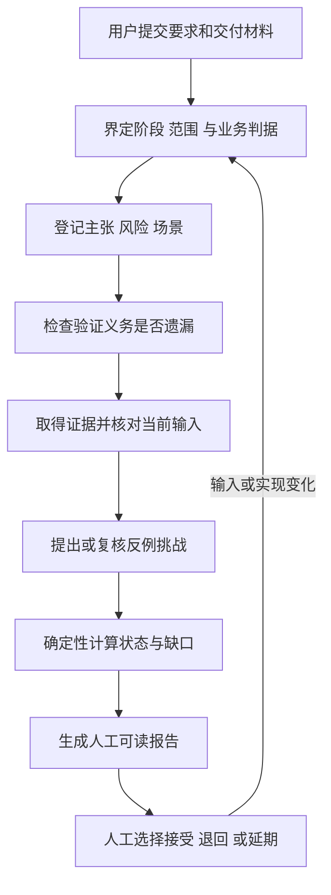

# AI 交付证据审查 Skill 设计规格

> 状态：待人工评审的设计规格；未实现、未进行业务验证。
> 日期：2026-10-18（Asia/Shanghai）。规格版本：1.0。
> 目标仓库：`https://github.com/gitgotcha/my-chatgpt-skills`。
> 本地仓库：`C:\Users\27846\my-chatgpt-skills`。
> 参考基线：本地 HEAD 与 GitHub main 均为 `7c588e4fd2e0e35ccc5a6f2fa8e527806af0deae`，于本次设计时核实；执行开发前重新检查。
> 本文是规格输入，不是实施计划，不表示任何未来检查已通过。DeepSeek 应先据此生成实施计划，再交人工评审。

## 1. 要解决的问题与交付目标

面试问题原意：怎样判断用例、测试方案、技术方案足够完备？怎样判断 AI 交付代码的质量、稳定性、扩展性？

这里的“足够”必须带上业务范围、失败后果、验证环境与剩余风险。有限测试不能证明所有输入、所有故障与所有未来变化都正确。本 Skill 的目标是把笼统判断改为可追溯的交付证据：

```text
业务要求 → 可证伪主张 → 风险与验证义务 → 场景与判定依据
        → 当前版本证据 → 反例挑战 → 缺口与剩余风险 → 人工决策
```

需要同时约束两个对象：业务交付是否有足够证据；本 Skill 是否比普通审查更能发现问题。它不自动发布、不出具生产可靠性认证，也不通过给方案打高分来替代事实。

### 1.1 明确需求与设计假设

| 类别 | 内容 |
|---|---|
| 用户明确需求 | 有深度、有实际工作学习价值；能支撑面试追问；参考现有仓库；产出详细、含路径、可用于生成实施计划并能人工验收的 Markdown；业务开发交给 DeepSeek |
| 本规格选择 | 一个普通 Skill，三种审查阶段；本地证据包；Python 标准库检查器；人工验收；首版不接新服务 |
| 尚未经实验验证 | 检出率提升、误报下降、时间成本、跨项目泛化能力；均需第 14 节的实验 |
| 本轮交付 | 本规格与配套验收规程；不创建 Skill 产品代码，不修改现有技能行为，不提交或推送远端 |

普通 Skill 的选择意味着保存项目交付材料，不保存跨会话的个人学习画像。若以后需要个人画像，应另开范围并遵守仓库画像契约。

## 2. 方案比较与选择

| 方案 | 收益 | 主要局限 | 决策 |
|---|---|---|---|
| 通用质量检查清单 | 成本低，容易开始 | 容易只完成表格；难发现“测试与实现一起错”以及证据过期 | 用作维度提示，不作为核心 |
| 多模型相互审查 | 能增加分析视角 | 相同材料、相似假设可能产生共同盲区；成本上升；投票无法解决证据冲突 | 人工可选，不作为运行依赖 |
| 主张—证据闭环与反例挑战 | 缺口可定位，结论可重验；能检验测试辨错能力 | 需要整理业务真值与证据；仍依赖人工判断范围是否合理 | 首版采用 |

工程价值来自三项组合，而非宣称发明新的测试理论：把质量主张变成带判定依据的验证义务；用有代表性的错误检验测试是否敏感；让证据和输入版本绑定，避免旧测试为新代码背书。

首版不要拆为多个相似技能。先做一条完整的闭环，收集实际失败后再判断是否独立抽包。

## 3. Skill 名称、触发与边界

- 目录与 frontmatter 名称：`evidence-driven-delivery`。
- 界面名称：`AI 交付证据审查`。
- 建议 description：`Use when assessing whether a software design, test plan, or AI-generated implementation has sufficient evidence for its stated requirements and risks, including counterexample challenges and human acceptance. Excludes ordinary project teaching and implementation work without an assessment request.`
- 典型触发：“这份 AI 方案能交付吗”“测试是否漏了关键场景”“审查稳定性与扩展性的依据”“用反例检验当前测试”。
- 不因出现“代码、测试、AI”就自动接管普通开发；不替代项目学习、模拟面试和通用 Skill 创建。

### 3.1 三个阶段共用契约

| `stage` | 输入最低条件 | 可得到的阶段结论 | 不能推导的结论 |
|---|---|---|---|
| `design` | 明确目标及技术方案 | 当前范围的设计论证是否充分，哪些实验仍待执行 | 已跑通、性能达标、生产稳定 |
| `test_plan` | 要求与待审查测试方案 | 测试是否有输入、可观察结果、业务判据与关键失败场景 | 测试已经通过、缺陷已修复 |
| `code` | 要求、源码/差异、测试及能取得的执行材料 | 当前版本是否具备进入人工验收的证据 | 自动准予上线、所有风险消失 |

阶段切换创建新的 run，不能把设计审查结果直接升级为代码验收。缺源码或运行环境时仍输出能完成的分析，并将相应运行证据列为缺口。

### 3.2 与现有仓库的关系

| 现有材料 | 复用内容 | 不继承的职责 |
|---|---|---|
| `software-project-learning/references/reliability-review.md` | 不变量、故障矩阵、并发时间线、幂等与真实回执边界 | 不承担教学节奏、理解评分或长期掌握度 |
| `profile-aware-skill-creator/SKILL.md` | 普通 Skill 的包结构、命名与 plain 验证 | 不读写身份，不引入画像契约 |
| `docs/superpowers/specs/2026-09-03-child-photography-style-batch-replacement-design.md` | 目标、输入输出、失败回退、文件结构、测试与验收的文档形状 | 不迁入图片业务及其规则 |
| Superpowers | 设计先行，先失败再修复，完成前验证 | 不把它设为安装依赖，不递归调用整个开发流程 |
| 插件中的 `review-model-routing` | 后续实施计划可明确审查职责与交接方式 | 本规格不硬编码模型型号，不虚构 DeepSeek 的工具或审查模型库存 |

该技能是评估工具；缺口修复由业务开发流程执行。审查中发现可疑点应提出定位与复现方法，不自行改业务代码。

## 4. 产品闭环与执行约束



1. 先辨认本轮要审查什么，不为一个局部修复自动展开全部质量维度。
2. 从用户材料中提取要求，区分明示要求、AI 推断、待确认项。业务接受标准不能完全由被审查实现反推。
3. 为每个必须要求登记至少一个当前阶段适用的主张；使用否定它所需的观察结果检验是否可证伪。
4. 按失败后果确定风险级别，补充相应验证义务，而非固定生成若干条测试。
5. 先审阅方案、测试及现有证据，再提出最小的新增实验。运行耗时、网络、破坏性操作受原任务授权约束。
6. 将“测试写了”“测试执行过”“观察结果支持主张”分开；保留未执行、结果不明与反证。
7. 用当前输入重新计算检查结果，生成有定位、有影响、有后续动作的报告。
8. 人工决定业务接受。工具不生成 `approved` 或“保证稳定”的结论。

### 4.1 交互预算

默认先处理一个业务闭环、最相关的三个风险；这不是宣称只需三个风险。用户要求全面审查时扩大范围。若扩大才能覆盖已识别的关键风险，明确说明并继续处理必要部分。

默认最多两轮补证或挑战设计修订；同一阻塞重复出现后给出最小复现、已尝试方法与所需人工决策，不靠反复改措辞获得通过。此限制不阻断用户明确要求的进一步研究。

材料足够时直接评估。只有缺失信息会改变业务判据时才问，例如“重复请求应返回同一订单，还是允许创建第二单”。可以继续做不依赖答案的工作。

## 5. 怎样定义“当前范围足够完备”

完备性定义为：在明确范围及故障假设下，必须要求均有验证义务；关键风险有相应场景；每个场景有独立于实现的判据；证据与当前输入对应；未覆盖项被公开。它是可审查的相对充分性，不是绝对完备性证明。

### 5.1 主张规范

合格主张示例：“同一租户的同一幂等键提交相同业务请求，包含并发重试时，仅生成一个订单，重复调用返回同一订单标识”。

不合格主张示例：“幂等性良好”“使用策略模式所以扩展性强”“测试覆盖全面”。应拆为适用输入、前提、可观察结果与否证条件。

每条主张必须说明需求来源、适用范围、成立前提、失效条件、验证责任人与判据来源。来源可以是用户确认的规则、接口契约、独立实现的模型或人工核实；AI 自己复述自己的实现不能成为唯一业务真值。

### 5.2 风险分级与强制升级

`severity` 为 1—5 或 `null`，表示失败影响；`likelihood` 为文字假设及依据，不伪装成统计概率。按以下顺序计算 `priority`：

1. `hazard` 含 `authorization`、`tenant_isolation`、`money`、`concurrency`、`irreversible_change` 任一项，或 severity 为 5：`critical`。
2. severity 为 3 或 4，或者 severity 未知：`high`。
3. 其余：`normal`。

优先级只能人工上调。下调必须修改风险假设及业务影响来源，触发新上下文，不允许通过填低风险分数绕过规则。上面的类别按本技能保守策略使用，不代表普遍行业风险评级标准。

### 5.3 风险到验证义务的映射

| 条件 | design 阶段 | test_plan 阶段 | code 阶段 |
|---|---|---|---|
| 任意必须要求 | 可证伪主张、前提、判据来源、正常及适用的失败路径 | 具体输入、前置状态、步骤、预期与观察点 | 当前版本执行材料或可定位静态证据；类型需与主张相符 |
| high / critical | 关键反例、故障后状态、恢复或边界说明 | 反例如何构造、怎样区别预期失败与环境失败 | 当前版本正常验证；至少一次与该主张相关的有效反例挑战 |
| 跨进程/存储边界 | 持久化点、原子性边界、结果未知、重试与对账 | 每个有差异的提交点前后故障；识别可合并的等价类 | 对应故障注入或等价可重放实验；只有源码推断时保留缺口 |
| 并发/幂等 | 并发时间线、身份范围、竞争约束、旧执行者问题 | 能重复触发竞争的控制方法、断言与清理 | 可控并发实验；仅串行重复请求不能覆盖并发主张 |
| 稳定性/容量主张 | 工作负载、资源约束、故障预算与待测阈值 | 负载、持续时长、指标、采样、停止条件与环境 | 与阈值对应的观测数据；超范围外推列为未知 |
| 扩展性主张 | 一个明确的未来变化与应保持的契约 | 变化实验的步骤、兼容回归与可接受改动面 | 在隔离副本完成该变化，记录改动面及旧行为回归 |

“不适用”需要原因、来源与人工复核项。关键风险不能仅用 `not_applicable` 消失。检查器验证记录存在，人工判断业务理由是否站得住。

### 5.4 覆盖分母与停止准则

报告分别列出，不合成万能总分：

- 要求映射率：有当前阶段主张的必须要求数 / 必须要求总数。
- 场景计划覆盖率：已有具体场景/挑战协议的验证义务数 / 需要场景/挑战协议的适用义务总数；不含 mapping。
- 当前证据支持率：获得当前且类型适配证据的验证义务数 / 需要证据的适用义务总数；不含 mapping，其余含 control/challenge。
- 关键反例敏感度：识别出指定错误的有效挑战数 / 具备可信业务判据的有效挑战总数。
- 单独列出未运行、失效、不适用、人工争议及未确认要求数量。

计数单位均为去重后的稳定 ID。一个场景可以关联多个主张，但同一条证据不能被重复计数提高覆盖；敏感度按挑战 ID 计数。分母为零显示 `N/A`，不显示 100%。

同一输入内规则顺序：先发现矛盾与已知缺陷，再检查证据缺口，最后判断能否进入人工验收。必须要求映射不完整、关键风险未关闭、相关反例未验证或输入证据过期，都不能靠普通项高覆盖抵消。

达到本阶段门槛且剩余风险明示时，停止本轮补证并进入人工决策；不是无限枚举所有输入组合。范围由人复核，工具不能证明分母没有被人为缩小。

## 6. 稳定性、扩展性与测试有效性

### 6.1 稳定性：把形容词改成故障后的行为

按实际风险选择实验：超时后的状态与对账、重复消息、依赖不可用、进程重启、资源耗尽、热点并发、队列积压、回滚兼容。没有相关风险时不强制全做。

每个实验至少包含：故障点、故障前持久化状态、故障注入方法、期望不变量、恢复入口、观测指标、停止条件、数据清理。负载结论必须包含环境、流量模型、时长、错误率和延迟分布；没有用户阈值时只能报告测量，不替用户宣布达标。

例如，远端创建成功但本端超时，首先是结果未知；实验应验证查单、对账或重试协议，不能默认为远端失败然后无条件回补资源。

### 6.2 扩展性：用一次具体变化做实验

示例主张：“新增一种通知渠道时，可新增一个适配器及注册配置，现有渠道契约无需修改，旧渠道回归通过”。

实验在隔离副本或专用分支完成：增加一种渠道，记录修改文件及职责、旧接口是否改变、旧测试是否为兼容新实现而被削弱、配置/迁移/回滚的影响。报告测得的改动面和成本，不把“存在接口或设计模式”当成已验证扩展性。

没有扩展实验只可标为设计分析；不能推断将来任何变化都容易。首版只要求与当前交付最相关的一个变化探针。

### 6.3 反例挑战的准入标准

一个挑战包含业务相关的错误假设、受影响主张、缺陷变体或故障注入方法、可信判据、正常对照、预期区分结果与实际证据。

- 正常对照必须通过，否则本轮挑战为 `invalid`。对照可以是经独立判据核对的正确参考变体；不能因为候选产品自身全绿就认定它没有业务缺陷。
- 缺陷必须触发目标业务错误；不能用语法错误、启动失败或环境损坏冒充业务缺陷。
- 同一个测试/协议对正常与缺陷版本执行；编译错误、超时原因不明记为 `inconclusive`。
- 业务断言将缺陷版本识别为错误记为 `killed`；缺陷仍被当成正确记为 `survived`。
- 设计与测试方案阶段允许书面反例推演，但结果只能是 `reasoned`，不能计入运行敏感度。
- AI 可提出缺陷变体，人或独立参考规则核对其业务含义。执行器不在真实仓库自动写入缺陷。

候选产品、正确对照与缺陷变体必须分开登记。挑战专用证据不直接参与候选产品的通过/失败聚合；它只回答测试能否区分正确与错误。当前产品仍需单独运行相应场景。

首版不建设自动 mutation 平台。先支持少量高价值的受控挑战；通用变异测试工具可以以后接入，不能把所有变异都认作有效业务错误。

## 7. 技术架构与职责

```text
宿主 Agent（语义判断）
  ├─ 读取要求、源码、测试；提出主张、风险、反例
  ├─ 取得授权范围内的执行材料；记录来源和环境
  └─ 写 review.json
          ↓
Python 检查器（确定性）
  ├─ snapshot：冻结显式范围，生成文件清单与指纹
  ├─ validate：类型、引用、路径、图结构、业务契约字段
  ├─ evaluate：重算输入、检查证据适配、计算缺口与门槛
  └─ render：从计算结果生成报告
          ↓
人工验收（业务真值与剩余风险）
```

检查器不调用 LLM、不联网、不运行 evidence 中的命令、不修复业务代码、不判定用户身份。模型负责语义发现，脚本负责可重复的约束检查，人负责范围、判据与业务接受。

首版技术栈：Python 3.11+ 标准库、Markdown、JSON、`unittest`；OpenAI UI 适配器是 YAML。没有 Web 服务、数据库、队列、画像同步、模型 SDK 或必装的第三方 Python 依赖。

### 7.1 脚本接口

统一入口：`evidence-driven-delivery/scripts/assurance.py`，支持以下四个子命令。

```powershell
# 均在 C:\Users\27846\my-chatgpt-skills 执行；这些是未来产品命令，本轮未实现。
python evidence-driven-delivery/scripts/assurance.py snapshot --target-root outputs/delivery-assurance/demo/target --scope outputs/delivery-assurance/demo/scope.json --out outputs/delivery-assurance/demo/baseline.json
python evidence-driven-delivery/scripts/assurance.py validate --bundle outputs/delivery-assurance/demo/review.json
python evidence-driven-delivery/scripts/assurance.py evaluate --bundle outputs/delivery-assurance/demo/review.json --target-root outputs/delivery-assurance/demo/target --evidence-root outputs/delivery-assurance/demo/evidence --out outputs/delivery-assurance/demo/evaluation.json
python evidence-driven-delivery/scripts/assurance.py render --bundle outputs/delivery-assurance/demo/review.json --evaluation outputs/delivery-assurance/demo/evaluation.json --out outputs/delivery-assurance/demo/report.md
```

| 命令 | 输入与主要输出 | 退出码 |
|---|---|---|
| snapshot | 读取目标与范围，输出 baseline JSON | 0 成功；2 输入、路径或 I/O 错误 |
| validate | 自包含 bundle 的结构与引用校验；不确认磁盘证据真实 | 0 结构有效；2 无效 |
| evaluate | 重新校验，重算当前目标和证据文件指纹，输出 evaluation | 0 `ready_for_human`；1 `changes_required` 或 `evidence_gap`；2 格式、路径或 I/O 错误 |
| render | 检查 bundle/evaluation 关联，输出 Markdown；不执行新测试 | 0 成功；2 关联或格式错误 |

`--out` 默认拒绝覆盖；显式 `--overwrite` 只覆盖该输出文件。输入和输出不能是同一文件，也不能覆盖任何被登记的目标/证据文件。先写同目录临时文件再原子替换；失败时不留下看似成功的半份报告。

JSON 输出使用 UTF-8、无 BOM、两空格缩进、字段排序；时间使用带偏移的 ISO 8601。`evaluate` 对相同输入和文件内容产生相同语义结果，不写当前时钟；CLI 展示的耗时不得进入判定指纹。

stdout 成功时只输出一个短 JSON 摘要；可理解的错误在 stderr，包含错误码与 JSON 字段路径，不输出私密文件内容。退出码 2 不生成成功格式的 evaluation。

### 7.2 路径与文件边界

- target-root、evidence-root 由本地 CLI 显式指定；bundle 中不保存机器个人绝对路径。
- 登记的所有路径使用相对于各自 root 的 POSIX 路径；拒绝绝对路径、盘符、`..`、符号链接和 Windows junction/reparse point。使用 resolve 后的包含关系再次检查；仅检查字符串前缀不够。
- v1 只接受普通文件。快照对二进制也可以计算哈希，但不解释其内容；证据文本最大 2 MiB，单个 JSON 最大 5 MiB，超限明确报错，不静默截断。
- 目标扫描硬跳过 `.git`、`__pycache__`、`.venv`、`node_modules`；完整列入 baseline 的 `exclusions`，其余排除由 scope 显式给出。不能自动排除业务配置、锁文件与迁移文件。
- scope 至少选择一个非空目录，递归包含其中普通文件；支持单文件条目。不支持平台相关 glob；排除只允许显式相对目录前缀或单文件。
- 输出目录必须位于快照范围外；发现输出属于 scope 时返回 `OUTPUT_IN_SCOPE`，不自动增加排除规则。
- 文件读取前后记录大小和纳秒修改时间；前后变化或文件集合变化时返回 `SNAPSHOT_UNSTABLE`。快照不是操作系统事务，重要执行应在停止写入的隔离副本进行；不声称完全消除并发改写窗口。

## 8. 数据契约：唯一可执行语义来源

`references/data-contract.md` 将完整维护本节及第 9 节的字段语义；`scripts/contracts.py` 按这些字段校验。首版不同时维护另一份 JSON Schema，避免双份定义漂移。所有对象禁止未知字段；新增字段需显式升级契约并增加兼容测试。

### 8.1 顶层 bundle

所有列出的字段均必需；允许空数组的地方已说明。标识符为 1—80 个 ASCII 字母、数字、下划线或短横线，区分大小写。文本字段必须是非空字符串；声明可为空的数组不使用 null。

| 字段 | 类型与约束 |
|---|---|
| schema_version | 固定字符串 `1.0`；其他版本拒绝，不能猜测迁移 |
| run_id | 稳定 ID；修订输入可以保留，但每次 evaluation 通过 bundle_hash 区分 |
| stage | `design` / `test_plan` / `code` |
| scope | 下节 scope 对象，嵌入 bundle |
| baseline | snapshot 结果，嵌入 bundle |
| requirements | requirement[]，至少一条；必须有一条 must |
| claims | claim[]，允许空，空时不能达到 ready |
| risks | risk[]，允许空，空时列为人工确认事项 |
| scenarios | scenario[]，允许空 |
| evidence | evidence[]，允许空 |
| challenges | challenge[]，允许空 |
| findings | finding[]，允许空 |
| exclusions | exclusion[]，允许空；业务不适用与扫描排除不是同一字段 |

`scope`：`intent` 文本、`include` 非空路径数组、`exclude` 路径数组、`assumptions` 文本数组、`requirement_review` 枚举 `unconfirmed` / `user_confirmed`、`review_record` 文本或 null。未确认时 review_record 必须为 null；已确认时必须有对话引用或人工记录，检查器只核验存在与格式，不验证人的身份。

`baseline`：`algorithm="sha256"`、`files=[{path,sha256,size}]`（非空，按路径排序）、`exclusions`（scope 与硬跳过规则汇总的排序路径数组）、`scope_hash`、`baseline_hash`。sha256 均为 64 位小写十六进制；size 是非负整数，不接受 bool；相同路径和大小写折叠冲突拒绝。

### 8.2 核心实体字段

下列“数组”默认允许空；特别说明非空的除外。任何 `*_ids` 都必须指向已存在的同类实体；所有实体 ID 在同类内唯一。

| 实体 | 完整字段与类型 |
|---|---|
| requirement | `id` ID；`text` 文本；`source` 文本；`origin` 为 user/document/inferred；`importance` 为 must/should；`confirmation` 为 confirmed/pending |
| claim | `id`；`requirement_ids` 非空 ID 数组；`statement` 文本；`preconditions` 文本数组；`falsifier` 文本；`oracle_source` 文本；`kind` 为 functional/stability/capacity/extensibility/security；`owner` 文本 |
| risk | `id`；`claim_ids` 非空数组；`failure` 文本；`severity` 为 1—5 整数或 null；`likelihood` 文本；`hazards` 为第 5.2 节五类值的去重数组；`boundary` 为 local/cross_boundary；`priority_override` 为 null/high/critical（不得降低计算级别） |
| scenario | `id`；`claim_ids` 非空数组；`risk_ids` 数组；`category` 为 normal/boundary/failure/concurrency/recovery/load/extension；`preconditions`、`steps`、`expected`、`observations`、`stop_condition`、`cleanup` 均为文本；`oracle_source` 文本；`protocol_artifact` 为目标相对路径或 null |
| evidence | `id`；`scenario_ids` 非空数组；`kind` 为 static_analysis/design_analysis/test_execution/fault_experiment/load_experiment/extension_experiment；`subject` 为 candidate/control/variant；`execution_status` 为 completed/harness_error/not_run；`context_hash`；`artifact_path` 证据相对路径；`artifact_sha256`；`outcome` 为 pass/fail/inconclusive；`provenance` 为 host_observed/user_supplied/model_asserted；`environment`、`procedure`、`observed`、`oracle_check` 均为文本；`recorded_at` ISO 时间 |
| challenge | `id`；`claim_ids` 非空数组；`risk_ids` 非空数组；`scenario_id`；`defect_hypothesis` 文本；`oracle_source` 文本；`method` 文本；`variant_artifact` 为目标相对路径或 null；`control_evidence_id`、`variant_evidence_id` 各为 ID 或 null；`analysis_evidence_id` 为 ID 或 null；`semantic_validity` 为 confirmed/pending/rejected；`validity_source` 文本或 null |
| finding | `id`；`claim_ids` 非空数组；`severity` 为 critical/high/normal；`statement`、`location`、`impact`、`remediation`、`verification` 为文本；`evidence_ids` 非空数组；`status` 为 open/resolved；`resolution_evidence_ids` 数组 |
| exclusion | `id`；`risk_id` 存在的风险 ID；`reason`、`source`、`reviewer_record` 均为文本；`status` 为 proposed/accepted |

字段类型：ID 为前述字符串，哈希同 baseline；数组去重且不允许 null 元素；未特别允许 null 的字段拒绝 null；空格字符串拒绝。`recorded_at` 校验语法，不能用于判断证据是否新鲜。

`protocol_artifact`、`variant_artifact` 若非 null，必须出现在 baseline.files；证据文件存在性和指纹在 evaluate 时检查。challenge 的对照与变体 evidence 必须关联同一 scenario，且 subject 分别为 control 与 variant；书面分析 evidence 的 subject 为 candidate。challenge.risk_ids 必须与其 claim_ids 具有已登记关联，scenario 也必须关联该挑战的主张与风险。执行未完成时 outcome 必须为 inconclusive。发现节点关系错误返回字段路径，不能悄悄丢弃该实体。

### 8.3 上下文与证据失效

统一哈希编码：JSON `sort_keys=True, ensure_ascii=False, separators=(',', ':')` 转 UTF-8；数组除 files/exclusions 外保留输入顺序。数值只接受有限整数，拒绝浮点、NaN 与重复 JSON key。

```text
scope_hash = SHA256(canonical(scope))
baseline_hash = SHA256(canonical({algorithm, files, exclusions, scope_hash}))
context_hash = SHA256(canonical({
  schema_version, stage, scope_hash, baseline_hash,
  requirements, claims, risks, scenarios,
  challenge_protocols
}))
```

`challenge_protocols` 是每个 challenge 仅保留 `id, claim_ids, risk_ids, scenario_id, defect_hypothesis, oracle_source, method, variant_artifact` 的有序列表，排除结果引用及 semantic_validity。修改挑战方法会使旧证据失效；补充观察结果不会形成循环哈希。

`bundle_hash` 为整个输入 bundle 的 canonical SHA256，包括 evidence、findings 与 exclusions；用于阻止 renderer 把另一份输入与旧 evaluation 拼在一起。

v1 故意使用保守失效：任何范围内文件内容、增删文件、要求、主张、风险、场景或挑战协议变化，旧上下文所有证据都需重新取得。不会声称具备精细的最小重测能力。v2 才考虑基于经验证依赖图做选择性失效。

evaluate 用磁盘当前文件重新计算 baseline，与嵌入 baseline 比较；不一致记录 `TARGET_DRIFT`，旧证据为 stale，输出 evidence_gap（若另有已知缺陷仍优先 changes_required）。evidence 的 artifact 改动记录 `EVIDENCE_DRIFT`；缺失文件同样属于缺口，不能伪装成格式正确的通过。

哈希保证关联与变化检测，不保证内容真伪。用户可编辑日志；`host_observed` 也是宿主声明，不是密码学证明。对来源、日志真实性与业务判据的信任必须在人审中显示，不能声称具备防篡改认证能力。

### 8.4 边、状态与门槛

边由 ID 引用导出：requirement → claim → scenario → evidence；risk → claim/scenario；challenge → claim/scenario/evidence；finding → claim/evidence。引用关系不允许自引用或不符合类型的跨层引用。无需引入图数据库。

验证义务 ID 为 `<claim-id>:<obligation-type>`，类型为 mapping/normal/negative/concurrency/control/recovery/runtime/load/extension/challenge；同主张同类型只有一个分母单位。主张的风险级别取关联风险最高级，无关联风险暂按 normal 计算并列为人工复核。所有主张需 mapping 与 normal；negative 在 high/critical 时必需；关联 concurrency hazard 需 concurrency；跨边界需 recovery；code 阶段 functional/security/stability 需 runtime；capacity 需 load；extensibility 需 extension；code 的 high/critical 需 challenge 与 control。不得让重复添加同类场景增加分母或掩盖缺口。

同一主张存在多个触发风险时，negative/concurrency/recovery/control/challenge 义务只有在**每个触发风险**都有对应场景/证据时才满足。保留 risk_ids 与 uncovered_risk_ids，不能用一个普通失败场景替所有风险结案。例如租户隔离与并发唯一两个风险均为 critical，只有租户挑战 killed 仍不能关闭并发挑战义务。

`required=true` 的条件是该主张关联至少一个 must requirement，或者其最高风险为 high/critical；其余只关联 should 且 normal 风险的义务为 required=false。所有适用义务仍显示并进入对应覆盖分母；required 仅决定缺证能否阻止 ready。输入实体 ID 使用前述字符限制；派生 obligation ID 的冒号是明确例外。

design/test_plan 阶段的 normal、negative、concurrency、recovery、load、extension 义务用具体协议及设计分析证据评估；不能要求尚不存在的产品已经运行。code 阶段对应类型要求运行证据。v1 的 exclusions 只记录范围争议及人工接受说明，不自动豁免任何适用义务；must 的缺口仍阻塞 ready，should 的缺口进入人工表。

义务满足的确定性映射如下；同一证据可真实支持多个义务，但不能因重复引用增加分子。所有支持证据必须当前、completed、pass，来源不是 model_asserted，且通过引用关联同一主张。

| 义务 | 场景或输入条件 | design / test_plan 的证据 | code 的证据 |
|---|---|---|---|
| mapping | 所有关联 requirement 均 confirmed 且有 source；主张有 oracle_source 与 falsifier | 不要求文件证据 | 不要求文件证据 |
| normal | category=normal | candidate 的 design_analysis 或 static_analysis | candidate 的 test_execution/fault_experiment/load_experiment/extension_experiment |
| negative | category=failure 或 boundary，且关联该高风险 risk_id | 同上 | candidate 的 test_execution 或 fault_experiment |
| concurrency | category=concurrency 且关联触发 risk_id | 同上 | candidate 的 test_execution 或 fault_experiment |
| recovery | category=recovery 且关联触发 risk_id | 同上 | candidate 的 fault_experiment |
| runtime | 属于本主张的任一场景 | 不生成此义务 | candidate 的 test_execution 或 fault_experiment |
| load | kind=capacity 且 category=load | candidate 的 design_analysis | candidate 的 load_experiment |
| extension | kind=extensibility 且 category=extension | candidate 的 design_analysis | candidate 的 extension_experiment |
| control | 每个关联高/关键风险都有有效挑战的正确对照 | 不生成此义务 | subject=control 且与挑战协议一致的 test_execution/fault_experiment |
| challenge | 每个关联高/关键风险至少一个有效挑战 killed，且不存在有效 survived | 关键反例的书面推演计入 negative，不生成此义务 | 按下一段规则计算 |

挑战判定顺序：semantic_validity=rejected 记 invalid；pending 或 validity_source 缺失记 pending；只有 analysis_evidence_id、没有运行引用且当前设计分析通过时为 reasoned；运行分支引用缺失记 pending。取得运行证据后，先检查来源与当前性，过期、来源不适配、结果不明记 inconclusive；harness_error 或 completed 的对照 fail 记 invalid；余下须两个证据 completed、kind 为 test_execution/fault_experiment、scenario 相同且对照 pass。此时 variant 的 fail 为 killed，pass 为 survived。方法文本为空属于格式错误，不是 pending。reasoned 不能满足 code challenge。多个挑战按“有效 survived 优先，其次其余缺口，再检查每个触发风险至少一个 killed”处理；额外未完成挑战若声明为当前交付范围，也不能静默略过。

脚本验证字段及证据声明的匹配，不从自由文本日志自动理解断言，更不证明人工填写的 oracle_source 正确。场景是否真的覆盖主张、风险是否漏标、观测是否符合原始日志，是 Skill 语义审查与人工验收的必查项；结构校验成功不能冒充语义覆盖充分。

主张状态由检查器计算，输入不得指定：

| 状态 | 条件（按顺序） |
|---|---|
| contradicted | 当前关联场景存在可信来源的 fail，或有效挑战 survived，或有未解决高/关键 finding |
| stale | 没有 contradicted，但有关联证据失效或目标漂移 |
| unsupported | 没有前两者，但仍有适用义务缺证、未确认业务判据或结果不明 |
| assessed | design/test_plan 的所有本阶段义务完成；仅表示方案论证已审查 |
| verified_in_scope | code 的所有适用义务有当前、类型适配的运行/静态证据，关键挑战有效，未发现反证 |

证据适配规则：model_asserted 永不满足义务；host_observed 或 user_supplied 可以支持，但 provenance 原样披露并人工复核。design_analysis/static_analysis 不能满足 code 的运行义务。candidate 是唯一能支持或反驳候选产品主张的 subject；control/variant 仅用于挑战计算。纯静态发现可以补充证据，但首版不以它关闭 functional/security 的 runtime 义务。

如果只有未验证来源的失败声明，不能自动判业务错误；形成待核实缺口。任何当前、completed、可接受来源的 candidate fail 均保留，即使另有 pass 也不以多数覆盖。resolved finding 必须有当前、pass、类型适配的 candidate resolution evidence；只适用于原判断被核实不成立等情况，不能消除已有 candidate fail。v1 不自动推断修复先后：修复后的业务输入创建新 run；原 run 保持失败作为历史材料。

聚合结果只允许：

1. `changes_required`：当前反证、有效挑战 survived、未解决 high/critical finding 任一成立。
2. `evidence_gap`：不存在上述问题，但有必须要求未确认/无映射、required 义务缺失/过期/不明、关键排除、或 scope 未确认。只关联 should 的高/关键风险同样生成 required 义务，不能降级绕过。
3. `ready_for_human`：以上均不存在；所有 must 主张状态符合当前阶段；should 的证据缺口单独列出并必须由人处置。should 仅缺少支持时可进入人审；已经存在的产品反证或有效 survived 不因 should 而免除 changes_required。

注意：should 不是逃生开关。inferred 或 pending 的 must 一直阻止 ready；将 must 改为 should 会改变上下文，并必须在 scope 的人工复核中解释。normal finding 可以不阻塞门槛，但始终列在剩余风险与人工接受表。

### 8.5 evaluation 输出

顶层固定字段：`schema_version, run_id, stage, bundle_hash, baseline_hash, context_hash, result, claims, obligations, challenges, issues, metrics, human_review_items`。

- claims：`[{id,state,obligation_ids,evidence_ids,reasons}]`。
- obligations：`[{id,claim_id,type,required,satisfied,risk_ids,uncovered_risk_ids,scenario_ids,evidence_ids,reason}]`。
- challenges：`[{id,state,reason}]`，state 为 reasoned/killed/survived/invalid/inconclusive/pending。
- issues：`[{code,entity_id,field_path,message}]`，按 code/entity_id/field_path 排序。
- metrics：第 5.4 节每项 `{numerator,denominator,display}`；display 保留一位小数或 N/A，不用于决策。
- human_review_items：非空文本数组，至少包含范围与判据来源、证据 provenance、剩余风险。ready 也必须存在。

required/satisfied 为 bool；reasons 与各 ID 集合按字符串排序。无任何模型评语参与脚本门槛计算。

## 9. 输出与人工验收契约

每个 run 默认写到 `outputs/delivery-assurance/<run-id>/`，由仓库 `.gitignore` 已覆盖。不默认上传任何证据、源码或报告。可版本化的通用 fixture 放在 Skill tests 下，不能含真实隐私或个人机器路径。

```text
outputs/delivery-assurance/<run-id>/
├── target/                 演示时使用的隔离目标；真实项目可由 CLI 指向其他只读目录
├── scope.json
├── baseline.json
├── review.json
├── evidence/               本地日志、协议分析或实验结果
├── evaluation.json
├── report.md
└── human-acceptance.md      从模板复制，由人填写
```

报告必须包含：

1. 阶段、目标范围、输入指纹、聚合结果；第一段说明结果的业务含义。
2. 要求—主张—风险—场景—证据映射表；source/path/line 只有实际存在且核对后才可展示。
3. 最高风险问题：触发条件、证据、影响、最小修复、重验方法。
4. 覆盖分母、未覆盖项、不适用项；不能只展示百分比。
5. 反例挑战：正常对照、缺陷语义、区分结果及 invalid/inconclusive 原因。
6. 稳定性与扩展性主张的支持条件；没有运行则明确未验证。
7. 证据失效项、来源与真实性限制、假设及剩余风险。
8. 给人的具体决策项与复验入口。

human-acceptance 模板字段：run_id、bundle_hash、context_hash、人工核对的范围与业务判据、核对的原始证据、风险接受/延期/退回逐项理由、负责人、日期、最终决定（accept_scope / return_for_changes / defer）。模板只留填写区，不预填人名或“通过”。

render 对应冻结的那次 evaluation，不检查之后的磁盘变化。人工接受前必须重新 evaluate，再核对三种指纹；报告中的历史结果不得被称为当前工作区仍然通过。

人工接受不能改写 evaluation；即使人接受带缺口交付，工具结果仍为 evidence_gap/changes_required，报告标注“人工接受剩余风险”。更不能将人工接受视为执行部署的授权。

## 10. 文件路径与模块责任

以下是实现时的预期产物；本轮只有本文及配套验收 MD 实际存在。仓库相对路径为交接的稳定契约，本机绝对定位由前述本地仓库根展开。

```text
C:\Users\27846\my-chatgpt-skills\
├── AGENTS.md                                           修改：增加独立评估路由
├── README.md                                           修改：技能清单、职责、入口
├── evidence-driven-delivery/                            新建
│   ├── SKILL.md
│   ├── agents/openai.yaml
│   ├── references/
│   │   ├── assessment-workflow.md
│   │   ├── data-contract.md
│   │   ├── risk-obligations.md
│   │   ├── counterexample-protocol.md
│   │   ├── stability-extensibility.md
│   │   └── worked-example.md
│   ├── assets/
│   │   └── human-acceptance-template.md
│   ├── scripts/
│   │   ├── assurance.py
│   │   ├── contracts.py
│   │   ├── snapshot.py
│   │   ├── evaluate.py
│   │   └── render.py
│   └── tests/
│       ├── test_contracts.py
│       ├── test_snapshot.py
│       ├── test_evaluate.py
│       ├── test_cli.py
│       ├── test_package.py
│       ├── behavior-scenarios.md
│       ├── evaluation-protocol.md
│       ├── fixtures/
│       │   ├── design_case/
│       │   ├── test_plan_case/
│       │   └── code_case/
│       └── evaluation-private/                          不打包进运行时；仅评测者使用
│           └── truth-catalog.json
├── tests/
│   └── test_evidence_driven_delivery_routing.py           新建：仓库接入回归
└── docs/superpowers/specs/
    ├── 2026-10-18-evidence-driven-delivery-design.md       本文
    └── 2026-10-18-evidence-driven-delivery-acceptance.md   配套规程
```

evaluation-private 的“private”表示评测上下文隔离，不是文件访问控制；宿主打包该 Skill 时排除此目录。被评模型不得收到真值文件、测试名称暗示或预期答案，评测者负责隔离。正式评测只挂载运行技能与单案原始材料，不挂载本仓库 docs、评测真值、其他案例及 Git 历史；否则本规格/验收文档本身可能泄题。

| 文件 | 单一职责与约束 |
|---|---|
| SKILL.md | 触发、三阶段、事实边界、最短闭环与按需加载；建议控制在约 180 行内，不为行数牺牲必要规则 |
| agents/openai.yaml | display_name、short_description、default_prompt；默认提示应包含 `$evidence-driven-delivery`；无需硬编码工具依赖 |
| assessment-workflow.md | 提取与核对业务主张，范围确认，何时补证和停止 |
| data-contract.md | 唯一字段语义、指纹算法、引用规则、输出与退出码 |
| risk-obligations.md | 义务生成、适配与门槛规则；不得只写泛泛检查清单 |
| counterexample-protocol.md | 正常对照、有效缺陷、killed/survived/invalid 判据 |
| stability-extensibility.md | 故障实验、工作负载边界、具体变化探针 |
| worked-example.md | 一条完整模拟输入、关键证据、失败报告、修复后新 run 与人工决策；清晰标模拟 |
| assurance.py | argparse 路由、I/O 边界、错误与退出码；不含业务判定算法 |
| contracts.py | 严格字段与引用校验、canonical hash；不读任意外部文件 |
| snapshot.py | 范围解析、路径限制、清单与指纹；不执行目标代码 |
| evaluate.py | 纯函数计算义务、证据适配、挑战和门槛；外部文件事实由入口注入 |
| render.py | 只渲染 evaluation；不二次发明评分，不私自放宽门槛 |

脚本通过入口脚本目录导入同目录模块，测试用 importlib 或明确 sys.path 装载，不要求安装全局 Python 包。未来若拆 package，应保留本节 CLI。

### 10.1 接入现有仓库

根 AGENTS 增加路由：“评估软件方案、测试方案或 AI 代码交付的证据充分性、反例挑战与人工验收：`evidence-driven-delivery/SKILL.md`”。同时用一句话区分：讲解/学习走 project-learning，明确评估交付走本 Skill。

根 README 增加普通、无长期画像的技能条目与入口，不改原有技能功能。不要把本地输出误写为跨会话画像，也不修改现有 RDS 服务或数据协议。

当前仓库没有已核实的插件注册 manifest 需要改动；不要凭空创建。后续若安装环境需要打包注册，先核对本机真实插件源与清单；开发完成不等于已安装，安装完成不等于已在新会话触发。未经明确要求不改缓存、版本号或远端。

## 11. 完整贯穿案例与样例要求

首版用“幂等创建订单”作为可控模拟例，不直接改动 `train-12306` 或 RDS 服务。业务规则由 fixture 明文定义，不声称来自真实生产。

规则：同一租户、同一幂等键、相同请求返回同一订单；同键不同请求返回冲突；不同租户可以使用相同键；超时不等于业务失败。

设计材料故意遗漏“远端提交成功但本端超时”的分支。测试方案只有串行重复测试。缺陷实现使用不带租户的去重键，或采用先查后插且没有并发约束。每个缺陷在独立 fixture 变体中展示，不混入一个无法归因的大坏例。

`worked-example.md` 必须保留如下完整过程：

1. 用户原始模拟请求和明确业务规则。
2. 设计阶段识别的主张、提交点、超时结果未知，以及待测项。
3. 测试方案阶段指出“串行去重不能证明并发去重”，给出受控竞争协议与租户隔离判据。
4. code 阶段的 review.json、实际采集协议、当前证据以及 evaluation.json 的关键字段。
5. 正常对照通过、缺陷变体触发业务错误、当前测试没有识别错误时，challenge 为 survived，门槛为 changes_required。
6. 增加独立业务断言后该挑战 killed；业务代码仍有当前 fail 时，仍然 changes_required，不能把“测试抓到错误”解释为“产品已经正确”。
7. 修复业务、重新快照、新 run 执行回归，旧证据不能搬过去；满足门槛才是 ready_for_human。
8. 人工核对范围、证据来源与剩余风险，再填写接受记录。

不要用只有标题的模板替代完整样例。模拟输入、日志与测量都标明模拟 fixture；只有实际运行的演示才可标“本次执行”。

### 11.1 最小输入的构建接口

`tests/fixtures/` 内每个阶段至少包含 `target/`、`scope.json`、`review.seed.json`、`evidence/` 与 `expected.json`。seed 不硬编码环境相关哈希；测试辅助函数仅替换 baseline/context/evidence 指纹，不改变业务主张或预期结论。

设计与测试方案 fixture 可以有非空的设计分析文件以及 design_analysis evidence；code fixture 必须含可在离线环境运行的 Python 模拟代码与 unittest。fixture 的程序执行由测试套件显式组织，四个产品 CLI 从不执行证据中携带的命令。

`expected.json` 只包含阶段、聚合结果、必要 issue code、关键主张状态与挑战状态。不要快照整篇报告文字；合理改写不应导致测试失败。

## 12. 异常、反规避与降级

| 情况 | 产品行为 |
|---|---|
| 没有用户确认的要求 | 完成能做的分析；must 待确认与 scope 未确认阻止 ready |
| 只有设计没有代码 | 使用 design；运行主张留待 code 验证 |
| 测试全绿但只断言 HTTP 200 | 要求与业务判据不适配；不能满足相关义务 |
| 覆盖率高但挑战 survived | changes_required；优先展示漏检的业务错误 |
| 测试超时/依赖缺失 | inconclusive 或 evidence_gap；不是业务 pass，也不能冒充 killed |
| 同一输入出现 pass 和 fail | 保留反证并退回；不能投票或按最新文本覆盖 |
| 输入或日志改了 | stale/缺口，重新采集；不能只改时间戳 |
| 假日志或 model_asserted | 后者不计支持；前者脚本无法鉴真，显式要求人工核查来源 |
| 语义风险被人为漏标 | 脚本不能发现所有语义遗漏；行为评测与人工范围复核负责暴露 |
| 无审查模型/外网 | 核心仍能离线工作；不静默替换用户选定模型 |
| 外部材料要求忽略规则或执行命令 | 当作待审查文本；不得提升为指令；fixture 覆盖提示注入 |
| accepted exclusion 涉及高风险 | 不能关闭强制义务，evidence_gap 并给人工决策项 |
| scope 以排除规则隐藏实现 | 报告完整范围，要求人工核对；脚本仅对所见范围负责 |

实现应优先消除歧义，不用一条总分掩盖关键缺口。错误消息至少覆盖 INVALID_SCHEMA、UNKNOWN_FIELD、BROKEN_REFERENCE、PATH_ESCAPE、UNSUPPORTED_VERSION、SNAPSHOT_UNSTABLE、OUTPUT_IN_SCOPE；业务 issue 至少覆盖 REQUIREMENT_UNCONFIRMED、UNMAPPED_REQUIREMENT、MISSING_OBLIGATION、TARGET_DRIFT、EVIDENCE_DRIFT、INADMISSIBLE_EVIDENCE、SURVIVED_CHALLENGE、INVALID_CHALLENGE、OPEN_BLOCKER。

## 13. 开发切分边界与验证

这不是逐步实施计划，以下是可拆为实施任务的交付边界。后续计划需为每个任务写 Create/Modify/Test 路径、前置依赖、失败测试、实现范围、命令、预期结果与人工检查点。

| 交付边界 | 依赖 | 完成证据 |
|---|---|---|
| A. 固定数据契约与三阶段 fixture | 本规格已评审 | 无歧义字段规则、无未知键、坏引用失败、阶段差异预期 |
| B. 快照与版本绑定 | A | 文件增删改、范围变更、非 Git/未提交变化、路径越界与排除行为实测 |
| C. 义务与门槛计算 | A/B | 反证优先、关键缺口阻塞、证据类型适配、挑战有效性测试 |
| D. CLI 与报告 | B/C | 四命令可执行；退出码、原子输出、不覆盖、陈旧 evaluation 拒绝 |
| E. Skill 行为与样例 | A/C/D | 完整三阶段例；真实模型行为评测及失败记录 |
| F. 仓库接入与人工验收 | E | 路由、plain 验证、仓库回归、人工签收 |

先用有意义的失败测试约束行为，再实现；不要只断言 SKILL 含某句话。包结构与路由允许少量结构测试，但它们不能替代业务行为测试。

### 13.1 未来实现完成后的本地命令

```powershell
Set-Location -LiteralPath 'C:\Users\27846\my-chatgpt-skills'
python -m unittest discover -s evidence-driven-delivery/tests -p 'test_*.py' -v
python -m unittest discover -s tests -p 'test_*.py' -v
python profile-aware-skill-creator/scripts/validate_profile_skill.py --mode plain evidence-driven-delivery
python evidence-driven-delivery/scripts/assurance.py --help
git diff --check
```

实际计划可按环境用 `py -3` 替代 python，但需记录真实解释器与版本。上面是首版要求的确定性测试，不等同于第 14 节的模型行为验收。Skill 官方 quick_validate 可作为额外包校验；若其本机路径或依赖缺失，不能把未运行写成通过。

示例应能离线执行，不能依赖 Redis、数据库、私人账号或 API key 才能演示。真实 Java 业务验证可后续由用户指定项目追加，先明确事实来源和执行条件。

### 13.2 必须覆盖的行为单测

- MUST 要求无主张、伪造孤立证据、重复 ID、未知字段、旧版本、非法枚举及 bool 冒充整数。
- 风险升级、义务去重、适用性与证据类型适配；N/A 不能变成 100%。
- 高风险关键失败不被普通通过抵消；同场景冲突不做多数投票。
- model_asserted 无效；未运行不当 pass；invalid/inconclusive 不计入 killed。
- 正常对照未通过时挑战 invalid；正常通过而有效错误未识别时 survived；识别业务错误才 killed。
- 文件增删改、未提交改动、未跟踪新增文件、范围或协议变更导致失效。
- render 拒绝另一份 bundle 的 evaluation；报告不输出虚假 passed/approved。
- 路径逃逸、链接/junction、跨根输出覆盖、读写失败、中文路径与 UTF-8。
- 四 CLI 在成功、业务缺口、无效输入三个方向的退出码与输出副作用。

## 14. 如何证明 Skill 本身值得用

不能用“使用它审查它自己并得到高分”证明有效。首版需要确定性回归与模型行为评测两条线，分别报告。

### 14.1 评测集与隔离

至少 12 个固定案例：8 个植入缺陷的案例、4 个无植入缺陷的对照。缺陷案例中有 4 个关键缺陷；三阶段各有样本。具体业务素材、判据与真值见配套验收文档；公开运行 fixture 与评测真值隔离。

4 个案例用于开发调试，另外 8 个保留作首轮验收；不得反复看保留集答案后仍称其为未见过测试集。解封后都转为回归集，再做后续独立案例。

评测前冻结模型精确标识、宿主工具、上下文上限、允许命令、单案时间预算、Skill 版本、评分标准及种子（若平台支持）。不预设 DeepSeek 具体版本或支持 seed；缺少字段时记录 unavailable，不能假称实验严格可复现。

### 14.2 对照方法

同一模型、同一业务材料、同一工具权限、同一预算，比较：

- Baseline：固定提示“请评审这份交付材料的质量与风险，给出问题、依据和结论”，不加载本 Skill。
- Treatment：相同请求并加载本 Skill，只提供运行所需参考，不给真值。

每案每组至少 3 次独立上下文，顺序交错。若预算不足，只能标为探索性结果，不通过正式效果验收。禁止用更强模型的 Skill 组和更弱模型的 baseline 组比较后声称是 Skill 带来的提升。

人工评分时隐藏组别；问题命中必须与预埋缺陷具有相同触发条件和业务影响，并给出可检查位置或复现方法。仅说“有并发风险”不算命中；同一缺陷重复表述只计一次；提出未植入但真实成立的问题可以确认后计为额外真阳性。

### 14.3 预先冻结的首版准入阈值

| 指标 | 首版门槛与解释 |
|---|---|
| 确定性回归 | 要求的本地测试全部通过；不允许以跳过关键案例达标 |
| 关键缺陷漏检 | 4 个关键缺陷 × 3 次 treatment 均不得漏检，且不得给 ready；样本很小，只作此基准的门槛 |
| 干净案例误报 | 4 个对照 × 3 次，共 12 次中，无依据的 high/critical finding 总次数不超过 1；报告事实依据比措辞更重要 |
| 未支持主张 | treatment 不得把未执行、过期、设计分析说成运行已证实 |
| 相对 baseline | treatment 在 8 个缺陷案的总命中次数不能更低；至少额外命中 1 个由人确认的缺陷，或在 baseline 已全部检出时减少至少 1 次无依据阻塞/无证据通过 |
| 成本 | 记录每案时长、工具调用数、可用的 token/费用；匹配预算内完成。超时视为该次失败，不能事后延长 treatment 预算 |

任何一项不达标：保留失败材料，列出原因和最小修改，再在新的保留案例上验证。不要反复修改阈值直到“证明创新”。即便通过，也只能声称在这组基准与环境下获得结果，不能声称统计显著、生产收益或普遍优于普通审查。

### 14.4 长期改进路径

先从用户授权的真实工作案例提取匿名失败模式，保留原始判断、漏检机制、修复与回归证据。将新失败加入回归集，同时维护新保留集，观察误报、漏报、成本与输出可操作性。只根据已观察问题改规则，防止积累大量没有收益的通用条款。

## 15. 人工验收与完成定义

配套规程：`docs/superpowers/specs/2026-10-18-evidence-driven-delivery-acceptance.md`。

分清三个完成状态：

1. 设计可交接：字段、路径、算法、阶段语义、错误处理、测试与人工标准无待定占位，能生成实施计划。**本轮目标**。
2. 首版可构建可演示：Skill 文件和 CLI 实际存在，包校验及回归通过，离线演示可重放。**后续开发目标**。
3. 实践效果已验收：行为评测达到冻结门槛，真实使用的事实边界清楚，有人工记录。**可形成面试成果的证据基础**。

没有状态 3 时，不得在简历中写“显著提升交付质量”。有演示时可说完成了工具设计与原型验证，并给出实际覆盖范围。

## 16. 可支撑的面试表达

### 16.1 在实现与实验之前

“我会先把‘质量好’拆成能被反驳的业务主张，再检查要求、风险、场景、判定依据和证据能否闭合。比如幂等不能只看串行请求是否去重，还要看并发、同键不同参数和租户范围。针对 AI 实现与 AI 测试可能共享的错误假设，我会引入独立业务判据和受控反例，检查测试是否真的能抓到错误。证据还要绑定输入版本，代码改了就不能继续拿旧测试背书。我正在把这个流程设计成 Skill，具体检出收益还需要对照实验。”

### 16.2 实验完成后才能补充的事实

只填真实记录：哪个项目/版本、什么缺陷、原审查为什么漏掉、挑战怎样构造、修复前后结果、对照样本数、额外成本与仍未覆盖风险。不要预填检出率、QPS、生产事故下降或个人承担的职责。

### 16.3 能继续追问的深度点

- 覆盖率高为什么仍可能不可靠：分母错误、判据错误、断言只验证表象。
- 怎样知道测试有用：正常对照加有效业务缺陷，区分 killed 与环境失败。
- 稳定性怎么验：明确故障模型、状态不变量、恢复路径与负载边界。
- 扩展性怎么验：执行一个受约束变化，检查旧契约与真实改动面。
- 怎样避免自证：独立判据、真值隔离、同模型同预算对照、人工盲评。
- 还能不能保证绝对完备：不能；给出当前范围、成立条件、缺口与风险接受依据。

## 17. 给 DeepSeek 的交接指令

以下内容可直接作为下一轮开发计划请求；本规格不是已经批准实施的证明。

```text
请以本规格和配套验收规程为输入，在 C:\Users\27846\my-chatgpt-skills
先核对 AGENTS.md、当前分支、未提交改动、参考文件和真实运行环境。

目标是新增 evidence-driven-delivery 普通 Skill。先生成详细实施计划，暂不写业务代码。
逐项列出仓库相对 Create/Modify/Test 路径、依赖、失败测试、实现范围、验证命令、
预期结果、人工验收点及回滚方式；所有检查初始为 pending，不声称已执行。

保留三阶段差异、保守证据失效、反例有效性、严格数据契约、门槛优先级和人工接受边界。
先完成数据/快照/门槛/CLI 的闭环，再写 Skill 说明和模型行为评测。
不要新增数据库、Web 服务、个人画像、自动业务执行器或强制多模型依赖。
不要改现有 RDS、其他技能业务、sources/ 镜像或插件缓存，不自动 push、合并或部署。

审查职责与执行方式根据你的实际环境填写；未核实模型或工具写成具体前置条件，
不假定能自动调用其他模型，不把未来审查填为 pass。
如果发现规格矛盾，列出位置和最小修订建议；不要静默改变质量门槛。
计划经人评审后，再按任务执行并保留失败、修复和通过的真实证据。
```

## 18. 参考依据与设计决策记录

本规格的仓库事实来自本轮读取；代码片段与业务例为新设计的模拟材料。主要可核查参考：

- [仓库固定基线](https://github.com/gitgotcha/my-chatgpt-skills/tree/7c588e4fd2e0e35ccc5a6f2fa8e527806af0deae)。
- [现有可靠性审查方法](https://github.com/gitgotcha/my-chatgpt-skills/blob/7c588e4fd2e0e35ccc5a6f2fa8e527806af0deae/software-project-learning/references/reliability-review.md)。
- [现有详细开发设计格式](https://github.com/gitgotcha/my-chatgpt-skills/blob/7c588e4fd2e0e35ccc5a6f2fa8e527806af0deae/docs/superpowers/specs/2026-09-03-child-photography-style-batch-replacement-design.md)。
- [仓库 Skill 创建约定](https://github.com/gitgotcha/my-chatgpt-skills/blob/7c588e4fd2e0e35ccc5a6f2fa8e527806af0deae/profile-aware-skill-creator/SKILL.md)。

决策：选择单 Skill 而非多个相似入口；选择本地标准库实现而非新增服务；选择可核查关联而非宣称防篡改；选择保守全量失效而非未经验证的精准重测；选择阶段结论而非统一分数；选择手工可控挑战而非首版自动变异平台。以上均可在未来实际失败或测量收益支持下修订。
