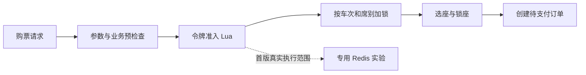
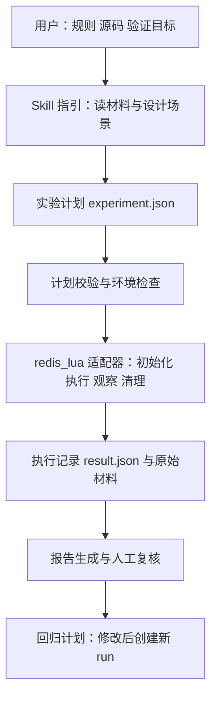

# 后端业务场景验证与故障演练 Skill：业务与框架设计

> 版本：1.1，供人工审查。初稿：2026-10-18；本次更新：2026-10-19，补充标准化文本输出与完整输入输出参考样本。
> 当前状态：只有设计文档；Skill、测试执行器和实验结果尚未实现。
> 目标仓库：`C:\Users\27846\my-chatgpt-skills`。
> 拟建 Skill：`verify-backend-scenarios`，中文名“后端业务场景验证与故障演练”。
> 本文是业务规格，不是实施计划。先审查是否解决了需要的问题，再据此拆开发任务。

**阅读建议：先读第 1—7 节理解业务功能，再读第 8—13 节了解框架、路径及验收。技术附录用于后续开发交接，无须第一次全部掌握。**

想直接看大模型应该怎样回答，阅读[完整输入输出参考样本](2026-10-19-verify-backend-scenarios-output-example.md)：包含六轮主线，以及无环境/客户端超时两个分支。样本为明确标注的合成示范，不能当作真实执行记录。

## 1. 它到底帮我做什么

假设你已经读懂了 12306 的购票逻辑，也能解释 Redis 令牌和锁的作用，但还有几个问题：

- “这段逻辑有没有漏掉关键情况？”
- “已有测试全绿，是否真的检查了业务结果？”
- “我说它能承受并发、能处理失败，依据是什么？”
- “AI 改完代码后，我应该怎样验收？”

这个 Skill 帮你把上述疑问转成一轮具体的验证工作：

```text
选择一个业务模块
    → 确认它必须遵守的规则
    → 设计能检查这些规则的场景
    → 在隔离环境执行能执行的实验
    → 检查测试能否识别有代表性的错误
    → 保留结果与回归入口
```

例如，你提出“帮我验证购票令牌扣减”，它交付的应是：哪些规则需要验证、每条规则怎样测、实际结果是什么、哪些地方仍未验证，而不只是给出一句“Lua 是原子的，所以没问题”。

### 1.1 一个完整的用户请求

```text
使用 verify-backend-scenarios，验证 12306 的购票令牌准入逻辑。
请先解释规则和实验计划，再执行当前授权范围内的隔离实验。
重点看库存不足、多席别请求和并发竞争。
不要修改原项目，不要连接业务 Redis。
```

**注意：当前只是这条请求的产品设计；本文没有执行它。**

### 1.2 与已有技能有什么区别

| 能力 | 回答的问题 | 主要产出 |
|---|---|---|
| 项目学习 Skill | 代码为什么这样写？整个流程是什么？ | 讲解、源码索引、机制与边界 |
| 本 Skill | 这项业务性质怎样验证？实际证据支持到哪里？ | 场景、实验、断言结果、回归材料 |
| 前一版通用交付审查设计 | 多类交付材料是否具备进入验收的证据？ | 通用证据模型与审查门槛 |

本次选择较小的落地范围。前面两份 `evidence-driven-delivery` 文档保留为早期研究稿，本 Skill 不继承其完整实体模型、通用审查门槛和大规模模型评测要求。

## 2. 谁会在什么时候使用它

| 用户场景 | 输入 | 希望获得的结果 |
|---|---|---|
| 学完一个项目模块 | 源码路径、自己的理解、想验证的规则 | 把理解转成能执行的实验 |
| 收到 AI 编写或修改的代码 | 需求、改动位置、相关测试 | 检查改动后的行为及测试缺口 |
| 准备讲述工程实践 | 已完成的实验与原始记录 | 区分项目机制、亲自验证、待改进项 |
| 修复过一次问题 | 复现场景、修复版本 | 留下以后还能执行的回归测试 |

默认处理一个小模块或一条业务规则集合，不接管整个项目。明确要求验证时触发；普通源码讲解仍走项目学习 Skill。

建议 description：

```yaml
name: verify-backend-scenarios
description: Use when turning backend business rules into executable verification scenarios, checking test sensitivity with controlled defects, or preserving failure reproductions as regression cases. Excludes ordinary source teaching and claims of whole-system correctness from isolated experiments.
```

## 3. 首版做哪些事情，暂缓哪些事情

### 3.1 三种落地方式的比较

| 方式 | 收益 | 局限 | 本次选择 |
|---|---|---|---|
| 只生成测试清单 | 开发轻，适合需求讨论 | 容易停在文字，缺少执行证据 | 作为环境不足时的可用输出 |
| 通用流程加一个真实执行案例 | 能验证闭环，也方便逐步复用 | 执行能力有明确边界 | 首版采用 |
| 自动理解并验证所有 Java 后端项目 | 覆盖面看起来很广 | 框架、依赖、数据与判据差异大，难以可信交付 | 暂缓 |

### 3.2 首版明确支持

1. 阅读用户给定的需求、源码和测试，提取规则并标明来源。
2. 生成包含输入、步骤、业务断言和清理方式的实验计划。
3. 通过一个 `redis_lua` 适配器，在真实、专用的本地 Redis 中执行 12306 令牌脚本。
4. 支持单次请求、多席别请求及受控的并发请求实验。
5. 在隔离副本上运行一个语义明确的缺陷变体，检查测试能否识别错误。
6. 保存输入版本、原始观察和可读报告；支持按相同计划重新运行。

### 3.3 首版不承诺的能力

- 不启动整个 12306 系统，不验证数据库锁座、真实订单与支付流程。
- 不自动完成任意项目的集成测试，不支持任意 shell 命令作为实验步骤。
- 不做完整压测平台，不用短时并发实验声称长期容量或生产稳定性。
- 不接个人画像、RDS 写入、云端服务或自动模型路由。
- 不自动修复业务代码，不改插件缓存，不推送、合并或部署。

订单超时、取消后资源释放、锁座冲突与新增席别会有**分析示例**，但这些不是首版已实现的执行适配器。

“故障演练”是完整产品方向；首版执行的是数据边界、并发和一个受控逻辑缺陷，网络断开或进程崩溃只负责识别、记录和清理，不主动做跨服务故障注入。

### 3.4 与刚才四条面试思路的对应

| 你已理解的思路 | Skill 的业务功能 | 首版能做到哪里 |
|---|---|---|
| 用例是否完整 | 从规则推导正常、边界、多席别与并发场景 | 在所选令牌模块内检查遗漏，不承诺全系统完备 |
| 测试是否有效 | 明确断言，再用受控缺陷检查辨错能力 | 真实执行七场景与一个指定缺陷 |
| 稳定性如何验证 | 观察失败、未知结果和资源清理 | 验证局部并发性质与执行器异常处理；跨服务恢复留待后续 |
| 扩展性如何验证 | 给新需求增加场景或新技术适配器，再执行旧回归 | 首版保留清晰职责；能否顺利扩展仍需第二案例实测 |

## 4. 业务功能一：先弄清楚“什么结果才算对”

### 4.1 输入需要多完整

| 已有材料 | 可以先做什么 | 不能宣称什么 |
|---|---|---|
| 只有需求 | 澄清规则，设计场景 | 代码已经正确 |
| 只有源码 | 提取观察到的行为，提出待确认业务规则 | 源码自己的行为就是唯一业务标准 |
| 有源码和规则 | 对照并准备实验 | 还未执行的实验已经通过 |
| 有规则、源码、测试和隔离环境 | 执行支持的实验，分析实际结果 | 未纳入实验的整条业务都正确 |

每条规则用简单格式表达：

```text
规则 R2：申请 2 个令牌，但请求区间仅剩 1 个时，应拒绝且不改变原有令牌。
来源：用户确认的业务规则；源码也存在对应检查。
适用前提：令牌桶已初始化、字段齐全、数量为合法正整数。
怎样证明它不成立：请求被允许，或者拒绝后令牌发生变化。
```

源码事实、AI 推断、人工确认分开记录。尚未确认的关键规则先继续分析，实际验证状态保持未执行，不能自动给“正确”结论。

### 4.2 解决主观判断的方法

“代码不够优雅”可以是建议；“拒绝请求后仍扣了令牌”是有输入和观察结果的业务问题。Skill 应优先输出后者。

需求冲突时列出具体冲突，例如“一起购票是否必须全部成功”，由人确认接受标准。检查器只保证按确认后的规则计算，不假装能自动理解所有业务。

## 5. 业务功能二：把规则变成具体场景

首版从 12306 的令牌准入逻辑开始。**令牌是进入选座的资格，不是已经分配的座位，也不是订单成功。**

示意链路：



### 5.1 首版七个标准场景

以下数字均为实验数据，A/B/C 为虚构站点；席别 1、2 分别对应当前项目的一等座、二等座。令牌预先构造成有效数据，不验证初始化流程。

| ID | 初始状态和请求 | 必须观察的结果 | 验证什么 |
|---|---|---|---|
| S1 | A→C 二等座 5 个，申请 2 个 | 允许；该字段剩 3 个 | 按人数扣减 |
| S2 | 仅剩 1 个，申请 2 个 | 拒绝；仍为 1 个 | 不足时不扣减 |
| S3 | 剩 0 个，申请 1 个 | 拒绝；仍为 0 个 | 零值边界 |
| S4 | 一等座 5 个、二等座 0 个，一次各申请 1 个 | 整体拒绝；两个字段均不变 | 多席别不出现部分成功 |
| S5 | 请求 A→C，人工给定 A→B、A→C、B→C 三个受影响字段均为 5，各扣 2 | 三个字段均变为 3；额外无关字段不变 | 完整执行给定区间列表 |
| S6 | A→C 剩 1 个；20 个独立客户端各申请 1 个，连续做 5 轮，每轮重新初始化 | 每轮恰好 1 次允许、19 次拒绝，最终为 0 | 有限并发下的准入数量性质 |
| S7 | 剩 2 个，恰好申请 2 个 | 允许；最终为 0 | 临界相等条件 |

S5 验证的是 Lua 是否处理**已经提供的区间列表**，不证明 Java 的区间计算正确。S6 不证明最终座位或订单不超卖，也不代表测出了吞吐上限。

### 5.2 场景计划至少包含什么

每个场景都写明：规则 ID、初始数据、请求参数、执行次数/并发客户端数、预期允许与拒绝次数、最终完整 Hash、观察点和清理方式。

不能只写“测试高并发”“看看有没有问题”。预期结果由规则推导，不从候选脚本的实际结果自动抄回。

## 6. 业务功能三：执行实验，并检查测试有没有用

### 6.1 一轮实验怎样进行

```text
确认规则和计划
  → 核对依赖与目标脚本
  → 创建本轮专用 Redis
  → 初始化一个场景的数据
  → 执行请求并记录返回与完整状态
  → 对照预期进行断言
  → 清理场景数据，再执行下一场景
  → 停止本轮专用 Redis，形成报告
```

首版使用 Docker 创建带本轮唯一标识的专用 Redis 容器。执行器只连接自己创建的容器，不接受外部 Redis 地址。镜像、Docker 或客户端依赖缺失时输出环境缺口，不隐式安装、不回退到业务 Redis。

Redis 真正执行目标 Lua；不使用只支持部分命令的内存模拟器替代后仍声称验证了 Redis 脚本行为。

### 6.2 并发怎样做，才能解释得清楚

S6 的每个客户端使用独立连接，准备完成后通过同一个启动屏障发出请求。等待所有请求结束，再核对允许次数、拒绝次数和最终 Hash。每一轮使用新 Key 与相同初始数据。

这里不使用“随机 sleep 多跑几次”作为唯一竞争控制方法。任一客户端连接失败、请求结果未知或未结束，该轮都不能算通过。不得自动重试可能已经扣减的请求；保留结果未知的事实。

Redis 官方说明脚本执行期间具有原子执行语义，但具体脚本仍需符合业务规则，脚本内部的错误也要单独处理。[Redis 脚本执行说明](https://redis.io/docs/latest/develop/programmability/eval-intro/)

### 6.3 怎样验证测试的辨错能力

首版只做一个明确挑战：在目标脚本的隔离副本中，将“扣减申请数量”改为“每次只扣 1 个”。原项目不变。

相同场景分别作用于原脚本与变体：

| 观察 | 结论 |
|---|---|
| 原脚本通过；变体在 S1 或 S5 的业务断言失败 | 这组测试能识别“扣减数量错误” |
| 原脚本通过；变体也通过 | 测试漏检，需要检查断言或场景 |
| 原脚本本身没有通过 | 先分析候选实现/规则/环境，挑战无有效对照 |
| 变体语法错误、Redis 故障或客户端超时 | 挑战无效或结果不明，不能当作抓到了业务错误 |

变体要由人或明确的规则核对其业务含义。只支持这个预先定义的挑战，不在首版建设任意代码自动变异系统。

**变体失败是测试辨错的证据，不是原脚本失败；测试能抓到一种错误，也不说明所有错误都能抓到。**

## 7. 业务功能四：解释结果，沉淀回归

### 7.1 用户最后拿到什么

每轮只保留三个核心材料，便于阅读：

| 材料 | 作用 |
|---|---|
| `experiment.json` | 这轮验证什么、怎样做、什么结果才算对 |
| `result.json` | 实际执行了什么、观察到什么、用了哪个版本 |
| `report.md` | 给人看的解释、问题、未验证项及下一步 |

原始日志、快照与脚本副本放在同目录的 `artifacts/`。失败记录不改成成功；修订代码或计划后创建新的 run，保留新旧记录。

### 7.2 一份报告会怎样说话

采用[完整参考样本第 5 轮的九部分报告](2026-10-19-verify-backend-scenarios-output-example.md#7-第-5-轮确认新规则执行增量与完整回归)作为给人看的输出基准，而不是只有标题的报告骨架。样本还包含用户原始输入、规划、候选失败、修复交接、原场景复验、辨错挑战、未覆盖规则确认和增量回归。

参考样本采用独立学习副本中人为设定的数量缺陷，真实参照 Lua 本身按 `-count` 扣减。所有示范通过/失败、清理与落盘均为合成设定；实际输出必须来自当前材料和工具事实，不照抄示例结论。

如果没有 Redis 环境，报告应直接写“已完成场景设计，尚未执行”，同时列出环境准备及重放入口。

### 7.3 四种整体状态

| 状态 | 含义 |
|---|---|
| `planned` | 有分析/计划，尚未执行 |
| `blocked` | 关键规则未确认、环境不具备、结果不明或实验未完成 |
| `needs_improvement` | 有当前、有效的业务断言失败，或有效变体未被识别 |
| `passed_in_scope` | 所有计划内场景和必要挑战完成并满足预期，版本一致，清理完成 |

判定顺序：有效业务失败或漏检优先记录为 needs_improvement；没有这些事实但有执行缺口则 blocked；明确仅分析且未尝试执行为 planned；全部条件满足才 passed_in_scope。存在执行缺口时不得把未完成项隐藏掉。

每个场景另记 `pass/fail/inconclusive/not_run`。环境错误与未知结果是 inconclusive；有明确实际值违反确认后的预期才是 fail。整体状态不等于上线许可，人工仍需核对规则与范围。

### 7.4 标准化文本输出契约

本节规范 report.md 和宿主面向用户的完整答复，不给机器 JSON 增加字段。它借鉴项目学习中的贯穿案例、先图后讲、源码与索引成对出现和事实分层；不引入理解评分、模拟面试或个人画像。

完整最终报告按以下顺序组织；局部追问和中间阶段按后文裁剪，不每次重发全部内容：

| 顺序与小节 | 必须包含的业务信息 | 禁止替代方式 |
|---|---|---|
| 1. 本轮结论与范围 | 当前状态、对象、已执行/未执行、本轮边界、候选与计划标识 | 只说“整体良好”“测试全绿” |
| 2. 业务链路及证据 | 一个最短流程图或关系表、操作前后状态、必要源码片段与核对过的索引 | 只堆类名；无材料时编造路径 |
| 3. 规则与确认 | 规则 ID、业务文字、来源、前提、确认状态、怎样被反驳 | 根据候选行为自动写“已确认” |
| 4. 场景及预期 | 场景 ID、关联规则、完整初始数据、输入/并发方式、独立推导的预期 | “测一下并发”“检查无异常” |
| 5. 隔离环境与执行事实 | 版本/环境来源、实际观察与预期、逐项状态、原始材料、清理与版本有效性 | 把超时填为拒绝，把 unknown 填成 0 |
| 6. 问题定位与辨错 | 触发、证据、影响、最小建议、候选与变体分别的结果、挑战有效性 | 把语法/环境失败当抓到业务错误 |
| 7. 修复交接与回归 | 谁修复、改动、原有断言是否保留、哪些旧场景重跑、新旧 run 与版本/计划差异 | Skill 没改代码却声称已修复；覆盖旧失败 |
| 8. 未覆盖规则、条件与残余风险 | 当前规则的未测组合、候选新规则、原因、结论限制及下一步 | 只给通过率；将范围外事项说成已验证 |
| 9. 交付与下一步 | 真实产物索引、阻塞、建议下一项、停止条件 | 虚构文件落盘或自动扩大执行范围 |

信息应完整，但不要求长篇或固定数量的表格。机器事实表由脚本生成；语义解释由宿主根据确认规则、源码与事实表补充，明确事实/推断/建议。宿主不能改写脚本结果、补造未观察数值或把合成样本写成工具事实。

阶段裁剪：

- 首次规划：重点给 1—4，明确第 5 项 not_run；补当前静态风险、未覆盖项和确认/执行前置条件。
- 失败报告：引用既有规则与计划，重点给 5—7，保留问题与执行缺口；不为完整样式重复整段源码。
- 修复后复验：列出变化与不变，重跑受影响及必要旧场景，候选结果和辨错结果分别计数。
- 覆盖复查：把“已确认规则的新条件/组合”与“需人确认的新规则”分开；先提出增量，不自动扩范围。
- 最终交付：九部分合并成可独立阅读的完整报告；没有发生的动作写明未执行、未修复或不适用及原因。
- 无环境、未知结果或停止请求：如实报告并收束，不硬填一套通过结果。

计数固定分母：按去重场景 ID 汇总通过/失败/未知/未运行；轮次另列；候选与变体分别汇总。不存在有效执行时不输出通过率，不能将 0/0 写成 100%。规则有对应场景不等于规则对所有输入已被证明。

回归必须包含三个问题：这次错误是否被修复、原有场景是否仍满足预期、哪些规则或条件仍未覆盖。未覆盖项可存在，但必须限制 passed_in_scope 的含义；若发现当前范围内尚未满足的强制规则，则保留 blocked/needs_improvement，不用“后续再测”掩盖。

用户要求停止或未授权增量执行时，只交付已有结果和下一步。明确的确认与执行授权持续有效，不把示例的轮数或确认步骤变成每次必走的审批流程。

开发时在 SKILL.md 链接 `references/output-format.md`；进行完整验证、最终交付或维护输出行为时按需读取完整 walkthrough。不得把完整样本缩写成标题清单，也不要默认把长对话全部载入每次局部追问。

## 8. 这个 Skill 的框架由什么组成



### 8.1 三种角色

| 角色 | 负责 | 能力边界 |
|---|---|---|
| 宿主 AI | 读源码、提取规则、提出场景、解释差异、写实验计划 | 不能把推断当业务真值，不能虚构执行结果 |
| 确定性脚本 | 校验参数、创建隔离环境、调用 Lua、执行断言、保存事实 | 不自动判断规则是否代表完整业务 |
| 人 | 确认关键规则、核对反例、理解剩余范围、决定后续动作 | 接受风险不改写历史观察 |

### 8.2 为什么保留适配器

通用的是“规则—场景—观察—结论”，执行方式与技术相关。Redis Lua 用 Redis 客户端执行；将来数据库并发或 HTTP 超时需要不同的准备、执行、观察与清理。

首版只给适配器定义 `validate / prepare / execute / observe / cleanup` 这五个职责，用普通模块实现，不开发插件注册中心、动态加载器或复杂继承框架。添加第二种适配器时，再用真实差异调整接口。

## 9. 首版工程范围和路径

所有产品文件未来放在目标仓库根下；当前只维护设计与完整参考样本文档。

```text
C:\Users\27846\my-chatgpt-skills\
├── AGENTS.md                                   后续增加明确验证请求的路由
├── README.md                                   后续增加技能入口与边界
├── verify-backend-scenarios/
│   ├── SKILL.md                               触发、主流程、边界与按需加载
│   ├── agents/openai.yaml                      Codex UI 信息
│   ├── requirements.txt                       经过验证后锁定的 redis-py 版本
│   ├── references/
│   │   ├── workflow.md                        如何提取规则并设计场景
│   │   ├── experiment-contract.md             计划、结果与断言契约
│   │   ├── output-format.md                   九部分输出、阶段裁剪与事实边界
│   │   └── redis-lua-guide.md                 唯一执行适配器及故障处理
│   ├── examples/
│   │   └── train-12306-token/
│   │       ├── walkthrough.md                 完整输入输出主线、异常分支与重放方法
│   │       ├── experiment.json                七场景的通用实验计划
│   │       └── fixtures/                      小型合成数据与挑战变体说明
│   ├── scripts/
│   │   ├── verify.py                          CLI、契约校验、版本记录
│   │   ├── redis_runner.py                    专用容器、Lua 调用、断言与清理
│   │   └── report.py                          从事实渲染报告
│   └── tests/
│       ├── test_contract.py                   输入与路径边界
│       ├── test_runner.py                     断言、错误、并发控制与资源所有权
│       ├── test_cli.py                        退出码、输出与失效检查
│       ├── test_redis_integration.py           真实 Redis 的七场景与挑战
│       └── behavior-scenarios.md              AI 行为验收与事实边界
├── tests/
│   └── test_verify_backend_scenarios_routing.py
└── docs/superpowers/specs/
    ├── 2026-10-18-verify-backend-scenarios-design.md
    └── 2026-10-19-verify-backend-scenarios-output-example.md
```

examples 的作用是承载完整用法与可执行计划，不用空目录、只有标题的模板替代。示例文件可随 Skill 发布；实际实验输出不得混进示例或测试真值。

本 Skill 为普通技能，无用户画像或云端持久化。frontmatter 只使用 name 与以 Use when 开头的 description；UI 字段放 agents/openai.yaml，默认提示显式包含 `$verify-backend-scenarios`。

### 9.1 项目源码如何引用

实验时使用用户提供的 `--project-root`。可分发的计划仅保存仓库相对路径，不硬编码个人机器目录。原项目只读，脚本和变体复制到运行输出目录后执行，并记录指纹。

首版用 Python 3.11+、redis-py、Docker CLI 和一个本地可用的 Redis 7.2 系列镜像；实际开发计划锁定验证过的客户端版本及镜像 digest，执行时记录真实版本。这里不声称本机已经具备这些依赖。

不要求构建整个 Java 项目，不增加新服务、数据库或浏览器界面。核心说明不依赖 Superpowers 或特定模型才能使用。

### 9.2 运行输出

```text
outputs/backend-scenarios/<run-id>/
├── experiment.json          本次计划副本
├── result.json              机器记录
├── report.md                可读报告
└── artifacts/
    ├── target.lua           实际执行的候选脚本副本
    ├── variant.lua          若执行挑战则保留
    └── observations.json    各轮返回、状态、异常与清理记录
```

仓库已有 `outputs/` 忽略规则。本地实验材料不自动进入 Git 或上传；通用规则与无隐私回归计划是否纳入仓库，由原任务范围决定。

## 10. 如何验收这个 Skill 是否有用

### 10.1 人工验收先看业务

- 能否从“验证令牌扣减”得到清晰规则，而不是泛泛建议？
- 是否能解释每个场景为何存在，预期结果依据是什么？
- 七个场景是否确实执行目标 Lua，而非另一份模拟算法？
- 是否能发现预先确认的“扣减数量错误”，并避免把环境失败当命中？
- 是否明确令牌准入与座位/订单正确性的区别？
- 没有环境、规则待确认或发生超时时，是否如实保留缺口？
- 修改后能否重放相同实验，并区分新旧结果？

### 10.2 首版必须保留的验证证据

| 验收项 | 通过标准 |
|---|---|
| 结构与输入 | 字段、类型、引用、路径错误有明确反馈，不被静默忽略 |
| 真实执行 | S1—S7 在专用 Redis 上执行，逐项结果与人工确认的预期一致 |
| 辨错挑战 | 原脚本先满足该组规则，变体至少触发一条预定业务断言；不能以语法/连接错误代替 |
| 资源隔离 | 不接受业务 Redis 地址，不修改源项目，只清理本轮拥有的容器和文件 |
| 结果未知 | 客户端超时不自动重试扣减请求；保留观察与未确认状态 |
| 版本关联 | 源脚本、实验计划或执行器发生变化时，旧结果不能继续标为当前有效 |
| 回归 | 原计划能重放；原始失败和新 run 均保留，不覆盖历史 |
| AI 行为 | 未确认规则、无环境、候选失败、变体环境错误四类请求均不虚构通过 |
| 文本输出 | 参照完整样本，规则—场景—观察—问题—回归—未覆盖项关联可核对，候选/变体/环境状态分开 |
| 增量验证 | 新规则先确认，原规则的新场景说明推导；新计划重跑必要旧场景并保留历史 |

真实 Redis 集成测试因缺依赖未运行时，最终状态为“确定性部分通过，集成验收未完成”，不能用跳过测试获得整体通过。

### 10.3 不急于声称“比普通 AI 更好”

首版先证明闭环能执行、能抓到这个指定错误。再拿同一模块，固定模型和材料，分别让普通提示与 Skill 生成验证方案，比较是否遗漏 S4/S5/S6、是否写对断言、是否增加无效复杂度，并记录时间成本。

少量比较只能作为探索性结果，不宣称普遍检出率提升。若流程没有带来额外发现或可重放收益，应缩减规则，而不是继续增加报告篇幅。

## 11. 扩展思维如何落到后续版本

| 阶段 | 新增能力 | 前置条件 | 能讲出的工程问题 |
|---|---|---|---|
| v1 | 令牌 Lua 场景、并发与一个受控缺陷 | 本文首版验收通过 | 测试检查了什么，为什么它能抓错 |
| 下一阶段 A | 具体座位及重叠区间验证 | 已核实座位数据模型、区间算法与隔离数据库 | 令牌通过为什么不等于最终购票正确 |
| 下一阶段 B | 远程创建订单的超时与恢复 | 明确请求关联方式、提交边界、查证/恢复契约 | 超时为何是结果未知，补偿怎样避免破坏已成功业务 |
| 下一阶段 C | 新增席别的变化实验 | 有可执行旧席别回归与明确新规则 | 实际改动范围能否支持扩展性主张 |

A/B/C 是按需求选择的方向，不是首版完成后必须全部开发。一个方向有真实收益后再抽象共性。

未来新适配器必须保留相同业务闭环，并补上其特有的初始化、故障控制、观测与清理。不能只改一个名称就声称支持了另一个项目。

## 12. 开发者应如何据此拆计划

本文评审后，实施计划按四个交付块拆解，每块写具体 Create/Modify/Test 路径及真实验证命令：

1. **规则与计划契约**：固定示例、校验与错误行为，先覆盖合法/不合法输入。
2. **真实 Redis 实验**：专用容器生命周期、单次/多席别/并发请求、状态观察与清理。
3. **反例与回归**：相同断言运行候选和变体，记录版本与新旧 run，区分失败类型。
4. **Skill 与人工交付**：按需参考、标准化文本输出、完整输入输出主线与异常分支、可读报告、路由接入和行为验收。

本轮不生成实施计划、不创建产品目录、不运行 Docker、不修改 train-12306。前述已有未提交改动及旧设计文档均保留。

## 13. 供你审查的五个决定

1. **业务定位**：帮助你把理解变成验证，而不是做通用架构打分。
2. **首版范围**：通用方法加一个真实 Redis Lua 适配器，先完成可重放案例。
3. **交互方式**：先展示规则和计划；已有明确规则和执行授权时不重复确认，没有时继续分析并保留待确认项。
4. **执行边界**：原项目只读、专用环境实验、结果不明不冒充通过。
5. **扩展顺序**：先证明一个模块的实践收益，再扩到锁座、远端失败与变化实验。

你可以先围绕这五项评审。技术附录用于说明实现可落地，不要求先掌握所有字段。

## 附录 A：实验计划与执行接口

### A.1 最小完整计划示例

下面是一份只含 S1 的合法计划形状；标记 confirmed 表示**执行时必须已经得到确认**，不是本轮替人确认。正式示例 experiment.json 应包含 S1—S7。

```json
{
  "schema_version": "1.0",
  "experiment_id": "token-admission",
  "adapter": "redis_lua",
  "target_script": "services/ticket-service/src/main/resources/lua/ticket_availability_token_bucket.lua",
  "rules": [
    {
      "id": "R1",
      "text": "令牌充足时按申请人数扣减",
      "source": "人工确认的业务规则及已核对源码",
      "confirmed": true
    }
  ],
  "cases": [
    {
      "id": "S1",
      "rule_ids": ["R1"],
      "description": "五个令牌申请两个",
      "initial_hash": {"A_C_2": 5},
      "request": {
        "interval": {"start": "A", "end": "C"},
        "seat_counts": [{"seat_type": "2", "count": 2}],
        "affected_routes": [{"start": "A", "end": "C"}]
      },
      "workload": {"clients": 1, "rounds": 1},
      "expected": {
        "accepted_per_round": 1,
        "rejected_per_round": 0,
        "final_hash": {"A_C_2": 3}
      }
    }
  ],
  "challenge": null
}
```

所有列出的字段均必需，禁止未知字段、重复 ID、断裂引用和重复 JSON key。schema_version 只接受 1.0，adapter 只接受 redis_lua。ID 使用字母、数字、短横线或下划线，长度 1—80。

计数都是整数，拒绝 bool 冒充整数；initial_hash/final_hash 非空，值非负；seat_counts 非空，seat_type 不重复，count 为 1—1000；clients 为 1—32、rounds 为 1—20。accepted+rejected 必须等于 clients。interval 与 route 的 start/end 非空且不同，不含冒号或下划线；route 去重且非空。

请求区间与所有受影响 route/seat_type 的字段必须已在 initial_hash 中给出；final_hash 必须包含与 initial_hash 相同的字段集合。首版不执行非法字段/损坏数据的探索性脚本实验，以免将适配器输入错误与目标业务错误混在一起。

规则数组、场景数组均非空；confirmed=false 可以用于分析，但 run 必须返回 blocked。source 是来源说明，不是人身份认证。新输入字段需要修改版本契约与测试，不能悄悄忽略。

校验分两步：格式/路径错误返回退出码 2，不启动容器；结构有效但规则或挑战语义未确认时，保存 blocked 记录并返回 1，同样不启动容器。已有明确确认或授权时复用，不要求重复确认。

### A.2 挑战与参数映射

challenge 非 null 时固定为 `{id, description, rule_ids, variant_path, semantics_confirmed}`。variant_path 相对于实验计划目录，语义未确认时只保留挑战说明，不执行并返回 blocked。挑战使用同一组 cases，不允许偷偷替变体降低预期。

适配器负责参数转换：

- KEYS[1]：本轮自动生成的专用 Hash Key；计划不能提供真实业务 Key。
- KEYS[2]：`start_end`，例如 A_C。
- ARGV[1]：seat_counts 映射为 `[{seatType: "2", count: "2"}]` 的 JSON。
- ARGV[2]：affected_routes 映射为 `[{startStation: "A", endStation: "C"}]` 的 JSON。
- `tokenIsNull=false` 计允许，true 计业务拒绝；不能用布尔值真假转换吞掉缺字段或类型错误。

每轮在新 Key 初始化，完整读取 Hash，保存原始返回，再断言次数与 final_hash。缺少 tokenIsNull、不是布尔值或不是预期 JSON，记为协议异常/inconclusive，保留原始材料，不当作正常拒绝。

### A.3 未来 CLI

```powershell
# 从技能仓库执行。命令是未来接口，本轮未实现。
python verify-backend-scenarios/scripts/verify.py run --project-root 'D:\Project\train-12306' --plan verify-backend-scenarios/examples/train-12306-token/experiment.json --out-dir outputs/backend-scenarios/demo-001
python verify-backend-scenarios/scripts/verify.py report --run outputs/backend-scenarios/demo-001/result.json --out outputs/backend-scenarios/demo-001/report.md
python verify-backend-scenarios/scripts/verify.py check --run outputs/backend-scenarios/demo-001/result.json --project-root 'D:\Project\train-12306' --plan verify-backend-scenarios/examples/train-12306-token/experiment.json
```

run：内部先校验计划和授权环境边界；0=passed_in_scope，1=有完整记录的 blocked/needs_improvement，2=格式、路径或输出等错误。仅分析由宿主生成 planned 计划/报告，不伪造 run。

report：0=成功渲染，2=记录格式或关联错误；渲染成功不表示业务通过。check：0=所登记的本地输入与版本一致，1=已变化/缺失，2=无法完成检查。check 不重新执行实验，也不证明环境未变。

out-dir 必须不存在，输出不能位于目标源码文件内或覆盖输入；report 默认拒绝覆盖。中文路径、UTF-8、失败退出码和部分输出清楚可见；中断时保留带 interrupted 标记的日志，不能留下一个通过结果。

## 附录 B：执行、版本与错误边界

- Python 通过参数数组调用 Docker，不执行计划里的自然语言或任意命令文本。脚本/变体路径必须位于指定 root 内，拒绝绝对路径、`..`、链接/junction 逃逸；读取普通文件，单个输入不超过 2 MiB。
- Docker 容器名与 label 包含本轮随机 run ID，端口只绑定本机；镜像从本地已具备的 Redis 7.2 系列镜像启动，不自动 pull。运行记录保存镜像 digest 与 Redis 实际版本。
- Redis 禁用持久化，不挂载业务目录。执行器只停止与清理自己创建且 label 匹配的容器；无论成功失败都进入 finally 清理。清理失败写入结果并阻止 passed_in_scope，不操作其他容器。
- 连接超时 3 秒、单请求读取超时 5 秒、单轮上限 15 秒、整轮实验上限 180 秒。所有值进入执行记录；达到上限不自动重试扣减，而是记 inconclusive 并终止当前实验。
- 源文件读取前后核对元数据；执行前复制字节到 artifacts 并记录 SHA-256，实验结束再核对原文件。若变化，结果标为版本失效，不给当前范围通过。
- 指纹覆盖目标 Lua、可选变体、规范化实验计划，以及三个执行器脚本的路径/字节。记录 Python、客户端、Redis 与镜像版本、开始结束时间。Git HEAD 只作辅助信息，不能代表未提交文件。
- 规范化计划使用 UTF-8 JSON，sort_keys=True，ensure_ascii=False，separators=(',', ':')；不接受 NaN 或无穷值。哈希用于关联与变化检测，不是对日志真实性的认证。
- result.json 固定包括 schema_version、run_id、experiment_id、overall_status、plan_hash、script_hash、variant_hash（可为 null）、runner_hashes、environment、case_results、challenge_result、cleanup、freshness、started_at、finished_at、artifact_hashes。缺字段或未知状态拒绝渲染。
- case_results 每项至少保存 case_id、subject（candidate/variant）、round、status、accepted、rejected、actual_hash、assertion_differences、error、raw_artifact。未能观察到的值为 null，不填 0；error 含分类和消息，不记录凭据。
- challenge_result 为 detected/missed/invalid/not_run：候选在选定规则上全部通过且变体有明确业务断言失败，才为 detected；有效变体也全部通过为 missed；候选没通过或变体遇到环境/协议/语法错误为 invalid。null challenge 为 not_run，首版标准验收仍要求实际演示一次有效挑战。
- freshness 保存 captured/current/stale/unknown。报告引用冻结的 run；check 可比较当前本地输入并另存检查记录，不改写原结果。报告不调用模型补造观察，也不把别的 run 的日志拼进当前结果。

result 中 hash 均为 64 位小写 SHA-256；尚未读到的目标 hash 可为 null。environment 固定记录 Python、redis-py、Redis、镜像 digest、容器 ID；未启动时相应值为 null。runner_hashes/artifact_hashes 为相对路径到 hash 的映射；cleanup 记录 status（not_needed/success/failed）和 error；error 无错误时为 null，否则包含 category/message。case 的 accepted/rejected 为整数或 null，actual_hash 为字段到整数的映射或 null，assertion_differences 为预期与实际差异列表，raw_artifact 为输出根内相对路径。schema_version、run_id、overall_status 及各数组/对象即使受阻也必须存在。

report 必须核对 plan_hash、artifact_hashes 和 raw_artifact 包含关系，拒绝混入另一 run 的材料。当前磁盘源文件变化由 check 检测；仅重新渲染报告不会刷新验证有效期。

这些限制为了让受控实验与业务环境分开；不是对任意恶意 Lua 的安全认证。首版仅运行已审阅的项目脚本与明确变体，所有写入均限定在专用 Redis 生命周期内。

## 附录 C：测试、源码依据与交接说明

### C.1 实现后要求执行的检查

```powershell
Set-Location -LiteralPath 'C:\Users\27846\my-chatgpt-skills'
python -m unittest discover -s verify-backend-scenarios/tests -p 'test_*.py' -v
python -m unittest discover -s tests -p 'test_*.py' -v
python profile-aware-skill-creator/scripts/validate_profile_skill.py --mode plain verify-backend-scenarios
git diff --check
```

必须分别记录离线单测与真实 Redis 集成测试的结果。需要覆盖：错误输入、无依赖、七业务场景、候选/变体的不同组合、并发屏障失败、客户端超时无重试、原始结果保留、指纹变化、路径越界、容器所有权、清理失败和中断报告。不要只断言文档含某个词。

### C.2 本次核实的源码事实

来源是本机当前工作区，而非仅 Git 提交。train-12306 HEAD 为 `c7d862d85cd4121655f32304a8abaac3a6da030c`，存在用户未提交修改；本轮只读并保留。以下路径/行号为本次核对位置，未来变动后重新核实。

| 内容 | 可核查位置 |
|---|---|
| Java 按席别汇总人数并调用 Lua | [TicketAvailabilityTokenBucket.java](/D:/Project/train-12306/services/ticket-service/src/main/java/org/opengoofy/index12306/biz/ticketservice/service/handler/ticket/tokenbucket/TicketAvailabilityTokenBucket.java:135) |
| Lua 检查所有请求席别，不足时提前返回 | [token Lua](/D:/Project/train-12306/services/ticket-service/src/main/resources/lua/ticket_availability_token_bucket.lua:18) |
| Lua 遍历给定区间并按 count 扣减 | [token Lua 扣减位置](/D:/Project/train-12306/services/ticket-service/src/main/resources/lua/ticket_availability_token_bucket.lua:40) |
| Java 的受影响区间列表来源 | [TrainStationServiceImpl.java](/D:/Project/train-12306/services/ticket-service/src/main/java/org/opengoofy/index12306/biz/ticketservice/service/impl/TrainStationServiceImpl.java:65) |
| 一等座 1、二等座 2 的枚举 | [VehicleSeatTypeEnum.java](/D:/Project/train-12306/services/ticket-service/src/main/java/org/opengoofy/index12306/biz/ticketservice/common/enums/VehicleSeatTypeEnum.java:41) |
| 令牌后进入加锁与购票执行 | [TicketServiceImpl.java](/D:/Project/train-12306/services/ticket-service/src/main/java/org/opengoofy/index12306/biz/ticketservice/service/impl/TicketServiceImpl.java:428) |

当前目标 Lua 的 SHA-256：`0d803605c755f17bdf8b3e1e2067554dba8298c46929f1ee25731bdec1c1ac54`。这只是设计所参考的文件指纹，不是实验通过证明。

Redis 的脚本运行与错误机制参考：[脚本执行说明](https://redis.io/docs/latest/develop/programmability/eval-intro/)、[Lua API](https://redis.io/docs/latest/develop/programmability/lua-api/)。业务拒绝和脚本错误应分别观察，不能把所有非成功返回都算正常拒绝。

### C.3 后续交给 DeepSeek 时的请求

```text
以本设计为输入，在 C:\Users\27846\my-chatgpt-skills 生成实施计划，暂不实现。
同时读取 2026-10-19-verify-backend-scenarios-output-example.md 的完整输入输出；
据此维护 references/output-format.md 与完整 walkthrough，不缩写成标题模板，保留合成示范标记。
先核对 AGENTS.md、未提交改动、依赖与目标源码。
逐项写明 Create/Modify/Test 路径、依赖、失败测试、实现边界、验证命令、
预期结果及人工检查点；全部未来执行与审查初始为 pending。

首版只做 verify-backend-scenarios 及 redis_lua 适配器，覆盖 S1—S7 与一个扣减数量变体。
完整示例必须能重放，不能用模拟 Redis 或另一份重写算法冒充目标 Lua 的执行。
不要改 train-12306、其他技能业务、RDS、sources/ 镜像或插件缓存，不自动发布。
保留原有未提交改动；若发现规则冲突，指出位置并提出最小修订，不静默放宽判据。
依赖版本与镜像 digest 在环境核实后锁定，缺环境如实记录，不填虚假通过。
计划经人工审查后再进入开发。
```
