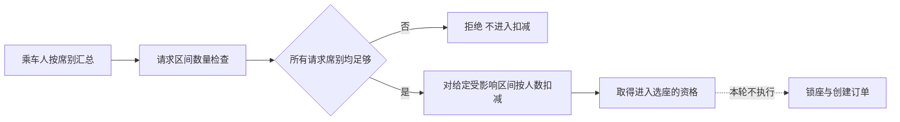
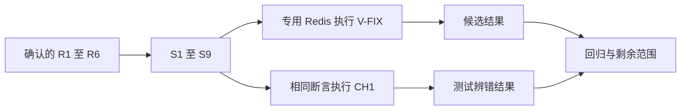

# 后端业务场景验证与故障演练：完整输入输出参考样本

> 版本：1.0。日期：2026-10-19。配套设计：[业务与框架设计](2026-10-18-verify-backend-scenarios-design.md)。
> 性质：为规范未来 Skill 行为而编写的**合成示范对话**，不是历史会话转录，也不是本轮真实实验记录。
> 本轮只核对了真实源码并编写文档，没有启动 Docker、执行 Redis 实验、制造业务缺陷或修复业务代码。
> 所有示例中的用户确认、运行编号、通过/失败、环境清理和文件落盘，均属于假设场景。实际使用必须由当前输入和工具记录替换，禁止照抄为事实。

## 1. 大模型应该学习什么

参考项目学习 Skill 的“直接说明范围 → 先图后讲 → 同一案例贯穿 → 源码片段与索引对应 → 状态与边界 → 按用户意图收束”形式。

本样本增加验证业务需要的内容：规则确认、明确断言、执行事实、失败定位、修复交接、回归差异、未覆盖项。不要把它退化成只有标题的模板。

可迁移的是输出结构与判断方法；不可照抄的是 12306 的路径、代码、席别、预期数字、实验版本和结论。换项目或模块后必须重新核对。

主线包含六轮：

```text
用户请求与候选材料
  → 规则和场景计划
  → 确认后发现候选错误
  → 业务开发者修复，Skill 复验并检查测试辨错能力
  → 分析未覆盖规则与条件
  → 用户确认增量范围，再次回归
  → 停止并交接
```

另给出“无执行环境”和“客户端超时”的完整分支。它们是独立示例，不混入上述主线。

## 2. 案例材料与事实边界

### 2.1 真实参照材料

真实 12306 工作区的 Lua 使用 `-count` 扣减，当前核对位置为 47 行；Java 先按席别汇总乘车人数，再调用 Lua。真实源码不是本样本的错误候选。

| 类型 | 来源 | 能说明什么 |
|---|---|---|
| 本轮核对的源码事实 | [Java 席别人数汇总与调用](/D:/Project/train-12306/services/ticket-service/src/main/java/org/opengoofy/index12306/biz/ticketservice/service/handler/ticket/tokenbucket/TicketAvailabilityTokenBucket.java:135) | 多位乘客形成某席别的申请数量 |
| 本轮核对的源码事实 | [Lua 数量检查](/D:/Project/train-12306/services/ticket-service/src/main/resources/lua/ticket_availability_token_bucket.lua:18) | 检查请求区间各席别数量，不足时提前返回 |
| 本轮核对的源码事实 | [Lua 区间扣减](/D:/Project/train-12306/services/ticket-service/src/main/resources/lua/ticket_availability_token_bucket.lua:40) | 遍历已给定的受影响区间并按 count 扣减 |

### 2.2 编写的示范材料

为展示发现问题到修复回归的完整过程，假设业务开发者提供一个**独立学习副本**：

- `V-BAD`：把扣减语句改成 `-1`，但原有小测试只申请一个令牌并检查允许标志。
- `V-FIX`：开发者将学习副本恢复为 `-count`。
- `CH1`：修复后另备一份 `-1` 变体，仅用于检查测试是否能识别扣减数量错误。

V-BAD/V-FIX 是便于讲解的版本别名，不是哈希值。正式结果中仍要使用执行器实际计算的 SHA-256，不能把这些别名写进 hash 字段。本文不编造真实容器 ID、日志链接、时间或 64 位指纹。

实验数据均为合成数据。`A_C_2` 表示 A→C 的二等座令牌字段，`A_C_1` 表示同区间一等座；Key 由执行器生成。本文出现的 `DEMO-RUN-*` 和输出路径也是示范标识，当前并未创建对应运行目录。

---

## 3. 第 1 轮：收到请求，形成可审查的规则与场景

### 用户输入（示范）

> 使用 verify-backend-scenarios，帮我审查这个基于 12306 的购票令牌学习副本。
>
> AI 修改后的扣减语句是下面这样，原有测试只申请一个令牌，看到允许就算通过：
>
> `redis.call('hincrby', KEYS[1], tostring(actualInnerHashKey), -1)`
>
> 我想验证人数扣减、数量不足、多席别和并发竞争。原项目不要改，也不要连接业务 Redis。先把规则、计划和预期讲清楚，暂时不要执行。

### Skill 完整输出（合成示范，非真实执行）

本轮先审查令牌学习副本，**状态为 `planned`：只分析，不启动实验**。你提供的 `-1` 与“按申请人数扣减”的候选业务规则存在明显冲突，下面先把规则和验证方法展开，等确认后再执行。

#### 1. 本轮范围与业务链路



贯穿例子：A→C 二等座初始有 5 个令牌，两位乘客一起申请。按候选规则应允许一次请求，扣 2 个，剩 3 个。拿到这两个令牌只代表可以继续选座，不代表两张具体座位已经分配。

#### 2. 源码依据与候选差异

真实参照 Lua 的扣减片段如下，节选自已核对源码：

```lua
for indexTwo, alongJsonObj in ipairs(alongJsonArray) do
    local startStation = tostring(alongJsonObj.startStation)
    local endStation = tostring(alongJsonObj.endStation)
    local actualInnerHashKey = startStation .. "_" .. endStation .. "_" .. seatType
    redis.call('hincrby', KEYS[1], tostring(actualInnerHashKey), -count)
end
```

索引：[真实 Lua 的区间扣减循环](/D:/Project/train-12306/services/ticket-service/src/main/resources/lua/ticket_availability_token_bucket.lua:43)。

你提交的学习副本片段是另一个输入，不能与真实参照混淆：

```lua
-- 合成候选 V-BAD，由本示范设定，不是当前真实项目源码
redis.call('hincrby', KEYS[1], tostring(actualInnerHashKey), -1)
```

区别在 `count=2` 时出现：真实参照片段按申请数量扣 2，候选固定扣 1。只申请 1 个的测试无法区分两者；只检查允许标志，也没有检查实际扣减量。

#### 3. 必须遵守的规则

| 规则 | 业务要求与适用条件 | 来源与确认状态 | 否证条件 |
|---|---|---|---|
| R1 | 数量足够时，各请求席别按申请人数扣减 | 用户目标与参照代码；待用户确认 | 申请 2 却只扣 1 |
| R2 | 请求区间任一数量不足时，拒绝且不发生扣减 | 参照分支与候选业务要求；待确认 | 拒绝后状态变化 |
| R3 | 多席别请求中有一个不足，整个请求不部分扣减 | 参照代码先整体检查；待确认 | 一等座已扣，二等座却拒绝 |
| R4 | 给定受影响区间列表中的对应字段都按人数变化 | 参照循环；待确认 | 列表内某字段未扣或扣错 |
| R5 | 同区间剩 1 个令牌，20 客户端各申请 1 个时每轮只允许 1 次 | 本轮有限并发规则；待确认 | 允许多次，或最终数量不符合规则 |

前提：桶已初始化、字段完整、申请人数为合法正整数。这里不测试初始化，也不从当前实现反推并自动确认业务真值。

#### 4. 场景与预期

每个场景单独初始化，互不复用上一个场景的数据。下表是完整数据与断言，尚未执行：

| 场景 | 规则 | 初始完整 Hash | 请求与执行方式 | 预期允许/拒绝 | 预期最终完整 Hash |
|---|---|---|---|---|---|
| S1 | R1 | `{A_C_2:5}` | A→C，二等座 2 人，单次 | 1 / 0 | `{A_C_2:3}` |
| S2 | R2 | `{A_C_2:1}` | A→C，二等座 2 人，单次 | 0 / 1 | `{A_C_2:1}` |
| S3 | R2 | `{A_C_2:0}` | A→C，二等座 1 人，单次 | 0 / 1 | `{A_C_2:0}` |
| S4 | R3 | `{A_C_1:5,A_C_2:0}` | A→C，一等/二等座各 1 人，单次 | 0 / 1 | `{A_C_1:5,A_C_2:0}` |
| S5 | R1、R4 | `{A_B_2:5,A_C_2:5,B_C_2:5,D_E_2:9}` | A→C，二等座 2 人；给定受影响列表 A→B、A→C、B→C | 1 / 0 | `{A_B_2:3,A_C_2:3,B_C_2:3,D_E_2:9}` |
| S6 | R5 | `{A_C_2:1}` | 20 独立客户端，各申请 1 人；每轮重置，共 5 轮 | 每轮 1 / 19 | 每轮 `{A_C_2:0}` |
| S7 | R1 | `{A_C_2:2}` | A→C，二等座 2 人，单次 | 1 / 0 | `{A_C_2:0}` |

S1/S2/S3/S4/S6/S7 的受影响列表均只含 A→C。S5 的区间列表是人为提供的实验输入，不证明 Java 的区间计算正确。

#### 5. 隔离与执行事实

当前没有执行，所有场景均为 `not_run`；没有容器、原始日志或通过记录。

执行计划为：使用执行器自己创建的本地专用 Redis，候选脚本只从学习副本复制；各场景及各轮使用新 Key；S6 用独立连接和启动屏障，观察全部返回与最终状态；结束后核对版本并清理本轮容器。缺依赖直接报告，不自动使用业务 Redis。

#### 6. 待执行的辨错挑战

CH1 用固定扣 1 的变体验证数量断言是否敏感，沿用同一组场景与预期。候选没有先通过时，CH1 没有有效对照，不能宣布挑战成功。

现阶段已能提出静态风险：“按 1 人写的小测试没有区分按人数扣减与固定扣 1”。这不是已经观察到的实验结果。

#### 7. 本轮交付与下一步

本轮交付的是规则表、S1—S7 计划和预期，尚无执行记录。未覆盖的是初始化、Java 区间计算、真实锁座、订单超时恢复、Redis Cluster 与容量测试。

请确认 R1—R5 是否符合这次业务要求；若确认并授权专用环境实验，下一步只执行本计划，不改业务实现。

---

## 4. 第 2 轮：确认后执行，发现候选问题

### 用户输入（示范）

> R1—R5 都符合要求。可以按你列出的计划，在本轮创建的专用 Redis 中运行学习副本和已确认语义的挑战。候选失败时先给我定位和修复建议，不要自行修改代码。原项目和业务 Redis 仍不动。

### Skill 完整输出（合成示范，非真实执行）

**本轮示范状态：`needs_improvement`。** V-BAD 在人数大于 1 的三个场景中扣减不足；其余四个场景满足本轮预期。CH1 因候选未通过而为 `invalid`，没有执行变体来冒充有效对照。

#### 1. 范围、版本与隔离记录

| 项目 | 本样本中的记录 |
|---|---|
| run | DEMO-RUN-001 |
| 候选 | 学习副本 V-BAD，固定扣 1 |
| 计划 | PLAN-1，R1—R5，S1—S7 |
| 确认 | 示例第 2 轮用户确认与授权 |
| 环境 | 示例预设的专用 Redis 7.2；不是业务 Redis |
| 版本证据 | 实际产品须填写源脚本、计划、执行器和环境的真实记录；此合成样本不编造哈希或容器 ID |
| 清理 | 示范中设定已完成；实际必须以工具返回核实 |

这里的“设定完成”只服务于样本演示，不能迁移成未来报告的默认值。

#### 2. 观察与断言结果

| 场景 | 预期 | 合成观察 | 场景状态 |
|---|---|---|---|
| S1 | 允许，A_C_2=3 | 允许，A_C_2=4 | fail |
| S2 | 拒绝，A_C_2=1 | 拒绝，A_C_2=1 | pass |
| S3 | 拒绝，A_C_2=0 | 拒绝，A_C_2=0 | pass |
| S4 | 拒绝，两个字段均不变 | 拒绝，A_C_1=5、A_C_2=0 | pass |
| S5 | 三个受影响字段均为 3，无关字段为 9 | 三个受影响字段均为 4，无关字段为 9 | fail |
| S6 | 每轮允许 1、拒绝 19，最终为 0 | 5 轮分别均为 1 / 19 / 0 | pass |
| S7 | 允许，A_C_2=0 | 允许，A_C_2=1 | fail |

按去重后的场景 ID 计数：**7 个场景，4 个通过、3 个失败、0 个结果不明、0 个未运行**。S6 的 5 轮仍是一个场景，不能将 5 轮当成 5 个独立业务规则来增加覆盖。

原始观察的文本形状示例，均为人工编写的模拟记录：

```text
[SIMULATED][DEMO-RUN-001][candidate][S1]
before: {"A_C_2":5}
request: interval=A_C, seatType=2, count=2
return: {"tokenIsNull":false}
after: {"A_C_2":4}
expected_after: {"A_C_2":3}
assertion: FAIL - expected 3, observed 4
```

#### 3. 问题定位

**F1：候选按请求次数扣减，违反已确认的按申请人数扣减规则。**

- 触发条件：某个席别本次申请人数大于 1，且数量检查通过。
- 证据关系：S1 的 5→4、S5 的每字段 5→4、S7 的 2→1，都符合固定扣 1 的候选语句。
- 影响：发放的准入数量与剩余令牌不一致；不能仅凭此局部观察宣布真实系统已经发生座位超卖。
- 修复建议：由业务开发者在学习副本中将固定 `-1` 改为 `-count`，不改变已确认的业务预期。
- 复验：保持 PLAN-1，创建新 run，重跑 S1—S7；候选通过后再检查 CH1。

S6 通过不能推翻 F1。它每次只申请 1 人，恰好无法区分 `-1` 与 `-count`，所以“并发测试通过”仍不能代替人数断言。

#### 4. 修复交接与未覆盖项

本轮未修复任何代码。建议交给业务开发者的最小改动为：

```diff
- redis.call('hincrby', KEYS[1], tostring(actualInnerHashKey), -1)
+ redis.call('hincrby', KEYS[1], tostring(actualInnerHashKey), -count)
```

这份 diff 只描述合成学习副本，不是对真实 12306 的补丁。

剩余未覆盖范围保持不变；目前也没有形成有效的辨错挑战结论。旧 run 保留失败状态，不通过修改日志或预期把它改成通过。

---

## 5. 第 3 轮：业务开发者修复后，复验并验证测试辨错能力

### 用户输入（示范）

> 业务开发者已把学习副本按这个最小 diff 改成 -count，其他逻辑没改。请核对新版本，保留旧失败记录，按原计划重新验证。候选通过后，用单独的 -1 变体检查这套测试能不能抓到数量错误。不要修改真实项目。

### Skill 完整输出（合成示范，非真实执行）

**本轮示范状态：`passed_in_scope`。** V-FIX 在 PLAN-1 的 S1—S7 均满足预期；CH1 的固定扣 1 变体被 S1/S5/S7 的业务断言识别，挑战状态为 `detected`。

#### 1. 变更与证据版本

| 对比项 | DEMO-RUN-001 | DEMO-RUN-002 |
|---|---|---|
| 候选 | V-BAD，固定 -1 | V-FIX，按 -count |
| 规则与场景 | PLAN-1 | PLAN-1，保持相同预期 |
| 计划指纹 | 真实产品应由工具生成 | 应与上一轮相同 |
| 候选指纹 | 真实产品应由工具生成 | 应与上一轮不同 |
| 候选结果 | needs_improvement | 当前计划内场景通过 |

核对的修复是扣减参数，不是削弱断言。新 run 使用新容器和新 Key；旧实验结果不作为新版本已通过的证据。

#### 2. 候选回归结果

| 场景 | V-FIX 的合成观察 | 状态 |
|---|---|---|
| S1 | 允许，5→3 | pass |
| S2 | 拒绝，1→1 | pass |
| S3 | 拒绝，0→0 | pass |
| S4 | 整体拒绝，5/0 不变 | pass |
| S5 | 三个受影响字段 5→3，无关字段 9→9 | pass |
| S6 | 5 轮分别允许 1、拒绝 19、最终 0 | pass |
| S7 | 允许，2→0 | pass |

计数：7 个场景全部通过；S6 保留 5 轮记录。版本一致性与清理在本示范中设定为完成，实际报告必须给出工具事实。

#### 3. 辨错挑战

同一 PLAN-1、同一组断言，分别作用于候选 V-FIX 和 CH1 变体：

| 对象 | 场景通过/失败 | 解释 |
|---|---|---|
| candidate：V-FIX | 7 / 0 | 在本轮选定规则和数据下满足预期 |
| variant：CH1 | 4 / 3 | S1/S5/S7 的最终数量与预期不符 |

变体脚本可正常运行，失败来自业务数量断言，而不是语法、连接或超时错误。因此 CH1=detected。

**变体的三个失败不计为候选的三个失败；它们说明测试能区分这项正确行为与指定错误。**

#### 4. 回归说明与后续边界

F1 在修复后的新 run 中得到复验支持，旧 run 仍保留失败；没有覆盖或改写旧记录。

当前可以说：“这次学习副本的人数扣减问题，在 S1/S5/S7 上已复验，原有其他场景也完成回归。”还不能说“所有数量组合都正确”或“整个购票链路已验证”。

若需要进一步检查覆盖，下一步先分析当前规则的组合盲区，不直接扩到订单或支付。

---

## 6. 第 4 轮：继续寻找未覆盖规则与条件

### 用户输入（示范）

> 这说明令牌模块就测完整了吗？请继续找当前范围里没有覆盖的规则或条件，先说明理由，不要执行新实验。

### Skill 完整输出（合成示范，非真实执行）

**还不能把“当前七个场景通过”说成令牌模块已完整验证。** 本轮仅补做覆盖分析，不执行新增场景。DEMO-RUN-002 仍是 PLAN-1 的历史通过记录，新增分析不会自动扩大其结论范围。

#### 1. 现有覆盖与缺口

| 项目 | 当前证据范围 | 未覆盖内容 | 处理建议 |
|---|---|---|---|
| R1 人数扣减 | 单次申请 1/2 人与临界数量 | 多客户端每次申请超过 1 人 | 组合 R1 与 R5，新增 S8 |
| R3 多席别拒绝 | 一个不足时整体不扣 | 多个席别都充足时，是否分别按人数扣减 | 留为 U1，尚未执行 |
| R4 给定区间处理 | 列表内三个字段及一个无关区间 | 同区间、未请求席别的字段是否保持不变 | 提出候选规则 R6，待确认后新增 S9 |
| R5 并发准入 | 剩 1 个、各申请 1 个、5 轮 | 无法整除的余量与批量并发组合 | 用 9 个令牌、每次申请 2 个检验 |

#### 2. 拟新增的具体场景

**S8：并发批量申请，余量不能被错误地继续发放。**

- 初始 `{A_C_2:9}`；20 个客户端各申请 2 个，5 轮，每轮重置。
- 根据 R1 与 R5 推导：每轮应允许 4、拒绝 16，最终剩 1。
- 同时检查请求计数与最终 Hash。只检查“最终不为负数”仍可能漏错。

**R6（候选、待确认）：请求未涉及的字段不应变化。**

这条规则应由业务接受标准确认，不能仅凭当前实现就宣布它已经成立。

拟新增 S9：初始 `{A_C_2:5,A_C_1:7,D_E_2:9}`，只申请 A→C 二等座 2 人，给定受影响列表只含 A→C；预期允许一次，最终 `{A_C_2:3,A_C_1:7,D_E_2:9}`。

S9 比现有 S5 多核对同一区间未请求席别的隔离，同时保留无关区间检查。

#### 3. 先保留的未覆盖范围

- U1：多席别都充足的成功组合，尚未设计完整实验。
- U2：桶初始化、缺失/损坏字段，不在当前执行适配器的合法输入域内。
- U3：Java 如何生成区间列表，不能由手工给定列表的 Lua 实验代替。
- U4：Redis Cluster、真实锁座、远端订单恢复与生产容量，需要其他环境/适配器。

新增 S8 是现有规则的组合验证；R6 是需要确认的新规则。两者应分别记录，不能把“多写一个测试”当成业务规则已得到确认。

本轮交付覆盖缺口表与增量计划；未运行任何新场景。

---

## 7. 第 5 轮：确认新规则，执行增量与完整回归

### 用户输入（示范）

> 确认 R6。按你说的补 S8、S9，并在原有隔离方式下执行；同时重跑 S1—S7 和 CH1。U1—U4 先保留，不扩范围。最终给我完整报告和回归说明。

### Skill 完整输出（合成示范，非真实执行）

#### 1. 本轮结论与范围

**示范状态：`passed_in_scope`。** DEMO-RUN-003 使用 V-FIX 与 PLAN-2，候选 S1—S9 全部满足本轮预期；CH1 的扣减数量错误被识别。U1—U4 继续公开，不表示模块或系统绝对完备。

本次新确认了 R6，并加入 S8/S9；没有修改候选业务逻辑，没有进入锁座、订单或支付。

#### 2. 业务链路及证据



真实项目的参照来源仍为[人数汇总](/D:/Project/train-12306/services/ticket-service/src/main/java/org/opengoofy/index12306/biz/ticketservice/service/handler/ticket/tokenbucket/TicketAvailabilityTokenBucket.java:135)与[Lua 扣减](/D:/Project/train-12306/services/ticket-service/src/main/resources/lua/ticket_availability_token_bucket.lua:40)；实验候选是合成学习副本。实际报告还必须附本轮工具产生的原始材料索引和指纹。

真实参照扣减语句节选如下，与上面 Lua 索引对应；学习副本 V-FIX 在本例中使用相同扣减参数：

```lua
redis.call('hincrby', KEYS[1], tostring(actualInnerHashKey), -count)
```

#### 3. 规则与确认

| 规则 | 已确认内容 | 当前场景 |
|---|---|---|
| R1 | 足够时按申请人数扣减 | S1、S7、S8、S9；S5 同时检查多个字段 |
| R2 | 不足时拒绝且不扣减 | S2、S3 |
| R3 | 多席别有一个不足时整体拒绝 | S4 |
| R4 | 给定列表内对应字段按人数扣减 | S5 |
| R5 | 选定并发负载下准入次数与剩余量符合规则 | S6、S8 |
| R6 | 未请求席别与无关字段不变 | S9；S5 仅补充无关区间观察 |

R1—R5 来自示例第 2 轮确认，R6 来自第 5 轮。规则文字没有根据实验结果反向修改。

#### 4. 场景及预期

S1—S7 的输入与预期完全保持第 1 轮计划。为使本报告可以单独阅读，完整列出本轮输入和预期；S8/S9 为增量：

| 场景 | 初始完整 Hash | 请求与工作负载 | 预期允许/拒绝 | 预期最终完整 Hash |
|---|---|---|---|---|
| S1 | `{A_C_2:5}` | A→C 二等座 2 人，单次 | 1 / 0 | `{A_C_2:3}` |
| S2 | `{A_C_2:1}` | A→C 二等座 2 人，单次 | 0 / 1 | `{A_C_2:1}` |
| S3 | `{A_C_2:0}` | A→C 二等座 1 人，单次 | 0 / 1 | `{A_C_2:0}` |
| S4 | `{A_C_1:5,A_C_2:0}` | A→C 一等/二等座各 1 人，单次 | 0 / 1 | `{A_C_1:5,A_C_2:0}` |
| S5 | `{A_B_2:5,A_C_2:5,B_C_2:5,D_E_2:9}` | A→C 二等座 2 人；列表 A→B、A→C、B→C | 1 / 0 | `{A_B_2:3,A_C_2:3,B_C_2:3,D_E_2:9}` |
| S6 | `{A_C_2:1}` | 20 客户端各申请二等座 1 人，5 轮，每轮重置 | 每轮 1 / 19 | 每轮 `{A_C_2:0}` |
| S7 | `{A_C_2:2}` | A→C 二等座 2 人，单次 | 1 / 0 | `{A_C_2:0}` |
| S8 | `{A_C_2:9}` | 20 客户端各申请二等座 2 人，5 轮，每轮重置 | 每轮 4 / 16 | 每轮 `{A_C_2:1}` |
| S9 | `{A_C_2:5,A_C_1:7,D_E_2:9}` | 只申请 A→C 二等座 2 人，单次 | 1 / 0 | `{A_C_2:3,A_C_1:7,D_E_2:9}` |

除 S5 外，受影响列表都只含 A→C；S5 的列表是人工输入，不验证 Java 区间算法。

#### 5. 隔离环境与执行事实

| 字段 | 本样本中的记录 |
|---|---|
| run / candidate / plan | DEMO-RUN-003 / V-FIX / PLAN-2 |
| 与上一轮的变化 | 候选未变；规则与场景计划改变，计划指纹应改变 |
| 隔离方式 | 示范设定为执行器拥有的本地 Redis 7.2 容器、独立连接、新 Key |
| 版本与环境事实 | 本样本不填真实哈希、时刻、容器 ID；产品实际报告必须从工具取值 |
| 清理与一致性 | 本样本设定成功且一致；产品须留实际记录，未完成就不能通过 |

候选完整回归：

| 场景 | 合成观察 | 状态 |
|---|---|---|
| S1 | 允许，A_C_2=3 | pass |
| S2 | 拒绝，A_C_2=1 | pass |
| S3 | 拒绝，A_C_2=0 | pass |
| S4 | 整体拒绝，A_C_1=5、A_C_2=0 | pass |
| S5 | A_B_2/A_C_2/B_C_2 均为 3，D_E_2=9 | pass |
| S6 | 5 轮分别允许 1、拒绝 19，A_C_2=0 | pass |
| S7 | 允许，A_C_2=0 | pass |
| S8 | 5 轮分别允许 4、拒绝 16，A_C_2=1 | pass |
| S9 | 允许，A_C_2=3、A_C_1=7、D_E_2=9 | pass |

计数：9 个候选场景通过；S6/S8 分别执行 5 轮。这里不编造响应时间、QPS 或性能收益。

#### 6. 问题定位与辨错

CH1 仍只破坏“扣减数量”，沿用相同 PLAN-2：

| 对象 | 通过 | 业务断言失败 | 失败场景 |
|---|---:|---:|---|
| candidate：V-FIX | 9 | 0 | 无 |
| variant：CH1 | 4 | 5 | S1、S5、S7、S8、S9 |

S8 展示了一个重要区别：CH1 每次只扣 1，初始 9 个且申请 2 个时，会允许 8 次、拒绝 12 次，最终也剩 1。**最终余量恰好相同，但准入次数已经错误。** 所以必须同时核对返回计数和最终状态。

原始观察形状示例，仍为合成记录：

```text
[SIMULATED][DEMO-RUN-003][variant][S8][round=1]
before: {"A_C_2":9}
clients: 20; requested_count_per_client: 2
accepted: 8; rejected: 12; after: {"A_C_2":1}
expected_accepted: 4; expected_rejected: 16
assertion: FAIL - count mismatch despite equal final balance
```

该变体语法与协议正常，失败来自确认后的业务断言，CH1=detected。S9 的变体失败来自 R1 的数量错误；变体没有破坏未请求字段，因此不能声称它检验了 R6 断言的辨错能力。

#### 7. 修复交接与回归说明

| run | 候选/计划 | 状态 | 本轮新增的证据范围 |
|---|---|---|---|
| DEMO-RUN-001 | V-BAD / PLAN-1 | needs_improvement | S1/S5/S7 暴露扣减数量错误 |
| DEMO-RUN-002 | V-FIX / PLAN-1 | passed_in_scope | 原场景复验，CH1 被识别 |
| DEMO-RUN-003 | V-FIX / PLAN-2 | passed_in_scope | 原场景保持通过，新增 S8/S9 |

业务修复由开发者在学习副本完成，Skill 负责核对输入、验证及记录。本轮没有将旧失败改写为成功，没有以降低预期换取通过。

未来可复用的是 PLAN-2 的场景与断言。代码、计划或执行器变化后应新建 run 并重新取得证据；单独渲染旧报告不会让它对新版本生效。

#### 8. 未覆盖规则、条件与残余风险

| ID | 未覆盖内容 | 对当前结论的限制 | 后续动作 |
|---|---|---|---|
| U1 | 多席别都充足的成功组合 | 目前仅验证多席别整体拒绝 | 按业务优先级另加成功组合，不自动执行 |
| U2 | 冷启动、缺失/损坏字段 | 当前规则依赖已初始化的合法桶 | 单开输入域与初始化验证 |
| U3 | Java 区间生成 | S5 只验证给定列表被处理 | 对区间算法做独立案例 |
| U4 | Cluster、真实锁座、订单恢复、容量 | 令牌局部实验不能支持这些主张 | 明确环境与适配器后再设计 |
| U5 | 对 R6 的反例敏感度 | 正常断言已过，但没有专门破坏 R6 的变体 | 如需该主张，另确认有意义的变体 |

本轮能支持：这些确认规则在上述选定输入、局部环境和有限轮次中满足预期。不能支持任意输入、所有故障及完整购票链路的正确性。

#### 9. 交付与下一步

实际产品应生成以下材料；这里是示范路径，当前文件未创建：

```text
outputs/backend-scenarios/DEMO-RUN-003/
├── experiment.json         PLAN-2 的本轮冻结副本
├── result.json             真实执行器记录，不能用本文代替
├── report.md               本轮九部分报告
└── artifacts/              候选、变体与逐轮原始观察
```

推荐先人工核对 R6、S8 的计数依据和 U1—U5，是否再扩范围由你决定。本轮先停止，不自动进入其他业务。

---

## 8. 第 6 轮：按用户要求停止并交接

### 用户输入（示范）

> 今天就到这里，保留结果和下一步，不继续执行，也不再加题。

### Skill 完整输出（合成示范，非真实执行）

本轮停止，后续不再运行实验或追加问题。

- 已完成的示范闭环：确认 R1—R5 → 发现学习副本数量错误 → 开发者修复 → 七场景回归与 CH1 → 发现组合缺口并确认 R6 → 九场景回归。
- 当前参考结果：DEMO-RUN-003 / V-FIX / PLAN-2，结论只限本轮范围；真实使用时应提供对应结果文件和原始材料。
- 保留：旧失败、新回归、同一套测试对缺陷变体的区分结果。
- 下次可从 U1 的多席别成功组合或 U3 的区间算法中选择一个，先确认范围再继续。
- 未形成的结论：全链路不超卖、生产容量、跨服务恢复，以及用户已经完成真实项目实验。

这是当前对话的停止与交接说明，不自动保存个人画像或上传实验材料。

---

## 9. 独立分支 A：没有执行环境

### 用户输入（示范）

> 规则确认了，请执行七个场景。但这台机器没有 Docker，本地也没有可用 Redis，不要帮我安装。

### Skill 完整输出（合成示范，非真实执行）

**状态：`blocked`。** 缺少首版要求的专用 Redis 执行环境；按你的约束，不安装依赖、不使用业务 Redis，也不用模拟算法冒充真实脚本验证。

| 材料/动作 | 当前事实 |
|---|---|
| 规则 | 已按本示例用户输入确认 |
| S1—S7 计划 | 已具备输入与预期，可保留 |
| 实际执行 | 0 个；全部 not_run |
| CH1 | not_run，无测试辨错结论 |
| 容器与数据清理 | not_needed，没有启动环境 |
| 实验通过率 | N/A，不能写 100% |

本轮可交付计划与环境缺口报告，不生成虚假的观察日志。下一步是在合适的本地隔离环境准备 Docker、已具备的 Redis 镜像和客户端依赖后，按同一计划创建新 run。

不能接受的说法是“逻辑上应该通过，所以已经验证”。本轮停止于环境缺口，不自动执行替代方案。

## 10. 独立分支 B：客户端超时，结果未知

### 用户输入（示范）

> 隔离环境里的 S1 客户端超时了。按原计划给出结果和下一步，不要擅自重试。

### Skill 完整输出（合成示范，非真实执行）

**状态：`blocked`，S1=`inconclusive`。** 客户端没有得到可确认的响应，不能仅凭超时判断 Lua 是否执行、是否扣减，也不能把它算业务拒绝。

| 项目 | 记录 |
|---|---|
| 初始输入 | A_C_2=5，申请 2 |
| 已知观察 | 客户端读取超时 |
| 允许/拒绝次数 | unknown，不填 0 |
| 当前最终 Hash | 尚未取得，unknown |
| 重试 | 未执行 |
| 剩余场景 | 按执行器整体时限与停止策略终止，未运行项如实列出 |
| 挑战 | 不形成 detected 结论 |

下一步先在本轮专用环境内尝试只读采集最终 Hash、Redis 状态与执行日志，并保留请求关联；若无法确认，保持 inconclusive。读到最终余量也不自动补出从未收到的原始返回。

采证完成或超出时限后，只清理本轮拥有的环境，记录实际清理结果。若需再次实验，重新初始化新 Key、创建新 run，不能把一次可能已经执行的扣减直接重发。

本分支没有证明业务规则失败，也没有证明规则通过。环境或协议问题和有效业务断言失败必须分开。

## 11. 作为输出标准怎样使用

### 11.1 继承结构，不复制事实

完整最终报告保留第 5 轮的九部分；规划轮重点讲规则、场景和未执行边界；失败轮重点给观察、定位与交接；后续局部问答只补当前差异，不每轮重发整篇报告。

没有可用源码时，省略真实源码片段并说明材料限制；不能制造路径。已有明确业务确认、执行授权时直接复用，不为了模仿本例强制增加对话轮数。

不要把本样本里 7/9 个场景、20 个客户端、5 轮、多表格或九个标题强行作为所有项目的固定业务规模。真实项目按范围选择场景，固定的是必要信息及事实边界。

### 11.2 输出验收的检查点

- 首段能否看出本轮结论、范围与是否执行？
- 图、规则、场景、观察和结论能否沿同一案例对上？
- 源码事实与候选材料是否分开？真实源码片段与索引是否相互对应？
- 规则是否有来源、确认与否证条件，预期是否独立于候选结果？
- 每个状态是否有事实支撑，未知值是否保留 unknown/null？
- 候选错误、测试漏检、环境故障、意图中的变体失败是否分开？
- 修复由谁完成、改了什么、旧场景是否重跑、版本与计划是否变化，是否明确？
- 是否主动寻找未覆盖规则或组合，区分待确认规则与已确认规则的新场景？
- 用户不扩范围或要求停止时，是否停止，并保留后续入口？
- 样本中的合成状态、版本、路径和计数是否始终没有冒充真实结果？

### 11.3 与机器契约的关系

本文件规范给人看的输出，不给 experiment.json/result.json 增加字段。R6 与 S8/S9 使用原有 rules/cases 数组；修复交接、规则缺口与下一步写 report.md。

实际 report 必须依据对应 result 与输入材料渲染，不得因为学习了本样本而填入预期的通过、失败或清理状态。候选/变体的结论继续遵守主规格的整体状态、退出码与 freshness 规则。

### 11.4 后续落入产品包的位置

开发阶段把规则与完整样例分别维护到：

- `verify-backend-scenarios/references/output-format.md`：必要信息、阶段裁剪和事实边界。
- `verify-backend-scenarios/examples/train-12306-token/walkthrough.md`：完整输入输出主线与异常分支。

当前这两个产品文件都尚未创建。此 MD 为它们提供完整设计输入；迁入产品时保留完整对话，替换本机索引为可移植定位，并要求真实任务重新核对源码，不把此合成案例写成用户经历。
