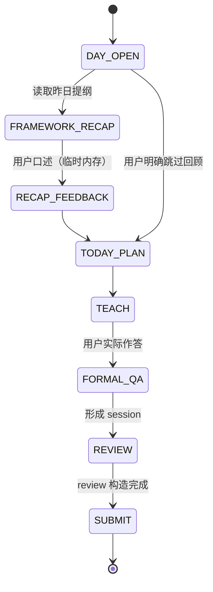

# 项目学习 × 模拟面试 × RDS 项目快照：联合设计规格

> 状态：设计规格，供后续实施使用。本文不表示任何代码已修改、数据库已迁移、测试已通过或插件已安装。
> 日期：2026-10-24（Asia/Shanghai）。规格版本：1.0。
> 技能仓库 S：`C:\Users\27846\my-chatgpt-skills`（远端 `gitgotcha/my-chatgpt-skills`），核实基线 `7c588e4fd2e0e35ccc5a6f2fa8e527806af0deae`。
> 运行时仓库 R：`C:\Users\27846\my-chatgpt-mcp-v2`，核实基线 `4f810094b65d0e9c6fc2d719aa97ddb2becaa7c2`。
> 配套计划：[项目学习 × 模拟面试 × RDS 项目快照实施计划](../plans/2026-10-24-project-interview-rds-implementation-plan.md)。
> 来源：2026-10-23 交接包（设计、两仓库执行计划、完整输出样本、44 项验收矩阵、合成夹具）。本文件把该包收敛为仓库内自包含版本，并按本仓库实测基线校正了路径、接口与既有失败。

## 1. 目标与用户可见效果

用户学习一个真实项目（示例：12306 余票展示）时，要同时得到两样东西：能拿去面试的完整讲解，以及一份**只属于这个项目**的长期作答证据。

1. 正式问答：原题、原答、追问、提示、评价一并保留，写入该项目在服务端的快照。旧回答永不覆盖。
2. 专项复测：从该项目的薄弱点生成**改变了条件**的变式题；新回答是新 attempt，旧回答保留。纠正误评另发更高版本评价，不修改历史事件。
3. 次日开场：先请用户口述昨日主体框架，教练补齐。**这段回顾全程不入库**：不产生作答、评价、教学提纲或附件。为跨会话知道“昨天讲了什么”，只保存教练实际讲授过的中性课程提纲（不含回顾表现）。
4. 模拟面试：结合已确认的简历项目、该项目快照和联网面经线索，按校招训练深度 L1–L4 逐层追问；一次只问一题，作答前不泄露本题答案。

验收语义：教得清楚（有时间图、真实源码定位、可复述答案）、源码忠实、回顾零写入、项目隔离、旧事件不重计、有效复盘可撤回、未知状态不冒充零分。

## 2. 实测现状与差距

以下均为 2026-10-24 在本机只读核实的结果，实施前需重新确认。

| 部分 | 当前事实 | 证据 | 对设计的约束 |
|---|---|---|---|
| 能力声明 | `capabilities` 代码返回 `storageVersion:2` 与启用域（含 `interview`），无项目快照 feature；本次未用真实凭据发起在线调用 | `services/reliable-drive-sync-worker/src/rds2/query.js` 的 `capabilities()` | 新能力必须以 feature 声明，未声明时技能不得发新参数 |
| 项目查询 | `projection.read` 只接受 `namespace/projectionName/limit/cursor`，cursor 中 `f`（rowKind）非空会被拒绝 | `src/rds2/query.js:115`、`src/rds2/query.js:224` | 先扩协议与 SQL 过滤，技能侧才可能按项目读 |
| 项目快照 | 现有 interview 投影只有 `session/review/selected_review/contribution/weakness` 五类行，无项目视图 | `src/rds2/projection/interview.js:9` | 需新增派生行，且不能只加 reducer |
| 构建引擎 | 单页 ≤20 行变更、单行 ≤64 KiB、包 ≤256 KiB、≤4 次 staged 读、每 kind ≤50 key；continuation ≤64 KiB | `src/rds2/projection/commit.js:11-14`、`src/rds2/projection/staging-read.js:15-19`、`src/rds2/projection/builds.js:24` | 一场多题必须拆子页，不能把历史塞进 continuation |
| 既有 continuation | interview reducer 把 `reviewEvents` 全文放进 continuation，随历史线性增长 | `src/rds2/projection/interview.js:154-158` | 新项目分支必须换成小游标，旧域不改 |
| staged 合并 | 引擎写死 `topic/problem/member/event_activity` 四个桶 | `src/rds2/projection/builds.js:351-354` | 新增内部行 kind 时必须同时改合并逻辑 |
| 本地 Outbox | 只有永久错误码直接 `blocked`；可重试错误按 30s–480s 退避，永不因次数升级 | `tools/reliable-drive-sync-mcp/local-outbox-v2.mjs:26-42`、`:282-311` | “依赖缺失 5 次后 blocked”是本次要新增的行为 |
| MCP 读通道 | `{"storageVersion":2,"operation":"projection.read","params":{…}}` 会原样转发到 `/v2/query`；旧 envelope 路由 `profile.snapshot.read` 只映射 `profile/<domain>` | `tools/reliable-drive-sync-mcp/stdio-bridge.mjs:134-142`、`v2-routing.mjs:66-72` | 无需新工具，也无需新事件类型；参数扩展即可 |
| 技能合同 | 两份 `schemas/contracts.schema.json` 字节一致（SHA-256 `C0E91E04…43A7D`），`manifest.json` 只列定义名，无哈希 | `conducting-…/schemas/`、`reviewing-…/schemas/README.md` | 合同改动必须让两份 schema 保持逐字节一致 |
| 画像工具链 | `validate_profile_skill.py --mode profile software-project-learning` 现有 6 项失败（缺三件画像工件、SKILL.md 未链画像契约、两处硬编码 `D:/` 路径） | 本机运行输出 | 项目学习要成为合规画像技能，须补齐并去掉本地绝对路径 |
| 技能测试 | 根 `tests/` 31 项通过；项目学习 2 项通过；模拟面试 17 项中 5 项失败（断言 V1 路径与旧身份措辞）；复盘 12 项中 1 项因缺 `python-docx` 报错 | 本机运行输出 | 既有失败必须原样记录，不得算作本次引入或本次修复的成果 |

补充事实：`reviewing-java-backend-interviews/scripts/interview_core.py:253` 的 `plan_question_sources` 使用 35/30/25/10 权重，而文档与 `interview-protocol.md` 声明 55/15/10/20；该函数目前只被测试引用。本次不把它当作完整 mock 的配比真源（见 §11）。

## 3. 责任边界

| 责任方 | 唯一职责 | 不得越界 |
|---|---|---|
| `software-project-learning` | 讲解、底部一道追问、保留实际作答、提交一份学习 session、按实际讲授提交中性提纲 | 不自行判定弱点是否关闭；不代写复盘 |
| `conducting-java-backend-mock-interviews` | 依据简历、项目快照与来源卡选题，一题一等，结束时提交一份 session | 不在面试中宣布画像变化；不提交 review |
| `reviewing-java-backend-interviews` + 共用构造逻辑 | 按同一 rubric 产出评价与证据定位，提交一份 review | 不直接写服务端快照；不改写原答 |
| RDS V2（R 仓库） | 校验身份与引用、原子接纳不可变事件、选取有效评价版本、派生项目快照、过滤查询、异步归档 | 不接受客户端“保存快照”；不把未知当零 |

三个技能通过同一项目标识、同一证据合同和同一读视图协作；不循环调用，不要求用户手工搬 JSON，不让两个技能各写一次同一事实。

## 4. 三类事实与每日状态机

### 4.1 事实分类（各有唯一 owner）

| 事实 | 事件 | 语义 | 写入方 |
|---|---|---|---|
| 已讲授内容 | `profile.evidence.recorded`，domain=`backend-project-learning`，`dimensionKey=learning-outline`，`outcome=observed` | 只证明“教练讲过这一节”，不证明用户会 | 项目学习技能 |
| 正式作答 | `interview.session.completed`，`interviewType=project_learning` | 原题、原答、追问、提示时间线 | 项目学习技能（学习场景）或模拟面试技能（mock 场景） |
| 评价 | `interview.review.completed`，引用 `sourceSessionEventId` | 分数、outcome、证据定位、弱点贡献 | 复盘技能 |

提纲观察项固定六字段：`dimensionKey`、`subjectKey=<projectId>:<unitId>`、`outcome=observed`、`evidence`（≤800 字，只写已讲授框架）、`confidence=high`（仅表示讲授事实）、`sourceRef=learning-unit:<unitId>:<conversationId>:<teachingMessageId>`。缺少可核验消息定位时只在本地保留，不杜撰 ID。提纲不得包含用户作答、分数、弱点或“已掌握”，也不得使用 `completed/passed` 等会进入正向能力归类的 outcome。

### 4.2 每日状态机



关键约束：

- 回顾阶段只允许读，不允许任何业务写入；回顾问答不得改名为正式题后补录。
- 用户后续明确要求专项复测时，必须重新出题并新建 attempt，不能复用回顾对话。
- 回顾读取 `profile/backend-project-learning` 的 `learning-outline` 行，按 `observedAt` 在 `Asia/Shanghai` 自然日定位“昨天”。`projection_not_found`、`building=true`、读取失败都表示“历史未知”，不能解释为“没学过”或零分。
- 跨多个项目时按实际学习顺序给出简短框架；无昨日记录时如实说明无可靠记录。

## 5. 事件合同：project contract v1

外层业务 envelope 仍是 `schemaVersion:"1.2"`；新增字段是显式扩展，旧事件不带新字段继续走原校验。项目扩展事件在事件对象顶层增加 `projectContractVersion: 1`；未知版本或未知字段拒绝。

### 5.1 session 扩展

| 字段 | 约束 |
|---|---|
| `interviewType` | `project_learning` 或既有 `mock` / `real` |
| `sessionId` | `project_learning` 使用 `LEARN-<UTC compact>-<uuid>`；`MOCK-` / `REAL-` 规则不变 |
| `projectContractVersion` | 项目扩展为 `1` |
| `questions[].projectEvidence` | 项目扩展 session 中每题必填（§5.2） |

`project_learning` 的 `profileChanges` 必须为空数组：项目能力只从 `projectAssessment` 派生，不能同时计入旧全局画像。

### 5.2 `questions[].projectEvidence`

| 字段 | 类型与约束 |
|---|---|
| `project` | 对象：`projectId`(UUID)、`displayName`(非空)、`basis{kind∈resume_claim\|user_confirmed\|source_learning, key:非空稳定串}`、`resumeVersion`(string\|null)、`resumeClaimIds`(string[])、`sourceRevision`(string\|null) |
| `attemptId` | UUID；一次真实独立作答一个 ID，同一题的提示与补答仍属该 ID |
| `questionKey` | 稳定考点 ID，1–128 字符 `[A-Za-z0-9._-]` |
| `variantId` | 稳定语义变式 ID；换人名、换数字、换项目名不算新变式 |
| `variantAxes` | 1–4 个非空串，声明改变了什么条件 |
| `purpose` | `initial_assessment` 或 `targeted_retest`；**不提供可落库的 `daily_recap` 分支** |
| `sourceSkill` | `software-project-learning` / `conducting-java-backend-mock-interviews` / `reviewing-java-backend-interviews` |
| `provenance` | `answerOrigin∈actual_user\|user_recall\|assistant\|synthetic`、`assistance∈none\|hint\|answer_shown`、`exactAnswerSeenBefore:boolean`、`exposureGroupId:非空串` |
| `sourceRefs` | 非空串数组：题目来源目录 ID、源码定位或官方文档 URL；不含私密简历全文 |

`originalAnswer` 是首次实际回答；提示后的补答追加进 `timeline`/`followUps`，不替换首答。只提出题目、用户尚未回答时不得构造 session；“不会”是有效回答，可以记录。

项目身份稳定：同一 `resumeVersion` 下明确的项目 claim 或用户确认的项目标识映射到同一 UUID；显示名、仓库路径、commit 变化不自动产生新项目；目录名相近不得自动合并。basis 改绑与项目合并是另一个功能，本次不做。

### 5.3 `questionReviews[].projectAssessment`

| 字段 | 约束 |
|---|---|
| `attemptId` | UUID，必须属于同一 session 的某道题 |
| `rubricVersion` | 固定 `project-campus-v1` |
| `scores` | `{technical,projectEvidence,causal,tradeoff,expression}` 或 `null`；上限 30/25/20/15/10 |
| `total` | 五项之和，或 `null` |
| `outcome` | `passed` / `partial` / `failed` / `unscored` |
| `evidenceRefs` | `<questionId>:originalAnswer` 或 `<questionId>:timeline:<messageId>`，必须指向该 session 真实存在的内容 |
| `reason` | 非空说明 |
| `weaknesses` | `[{weaknessId,title,outcome∈failed\|passed\|observed}]` |

通过门槛（训练口径，不是公司录用线）：`total≥80`，`technical≥24`，`projectEvidence≥18`，`causal≥14`，且无颠倒库存/事务/超时结果等关键错误。证据不足时 `scores=null`、`total=null`、`outcome=unscored`。纯八股与算法题沿用原 rubric，不塞入此对象。

### 5.4 接纳校验与稳定拒绝码

| 码 | 触发 |
|---|---|
| `project_contract_version_unsupported` | `projectContractVersion` 非 1 或缺失却被使用 |
| `invalid_project_evidence` | 字段缺失、类型错误、枚举越界、UUID 非法 |
| `project_identity_conflict` | 同一 user 的同一 basis 已绑定另一 projectId |
| `attempt_identity_conflict` | 同一 user 的 attemptId 已属于另一 session/question/project |
| `source_session_not_committed` | review 引用的 session 尚不存在（409，不接纳） |
| `review_source_mismatch` | session 存在但用户、ID、类型或题目对不上 |
| `assessment_question_mismatch` | `attemptId`/`questionId` 不在该 session |
| `assessment_score_invalid` | 单项超上限、和不等 total、passed 但门槛不足 |
| `assessment_evidence_unresolvable` | `evidenceRefs` 指向不存在的内容 |
| `project_envelope_too_large` | 超 §5.5 容量 |

校验顺序：身份 → 合同版本与结构 → 引用（session 存在且同用户）→ 题目/attempt 对应 → 证据定位 → 分数一致性。任何一步失败都不写事件、不建投影任务。

### 5.5 容量上限（接纳前拒绝，不截断）

| 对象 | 上限 |
|---|---|
| 整份 envelope canonical bytes | 48 KiB |
| 单题原始记录（题目+原答+timeline） | 24 KiB |
| 单题 `projectAssessment` | 8 KiB |
| 超限处理 | 拒绝并保留本地原文，提示拆分或缩短 |

上限针对项目合同；旧事件维持现状。派生行合并后仍须满足 64 KiB/行。

## 6. 服务端派生：项目快照

### 6.1 三类派生行

沿用 `namespace=interview`、`projectionName=interview` 的生成/切换协议；新行 `member_key = projectId`。

| rowKind / rowKey | 最小内容 |
|---|---|
| `project_summary` / `projectId` | `version`、项目元数据、`assessedAttemptCount`、`pendingAttemptCount`、`lastAssessedAt`、`weaknessCounts`、`coverage`（questionKey→状态）、`sourceSessionIds`、`sourceReviewEventKeys`、`truncated` 标记 |
| `project_attempt` / `attemptId` | `projectId`、`sessionId`、`questionId`、`questionKey`、`variantId`、`variantAxes`、`purpose`、`sourceSkill`、`originalQuestion`、`originalAnswer`、`followUps`、`timeline`、`provenance`、`sourceRefs`、`selectedReview`、`assessment`、`eligibleIndependentPass` |
| `project_weakness` / `projectId:weaknessId` | `projectId`、`weaknessId`、`title`、`status∈open\|improving\|closed`、`cycleStart`、`eligiblePassAttemptIds`、`evidenceAttemptIds` |

内部归约行（不对普通项目查询返回）：`project_selected_review` / `sessionId`、`project_review_question` / `reviewEventId:attemptId`。

摘要裁剪上限：`coverage` 50 个考点、`sourceSessionIds` 与 `sourceReviewEventKeys` 各 20 个、弱点证据 ID 各 20 个；裁剪必须附 `truncated` 与总量，且计数始终按全量计算。完整历史从 `project_attempt` 分页追溯。

`project_summary` 的 `status` 只描述**评价事实**（待评估/已评估），不描述用户能力。

### 6.2 独立通过与弱点关闭

服务端计算，忽略客户端任何“已关闭”声称。

```text
按 (session.completedAt 的 UTC 毫秒, sessionId, question 在数组中的整数 index, attemptId) 排序
为每个 session 选一个有效 review（applyProfileChanges=true，最高有效 reviewVersion）
一次 attempt 记 eligibleIndependentPass，当且仅当：
  assessment.outcome == passed
  且 provenance.answerOrigin == actual_user
  且 provenance.assistance == none
  且 provenance.exactAnswerSeenBefore == false
在最近一次有效 failed 之后统计：
  1 个合格通过 → improving
  ≥2 个不同 session、≥2 个不同 variantId、≥2 个不同 exposureGroupId 的合格通过 → closed
  出现新的有效 failed → 回到 open，并开启新周期（旧通过不计入新周期）
```

排序键使用规范 UTC 与补零 index，禁止用不同时区的原始字符串或未补零数字做字典序。同日多次真实作答各自保留，不做“每日首答”去重。

### 6.3 评价撤回与重算

- 更高 `reviewVersion` 且 `applyProfileChanges=true` 替换旧贡献；`apply=false` 只存档，不撤销已生效版本。
- 撤回用更高版本的 `unscored` + 空 `weaknesses`，重算从空状态重建该代，不能残留旧计数。
- 同版本多份复盘沿用现有 `completedAt`/`eventId` 稳定比较并告警，不增加贡献。
- 新复测必须是新 attempt/session，不能靠提升 reviewVersion 冒充。

### 6.4 有界构建合同 v2

仅 interview 的项目分支启用；其他域与旧归档 v1 不变。

1. **ingest**：逐个源事件写入确定性子项（session 行 + 各题原始 attempt；review 行 + 选中版本指针 + 逐题候选评分），按原 question 数组顺序与固定子项类型推进 `eventItemIndex`，事件子项全部完成才移动 `nextEventSeq`。
2. **fold_attempts**：ingest 完整消费 frozen target 后，按原作答顺序分页扫描 `project_attempt`，对照选中 review 指针与候选评分更新 attempt、项目 summary、weakness；全部完成后才切换 active generation。

continuation 只放小游标：

```json
{"buildContractVersion":2,"phase":"ingest|fold_attempts","nextEventSeq":0,"eventItemIndex":0,"rangeAfter":["sortKey","rowKey"],"foldItemIndex":0,"page":1}
```

- 引擎校验 `(phase, 事件游标, 子项游标, range 游标)` 严格单调，并与确定性子项数量一致。
- 仅 v2 允许“合法零消费但子游标前进”的页；旧 `build_no_progress` 保护不放宽。
- 每页仍 ≤20 rowChanges、单行 ≤64 KiB、包 ≤256 KiB、≤4 次 staged 读。
- 新增声明式 range read：scope/user/generation/rowKind 固定，按 `(sort_key,row_key)` 续读，每次 ≤20 行，同一 4 次预算；不接受任意 SQL。
- 点读允许 ≤50 keys，仍先计价后请求。
- 合并 staged maps 必须包含新增 kind，不得只合并四个旧桶。
- 摘要中的计数按全量 fold 计算，不用被裁剪的展示列表。

归档包 `build_package` 增加 `buildContractVersion:2`、`workStart/workEnd`、`sourceEventHash`、`frozenTarget`；v2 包用工作游标连续性证明无跳项，不能伪造旧 consumed 窗口。`replay-validate` 对 v2 拒绝缺页、重复子项、跳项、非法零进展、fold 未完成即激活；v1 包沿用旧验证。activation 只有两阶段完成且包连续后才可见。

## 7. 查询与能力握手

### 7.1 capabilities

`/v2/query` 的 `capabilities` 增加可选：

```json
{"features":{"interviewProjectSnapshots":{"version":1,"projectFilter":true}}}
```

只有实现、迁移、回归全部通过并显式开启后才返回该 feature。旧 `system.capabilities.read`（`src/capabilities.js`）保持现状，技能读的是 `/v2/query`。

### 7.2 `projection.read` 参数矩阵

| projectId | rowKind | 行为 |
|---|---|---|
| 有 | 省略 | 返回该项目的三类行，`summary` 为该 `project_summary` 的 value（无则 `null`） |
| 有 | 三类之一 | 只返回该项目该 kind |
| 有 | 其它（含 legacy kind） | `invalid_params` |
| 无 | `project_summary` | 返回当前用户的项目目录（仅摘要元数据），`summary=null` |
| 无 | `project_attempt`/`project_weakness` | `invalid_params` |
| 无 | 省略或 legacy kind | 旧行为：只返回 legacy rowKind，`summary` 为全局 summary |

约束：

- `projectId` 必须是 UUID，且只在 `namespace=interview`、`projectionName=interview` 下允许。
- 过滤在 SQL 内完成：`user_id + active_generation + member_key`，不先取全量再筛。
- `summary` 必须受项目范围限制，不得带出其它项目或全局内容。
- cursor 绑定 `user + operation + namespace + projectionName + projectId + rowKind + revision + lastSortTuple`；任一变化返回 `cursor_scope_mismatch`。
- `limit≤50`、响应 ≤256 KiB、cursor 15 分钟；跨页保持同一 revision；`cursor_expired` / `projection_changed` 从头重读。
- `building=true` 表示构建未完成，不是空快照。
- 旧查询（不带新参数）只返回 legacy kind，行为不变。

### 7.3 会话读取

`interview.session.list` 默认只列 `mock`/`real`；项目学习会话通过 `project_attempt` 定位。若 `interview.session.load` 传入 `LEARN-` ID，协议、路由与 Python helper 必须一起支持，并始终按凭据用户隔离；`LEARN-` 前缀不能绕过身份校验。

### 7.4 状态口径

`pending`（本地排队）、`d1_committed`（D1 接纳）、`projected`（读视图已应用）、`archived`（Drive 归档完成）分开报告，全部用原 requestId/eventId 查询，不为轮询制造新事件。客户端超时属于结果未知：先对账，不换 ID 重提。

## 8. 技能侧行为

### 8.1 教学输出标准

每个完整单元：具体场景 → 责任清楚的可见时序图 → 源码定位 → 保留真实分支的注释节选（省略处明确标注）→ 状态变化与反例 → 取舍与验证办法 → 可口述答案 → 底部**一道**追问。可以分轮展开，不为套模板重复整套大图。

- 图片必须直接显示；Mermaid 源码只能作可选附件。
- 源码行号以执行时实际工作树为准；教学注释不得插入 SQL 或字符串字面量内部。
- 幽默服务理解，不替代因果，不拿用户失误开玩笑，不编造生产经历。
- 用户没回答时停止等待：不伪造答案，不产生 session/review。

### 8.2 回顾零写入

回顾的提问、回答、提示、评分只存在于当轮上下文。禁止通过 outline、附件、报告、profileChanges 等任何旁路保存。判定标准是“业务写入次数为 0、新增 attempt 为 0、新增 review 为 0、新增 outline 为 0”，不是“回顾不计分”。

### 8.3 交接与恢复

- 学习 session 与 review 不承诺跨请求原子性：session 已入库而 review 未到时，只显示“待评估”。
- 本地持久化交接清单保存两份原 envelope 及各自回执；重试保持 requestId/eventId/eventKey 与内容不变。
- review 先到：接纳前返回 409，不建投影任务；Outbox 按退避重试，连续 5 次仍缺依赖转 `blocked` 并保留原文；之后用同一 envelope 重试时，桥接层只读校验 session 已提交，再把原记录恢复 `pending`。永久错误不走该恢复。
- 恢复不改变任何 ID，不新建云端“待依赖队列”。

### 8.4 专项与完整 mock

- 专项模式（`project_targeted`）：全部问题必须能回到选中项目；允许一题解释必要基础机制，不混入其它项目弱点，不另起无关八股池。
- 完整 mock：维持既有配比 55% 简历/项目、15% 历史弱点、10% 领域、20% 算法与场景；无简历 35/45/20；弱点题不超过 40%。专项明确不受 40% 约束，两者互不影响。
- 专项默认从 L2 开始，按实际表现走向 L1 或 L3/L4；一次只问一道；作答前不展示完整答案。

### 8.5 出题资料与来源卡

1. 从 resume-knowledge 的有效版本读取已确认项目 claim；未确认时标明“非简历定制”。
2. 读取项目快照：已考内容、弱点、最近辅助程度、旧变式。
3. 联网只用于找“出现过什么话题”的线索；技术答案以源码或官方文档核验。优先近 12 个月、同批次/地区/方向；不足时如实说明。
4. 给模型的是候选卡：projectId、claimRefs、questionKey、变式条件、层次、来源、预期考点、追问分支、答案证据、去重结果、选中/剔除理由。模型负责选择与追问，不把搜索摘要当标准答案。

来源卡字段：`sourceId`、`url`、`title`、`author`（可得时）、`publishedAt`（不明为 `null`）、`retrievedAt`、`role`、`recruitmentType`、`region`、`evidenceLevel`、`originGroupId`、`relevanceNote`。原帖与转载同组，只算一条线索；公开帖子是自述，不保证真实；跨多篇出现不等于统计概率。

默认一轮 6–10 张候选卡、2–3 个独立来源，选 3–5 张；联网不可用时用已核验资料或原创条件题，标记 `frequency=unknown`，不编造出处。搜索词只含公共技术与岗位方向。

### 8.6 难度标定（训练口径）

| 层次 | 能力表现 | 余票示例 |
|---|---|---|
| L1 链路 | 说清参与者与状态 | HGET 命中、`null`、字符串 `0` 分别怎么走 |
| L2 机制 | 解释为何这样写 | 锁内二次检查防什么；局部 Map 与 Redis 谁承担返回 |
| L3 反例与修复 | 最小反例、修复、有区分度的测试 | A 回填、B 等锁后命中但空 Map，如何证伪并修复 |
| L4 迁移与取舍 | 换约束仍守契约 | 回填超时结果未知时怎样返回与观测 |

不宣称公司内部标准、今年必考率或录用线。

## 9. 兼容、迁移与回滚

- 旧事件零改动：无 `projectContractVersion` 的 session/review 继续走现有 reducer 与 summary。
- 无 `projectId` 的历史作答不猜项目、不批量迁移、不复制进项目视图。
- migration 只增量新建两张身份表（项目、attempt），不重建、不删除既表；冲突由唯一约束在接纳事务内裁决。
- feature 关闭时：技能可继续讲课，只保留本地待交接记录，不发新字段；查询返回旧行为。
- 回滚：关闭 feature + 停止发送新字段即可；已接纳的项目事件保留可读，不删数据。
- 冻结代码（S 内旧 Worker/MCP、`cloud-mcp`）与安装缓存副本不在本次修改范围。

## 10. 验收

44 项用例分四组：L（教学与回顾，10 项）、Q（选题与面试纪律，10 项）、R（合同/归约/隔离，20 项）、P（打包与陈述，4 项）。逐项定义、任务归属与执行方式见计划的“验收矩阵”附录；结论只能填 `pass` / `fail` / `blocked` / `not_run`，并附命令、退出码、日志或对话轨迹路径。

最小端到端期望（隔离、合成数据）：

1. 实际讲授提纲 1 条（observed）→ A1 正式作答 + review → 项目 open。
2. 次日回顾 → 写入 0 条，快照不变。
3. A2 不同条件、无提示 → improving。
4. A3 另一语义条件、另一曝光组 → closed。
5. A2 更高版本 review 撤回 → 回到 improving，旧答与旧 review 仍可追溯。
6. 归档包离线重建 → 与在线投影逐行一致；旧 mock 基线不变。

## 11. 已发现的基线问题（实施时必须处理或明确保留）

| 编号 | 问题 | 处理建议 |
|---|---|---|
| B1 | 项目学习技能缺 `references/profile-contract.md`、`schemas/profile-capability.json`、`tests/test_profile_contract.py`，SKILL.md 未链画像契约 | 由 T5 补齐，使 `validate_profile_skill.py --mode profile software-project-learning` 通过 |
| B2 | `detailed-lesson-format.md` 与 `examples/unit-2-complete-dialogue.md` 含 `D:/` 绝对路径，画像校验判定不可移植 | T5 改为 `<project-root>/…` 占位，真实运行时输出实际绝对路径 |
| B3 | 模拟面试 5 项跨技能断言仍要求 V1 `users/<userId>/interview/events/` 或旧身份措辞 | T6 在改动受影响文本时同步更新断言，并在报告中标注“既有失败修复”，不得静默删除 |
| B4 | 复盘 12 项测试中 1 项因当前解释器缺 `python-docx` 报错 | 记录为环境阻塞；安装后重跑，不伪造通过 |
| B5 | `plan_question_sources` 权重 35/30/25/10 与文档 55/15/10/20 不一致，且只被测试引用 | 完整 mock 以文档配比为真源；本函数本次不改，报告列为已知不一致，除非 T6 必须复用 |
| B6 | 仓库内其它画像技能同样不通过当前 validator，只有新增的 `adaptive-study-planning` 通过 | 不借本次做全仓迁移；只保证项目学习符合标准，其余维持并记录 |
| B7 | R 的 `tools/reliable-drive-sync-mcp/test/rds2-skill-contract.test.mjs` 仍读取已改名的 `backend-project-learning/SKILL.md`，导致 `npm test` 的 bridge 段 2 项失败（worker 段 704 项全绿） | T7 修正包名并同步断言；报告分列“既有失败修复”，不得只改路径而不核断言语义 |

## 12. 非目标

- 不实现项目合并、basis 改绑、改名迁移。
- 不回填历史作答，不猜测历史项目归属。
- 不新增自动提醒、定时任务或生产部署。
- 不处理私人面试录音、不上传语料、不上传源码仓库。
- 不修改冻结的 V1 Worker/MCP、`cloud-mcp`、安装缓存。
- 不改写其它技能的既有规则（复盘技能只做合同联动所需的最小改动）。
- 不宣称性能或生产规模结论：只给有界性与隔离测试证据。
