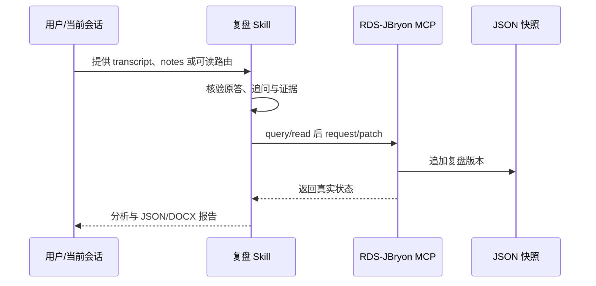

# Java Backend Interview Review

用于复盘模拟面试或真实面试的 Java 后端 Skill。它保留原始会话证据，在此基础上生成逐题分析、改进回答和本地报告。

## 能做什么

- 分析用户提供或明确选择的会话材料。
- 给出正确性、完整性、错误、遗漏、失分原因和追问建议。
- 为模拟面试或经用户确认的真实面试生成结构化画像变化。
- 输出 JSON 与 Word 复盘报告。

## 复盘流程



旧云端会话目录不再用于列举历史；若用户没给出旧会话材料，应说明缺少输入并请其提供，不得伪造读回。

## 快照与本地输出

项目复盘写入 `project/<slug>/学习快照.json`；其它复盘使用用户确认的 `interview/reviews/<name>.json`。保留原问题、原回答和追问时间线，修订时追加版本，不覆盖原答。只有 RDS-JBryon 返回 `projected` 才报告云端保存完成。

本地派生输出：

```text
outputs/interview/<sessionId>/interview-<sessionId>-report.json
outputs/interview/<sessionId>/interview-<sessionId>-report.docx
```

JSON 与 DOCX 不自动上传到云端，也不作为画像输入。真实面试的画像变化必须先询问用户。

## 开发者入口

- [SKILL.md](./SKILL.md)
- [复盘协议](./references/review-protocol.md)
- [RDS-JBryon 运行契约](../references/rds-jbryon-runtime.md)
