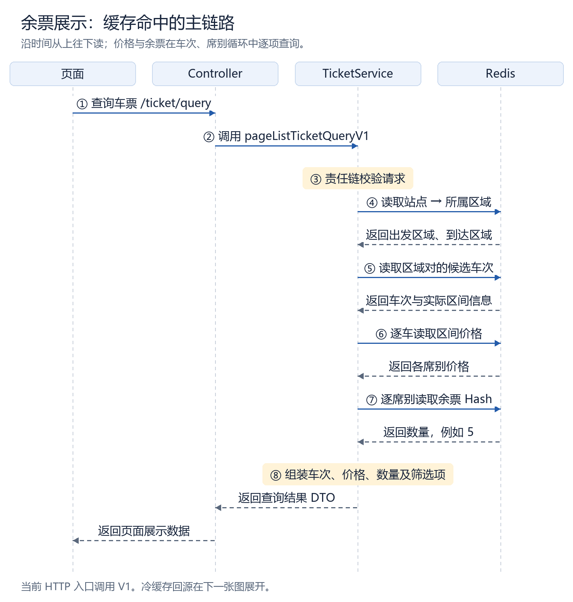
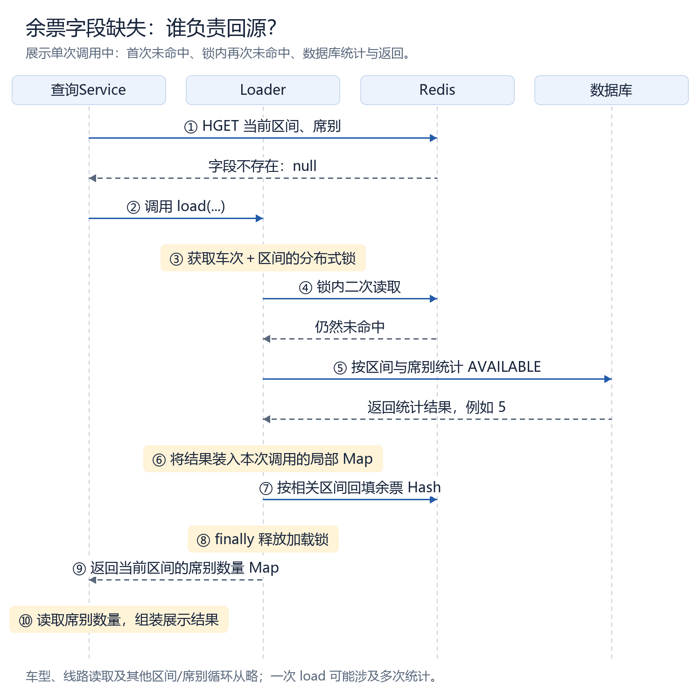
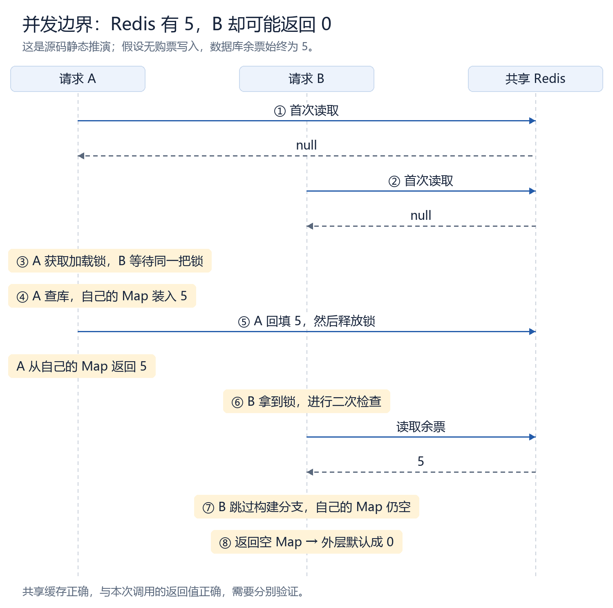

# 完整单元：12306 余票展示查询（合成教学样本）

> 本文件的学员输入、分数和日期均为**合成教学示例**，不是真实用户作答，也不发送任何个人 RDS。12306 事实来自本地工作树的**静态源码核验**：没有启动服务、没有做并发复现，下面的并发结论是可静态推导的教学推演。三张 PNG 是合成教学图，不是生产截图。示例中的源码行号一律写作 `<line>`；真实授课必须按当次工作树复核，再输出核验过的起始行号。

## 1. 场景

**合成学员输入：** 今天学习 12306 余票展示链路。先按“图 → 源码 → 反例 → 口述答案”讲完整，源码注释详细一点，最后再问我。

今天跟着手机上的“二等座还有 5 张”走一趟。先记住三份东西：数据库里的座位状态、Redis 里的展示余票、这次方法调用里的返回 `Map`。它们像仓库账本、门口电子屏、前台手里的便签。电子屏亮了，不代表前台手上那张便签也自动写好了——今天的坑就在这里。

本轮范围只到“余票展示查询”，购票扣减只交代责任边界，不展开支付、令牌和锁座。要学到三件事：

1. 沿调用链找到“数量”到底从哪里来；
2. 解释为什么加载锁里还要做一次检查；
3. 判断“缓存里有数据”和“本次响应正确”之间差在哪里。

本轮是**讲授**，不是作答：可以把已讲框架记为 `learning-outline` 的 `observed`；在你回答底部问题之前，不构造 session、不产生评价、不写任何作答证据。

## 2. 可见时序图



从上往下读时间：页面请求进入 Controller，Controller 调 V1 Service；Service 做请求校验、把站点映射到区域、找区域对的候选车次，再逐车取价格、逐席别读余票，最后组装 DTO 返回。**候选车次不是靠逐个座位扫出来的**；价格和余票也不是同一个缓存。



单个席别的数量缺失时：外层 HGET 得到 `null`，调用 `SeatMarginCacheLoader.load`；Loader 拿“车次 + 区间”的加载锁，锁内再读一次 Redis；仍缺失才按车次、席别、区间和 `AVAILABLE` 状态统计数据库，把结果装进**本次调用的局部 Map**，同时回填 Redis，最后返回这个局部 Map。



两个请求 A/B 同时 miss 时：A 先拿到锁，查库得到 5，写自己的 Map、回填 Redis、释放锁；B 拿到锁后二次检查命中 5，于是**跳过整个 if 分支**。此时 Redis 已经有 5，但 B 自己的局部 Map 还是空的；方法末尾读的是 B 自己的 Map，不是重新读 Redis。

## 3. 源码定位

源码索引按执行顺序排列。路径统一写成 `<project-root>/...` 占位，起始行统一写 `<line>`，真实授课时替换为当次核验过的实际值。

| 顺序 | 文件与符号 | 起始行 | 输入 / 结果 | 本处证明什么 |
|---:|---|---|---|---|
| 1 | `<project-root>/services/ticket-service/src/main/java/org/opengoofy/index12306/biz/ticketservice/controller/TicketController.java` · `pageListTicketQuery` | `<line>` | 查询参数 → 调用 V1 Service | HTTP 入口不计算库存 |
| 2 | `<project-root>/services/ticket-service/src/main/java/org/opengoofy/index12306/biz/ticketservice/service/impl/TicketServiceImpl.java` · `pageListTicketQueryV1` | `<line>` | 校验、站点区域、候选车次、价格与余票 | 主链路的编排位置 |
| 3 | 同上 · `quantityObj` 与 `orElseGet` 分支 | `<line>` | Redis 命中 → 数量；缺失 → Loader | 三种输入分支与兜底 0 |
| 4 | `<project-root>/services/ticket-service/src/main/java/org/opengoofy/index12306/biz/ticketservice/service/cache/SeatMarginCacheLoader.java` · `load` | `<line>` | 车次、席别、区间 → 局部 Map | 加载锁、二次检查、返回契约 |
| 5 | 同上 · 车型 `case 0` 分支与 `selectSeatMargin` | `<line>` | 可售区间 → 各席别统计 | 只统计当前区间与席别，不扫全车 |

`CacheUtil.buildKey(trainId, departure, arrival)` 生成 Hash 的 Key 后缀；Hash field 是席别。加载锁的 Key 由 `LOCK_SAFE_LOAD_SEAT_MARGIN_GET` 与同一个 `keySuffix` 拼成，因此锁粒度是**车次 + 出发站 + 到达站**，不是整条购票事务。

## 4. 保留真实分支的注释节选

下面只调整换行并追加标注为“教学”的注释；变量名、条件分支和返回语句保留源码形态。`// ……省略：…` 表示原文还有未展示内容，代码块是阅读节选，不是可直接替换整个方法的补丁。

### 4.1 外层：`null`、字符串 `"0"`、字符串 `"5"` 走不同分支

```java
Object quantityObj = stringRedisTemplate.opsForHash().get(
        TRAIN_STATION_REMAINING_TICKET + keySuffix, seatType);

int quantity = Optional.ofNullable(quantityObj)
        // 教学：有值就转换并直接使用；字符串 "0" 也是值，会得到整数 0，
        // 因此“缓存里确实存了 0”不会被误判成未命中。
        .map(Object::toString)
        .map(Integer::parseInt)
        // 教学：只有 quantityObj == null 才进入这里；orElseGet 是延迟执行。
        // 这段要的是当前车次、当前区间、当前席别的数量。
        .orElseGet(() -> {
            Map<String, String> seatMarginMap = seatMarginCacheLoader.load(
                    String.valueOf(each.getTrainId()), seatType,
                    item.getDeparture(), item.getArrival());

            // 教学：本次 HTTP 响应依赖 Loader 交回的 Map。
            // Redis 已经被别人写入，不会自动出现在这个局部变量里。
            // 这里把 Map 中不存在的席别兜底为 0，正是要核对的边界。
            return Optional.ofNullable(
                            seatMarginMap.get(String.valueOf(item.getSeatType())))
                    .map(Integer::parseInt)
                    .orElse(0);
        });

// 教学：价格除以 100 是源码既有转换；数量直接使用上面的 quantity。
seatClassList.add(new SeatClassDTO(
        item.getSeatType(), quantity,
        new BigDecimal(item.getPrice()).divide(
                new BigDecimal("100"), 1, RoundingMode.HALF_UP), false));
```

三种输入不要混：字段为 `"5"` 直接返回 5；字段为 `"0"` 直接返回 0；字段缺失（`null`）才调用 Loader。异常字符串会解析失败，也不能擅自宣布“就是 0 张票”。

### 4.2 Loader：锁保护什么，返回值又由谁负责

```java
public Map<String, String> load(
        String trainId, String seatType, String departure, String arrival) {
    // 教学：每次调用都 new 一份；A 的 Map 不会自动变成 B 的 Map。
    Map<String, Map<String, String>> trainStationRemainingTicketMaps
            = new LinkedHashMap<>();
    String keySuffix = CacheUtil.buildKey(trainId, departure, arrival);

    // 教学：锁粒度是车次 + 出发站 + 到达站，不是整条购票事务锁。
    RLock lock = redissonClient.getLock(
            String.format(LOCK_SAFE_LOAD_SEAT_MARGIN_GET, keySuffix));
    lock.lock();
    try {
        StringRedisTemplate stringRedisTemplate =
                (StringRedisTemplate) distributedCache.getInstance();
        Object quantityObj = stringRedisTemplate.opsForHash().get(
                TRAIN_STATION_REMAINING_TICKET + keySuffix, seatType);

        // 教学：进入 if 才会构建本次返回 Map；
        // 若二次检查命中，就跳过这整个分支。
        if (CacheUtil.isNullOrBlank(quantityObj)) {
            // ……省略：读取列车信息、取可售区间、按车型分别统计或补 0；
            // 这些原始分支负责填充 trainStationRemainingTicketMaps。
            trainStationRemainingTicketMaps.forEach((cacheKey, cacheMap) ->
                    stringRedisTemplate.opsForHash().putAll(cacheKey, cacheMap));
        }
    } finally {
        // 教学：释放加载锁；finally 不会替方法补上返回值。
        lock.unlock();
    }
    // 教学：读的是这次调用的局部 Map，不是再次从 Redis 读取！
    return Optional.ofNullable(trainStationRemainingTicketMaps.get(
                    TRAIN_STATION_REMAINING_TICKET + keySuffix))
            .orElse(new LinkedHashMap<>());
}
```

`if` 之外没有第二个“把命中值放进返回 Map”的分支。这是整段逻辑的关键：**二次检查只决定“要不要回源”，不负责“把命中值交给调用方”**。

### 4.3 数据库统计：条件来自当前请求，不是全车扫描

```java
private String selectSeatMargin(
        String trainId, Integer type, String departure, String arrival) {
    LambdaQueryWrapper<SeatDO> queryWrapper = Wrappers.lambdaQuery(SeatDO.class)
            .eq(SeatDO::getTrainId, trainId)
            .eq(SeatDO::getSeatType, type)
            .eq(SeatDO::getSeatStatus, SeatStatusEnum.AVAILABLE.getCode())
            .eq(SeatDO::getStartStation, departure)
            .eq(SeatDO::getEndStation, arrival);
    // 教学：count 只覆盖上面这些条件；不能据此推断日期隔离已经完整。
    return Optional.ofNullable(seatMapper.selectCount(queryWrapper))
            .map(String::valueOf).orElse("0");
}
```

车型分支只展示 `case 0` 的席别集合，`case 1` / `case 2` 的席别集合不同，不能把 0/1/2 外推成全部车型：

```java
case 0 -> {
    for (RouteDTO each : routeDTOList) {
        Map<String, String> trainStationRemainingTicket = new LinkedHashMap<>();
        // 教学：每个可售区间分别统计该车型的各席别。
        trainStationRemainingTicket.put("0", selectSeatMargin(
                trainId, 0, each.getStartStation(), each.getEndStation()));
        trainStationRemainingTicket.put("1", selectSeatMargin(
                trainId, 1, each.getStartStation(), each.getEndStation()));
        trainStationRemainingTicket.put("2", selectSeatMargin(
                trainId, 2, each.getStartStation(), each.getEndStation()));
        String actualKeySuffix = CacheUtil.buildKey(
                trainId, each.getStartStation(), each.getEndStation());
        // 教学：外层 Map 按区间 Key 取，内层 Map 按席别 field 取。
        trainStationRemainingTicketMaps.put(
                TRAIN_STATION_REMAINING_TICKET + actualKeySuffix,
                trainStationRemainingTicket);
    }
}
```

## 5. 状态与反例

设数据库当前区间仍可售 5 张，且没有发生购票写入；A、B 两个查询请求同时到达。下面的 5 个时刻是**静态推演**，不是并发实测：

| 时刻 | 请求 A | 请求 B | Redis 数量 | B 的局部 Map |
|---|---|---|---|---|
| t1 | 外层 miss，拿到加载锁 | 外层也 miss，等同一把锁 | `null` | 空 |
| t2 | 查库得 5，写自己的 Map 并回填 | 仍在等待 | `5` | 空 |
| t3 | 返回并解锁 | 获得锁，二次检查命中 5 | `5` | 空 |
| t4 | — | 跳过 `if`，到方法末尾取自己的 Map | `5` | 空 |
| t5 | — | 外层按缺失兜底 `orElse(0)` | `5` | 空，响应为 0 |

三份状态的归属要分开：

| 对象 | 谁写 | 谁读 | 在反例里是否正确 |
|---|---|---|---|
| 数据库座位状态 | 购票/锁座链路 | `selectSeatMargin` 统计 | 5 张可售，正确 |
| Redis 展示余票 Hash | A 在锁内回填 | 所有请求的 HGET | 已写入 5，正确 |
| 本次调用的局部 Map | 当前调用自己 | 当前调用的 `return` | B 从未写入，为空 |

结论：这是**可静态推导的误展示路径**，不是“Redis 没写成功”，也不是“锁没加”。锁完成了减少重复回源的任务；二次命中的请求没有把命中值带回本次调用。共享缓存正确，与本次调用返回值正确，需要分别验证。

还要守住一个边界：展示数只表示“查询这一刻看到的可售数量”，**不等于购票预占或一定能买到**；令牌准入、选座与数据库锁座属于后续责任。请求校验包含日期，也不等于这里读到的每个缓存 Key 都已按日期隔离——未检查的配置、DDL 和其它链路要继续核验，不能靠合理想象补齐。

## 6. 取舍与验证

### 6.1 最小修复方向（设计建议，未提交）

让 `load` 的两条返回路径遵守同一个契约：锁内二次命中时，把当前请求席别的数量放进返回 Map。

```java
if (!CacheUtil.isNullOrBlank(quantityObj)) {
    // 建议：当前调用只需要当前席别；先核验所有调用方是否还有其它要求。
    Map<String, String> cachedSeatMargin = new LinkedHashMap<>();
    cachedSeatMargin.put(seatType, quantityObj.toString());
    return cachedSeatMargin; // 位于 try 内，现有 finally 仍会释放锁
}
```

这不是现有源码；如果其它调用方需要完整席别集合，就应重新定义返回契约，或把“加载”与“读取当前席别数量”拆开，不能只凭一处调用就改全局行为。

### 6.2 取舍

- **只补命中分支**：改动最小，但要把 `load` 的返回契约写清楚，否则其它调用方可能拿到“只有一个席别”的 Map。
- **统一返回契约**：命中与回源都返回完整区间集合，语义最稳，但命中时要构造完整 Map，读放大增加。
- **拆分加载与读取**：边界最清楚，改动面也最大，不属于今天必须扩建的工程。

加载锁按“车次 + 区间”而不是整条购票事务加锁，是为了限制回源并发而不把查询串行化；代价是同区间不同席别会共享同一把加载锁。写多个 Hash 的 `forEach` 也不是一个原子事务；Pipeline 主要减少往返，不能当作多操作原子性证明。

### 6.3 验证办法

要抓住缺陷，测试必须控制先后，不能靠睡眠碰运气：

1. 用可控栅栏让 A 完成“查库 + 回填”，B 已经外层 miss 但尚未二次检查；
2. 释放 B，断言 `load` 返回当前席别的 5，外层 `quantity` 也是 5；
3. 同一用例在原实现上应复现空 Map → 0，在修复实现上应得到 5；
4. 另补：缓存直接为 0、仍缺失时真实回源、异常路径释放锁、二次命中不重复查库。

本次只给验证设计，**没有实际运行**（`not_run`）；不能用静态阅读冒充并发实测。

## 7. 可口述答案

“我看的是余票展示链路。Controller 调 V1，Service 校验后通过站点区域映射找到候选车次，再按实际区间装配价格和各席别余票。余票从 Redis Hash 读取，字段缺失才进入 Loader：拿车次和区间的加载锁，在锁内二次检查，仍缺失就按可售区间、席别和 `AVAILABLE` 状态统计数据库并回填。

我会特别核对等待锁后的返回路径：二次命中能避免重复查库，但当前方法只有 miss 分支填本次局部 Map，等待者可能返回空 Map，被外层兜底成 0。因此要让命中与回源两条路径都返回当前数量，并用固定并发顺序测试。展示数不等于购票预占，令牌、选座与数据库锁座是后续责任。”

补一句边界：请求校验包含日期，不等于这里读的每个缓存 Key 都已经按日期隔离；未检查的配置、DDL 和其它链路要继续核验。

## 8. 今日追问（只此一道）

**A 已经回填 5 张票，B 等待锁后二次检查命中。请沿“B 的局部 Map → `load` 返回值 → 外层 `quantity`”说明 B 最终显示多少，以及最小修复应放在哪个分支。**
