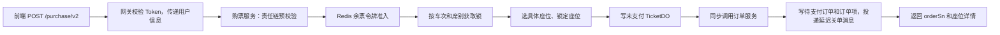

# 完整示范对话：单元二式项目学习

> 这是用户在 12306 购票 V2 学习中认可的实际教学往返，保留原始学习输入和对应的完整教练答复。它示范如何从一段主讲开始，接受澄清、深入局部机制、安排复述、依据回答反馈，并在信息量已满时停课。

## 跨项目使用边界

- 可迁移的是教学动作：先界定一轮范围；先图后讲；用同一案例贯穿输入、调用、状态和结果；用真实源码片段配已核验的可点击索引；答当前疑问时复用全链路；按学习者反馈调整深度；确认门槛持续有效；区分听过、确认讲解、独立复述。
- 不可迁移的是 12306 的事实：`/purchase/v2`、令牌桶与 Lua、`trainId + seatType` 锁、`t_seat`、`TicketDO`、`PENDING_PAYMENT`、Feign/RocketMQ 等结论和代码。它们只描述本案例。进入任何新项目，都要重新读取该仓库的入口、实现、配置、状态和失败路径。
- 下面的源代码索引沿用当时 12306 工作区的绝对路径与行号，只作“格式真实示范”；新项目必须从本地重新核验，绝不能照抄这些链接或行号。
- 本例展示对话输出，不授权自动保存其他项目的学习记忆、画像、简历主张或个人经历。只有用户明确要求时才另行处理。

## 完整输入与输出

> 为便于阅读，保留学习者输入和每次完整答复；中间的状态播报与工具日志不属于教学正文，因此省略。对话按发生顺序排列。

### 第 1 轮

**学习者输入**

> 我希望项目的逻辑我们讲解时更加细致一些，毕竟这是我们的主力项目，我需要确保我理清所有细节，我们重新单元2

**教练输出**

<details>
<summary>展开完整答复</summary>

好，我们把**单元 2 从头重讲**。这次以当前前端实际调用的 `/purchase/v2` 为准，先讲清楚“点击购买 → 返回订单号”这段同步链路。支付是后续独立请求；你确认这段逻辑后，我们再展开支付与异常分支。本轮不追问。

### 先看整条链路



贯穿例子：**同一用户给两位乘车人购买某车次 A→B 区间的二等座**。操作前，两人尚未分配座位；操作成功后，有两张锁定的具体座位、两条未支付车票记录、一个待支付主订单和两个订单项。

### 1. 入口与预校验

前端发出 `/api/ticket-service/ticket/purchase/v2`，进入 `TicketController.purchaseTicketsV2`。服务方法上还有一个按用户名生成 Key 的 `@Idempotent`：它在执行期间用锁拦住同一用户的并发下单请求，**不等于永久禁止重复购买**。[前端请求](/D:/Project/train-12306/console-vue/src/service/index.js:84) · [控制器](/D:/Project/train-12306/services/ticket-service/src/main/java/org/opengoofy/index12306/biz/ticketservice/controller/TicketController.java:69) · [幂等实现](/D:/Project/train-12306/frameworks/idempotent/src/main/java/org/opengoofy/index12306/framework/starter/idempotent/core/spel/IdempotentSpELByRestAPIExecuteHandler.java:53)

责任链依次做必填项、车次及区间合法性、展示余票预检查。最后还有一个“重复购票”处理器，但**当前 `handler` 是空的**，面试时不能说已经实现了“同一乘车人禁止重复购买”。展示余票检查也只是提前拦截明显无票的请求。[必填校验](/D:/Project/train-12306/services/ticket-service/src/main/java/org/opengoofy/index12306/biz/ticketservice/service/handler/ticket/filter/purchase/TrainPurchaseTicketParamNotNullChainHandler.java:37) · [车次校验](/D:/Project/train-12306/services/ticket-service/src/main/java/org/opengoofy/index12306/biz/ticketservice/service/handler/ticket/filter/purchase/TrainPurchaseTicketParamVerifyChainHandler.java:59) · [余票预检查](/D:/Project/train-12306/services/ticket-service/src/main/java/org/opengoofy/index12306/biz/ticketservice/service/handler/ticket/filter/purchase/TrainPurchaseTicketParamStockChainHandler.java:49) · [空的重复购票处理器](/D:/Project/train-12306/services/ticket-service/src/main/java/org/opengoofy/index12306/biz/ticketservice/service/handler/ticket/filter/purchase/TrainPurchaseTicketRepeatChainHandler.java:33)

### 2. 令牌准入，然后才竞争锁

```java
purchaseTicketAbstractChainContext.handler(
    TicketChainMarkEnum.TRAIN_PURCHASE_TICKET_FILTER.name(), requestParam);

TokenResultDTO tokenResult =
    ticketAvailabilityTokenBucket.takeTokenFromBucket(requestParam);

if (tokenResult.getTokenIsNull()) {
    throw new ServiceException("列车站点已无余票");
}
// 令牌通过后，才按车次 + 席别获取本地锁和 Redisson 锁
```

这两位乘客同买二等座，令牌请求按席别汇总为 **count = 2**。Redis Hash 以车次为桶、以“起站_终站_席别”为字段；Lua 先检查请求区间的数量，够了再扣减受影响的售票区间。**令牌表示进入选座阶段的资格，不是两张票已经买到。**[V2 主方法](/D:/Project/train-12306/services/ticket-service/src/main/java/org/opengoofy/index12306/biz/ticketservice/service/impl/TicketServiceImpl.java:428) · [令牌桶实现](/D:/Project/train-12306/services/ticket-service/src/main/java/org/opengoofy/index12306/biz/ticketservice/service/handler/ticket/tokenbucket/TicketAvailabilityTokenBucket.java:89) · [Lua 脚本](/D:/Project/train-12306/services/ticket-service/src/main/resources/lua/ticket_availability_token_bucket.lua:17)

令牌通过后，代码按**车次 + 席别**准备本地公平锁与 Redisson 公平锁，再进入选座。若一次请求同时买两种席别，会涉及多把锁；这和两位乘客都买同一种席别是不同场景。[锁的构建与获取](/D:/Project/train-12306/services/ticket-service/src/main/java/org/opengoofy/index12306/biz/ticketservice/service/impl/TicketServiceImpl.java:449)

### 3. 选座、锁座与车票记录

`TrainSeatTypeSelector` 先按席别分组，再按**车型 + 席别**选对应的选座策略；之后到用户服务查询乘车人实名资料，查询票价，最后调用 `seatService.lockSeat`。后者把具体座位在受影响的售票区间更新为 `LOCKED`。[选座器](/D:/Project/train-12306/services/ticket-service/src/main/java/org/opengoofy/index12306/biz/ticketservice/service/handler/ticket/select/TrainSeatTypeSelector.java:67) · [锁座更新](/D:/Project/train-12306/services/ticket-service/src/main/java/org/opengoofy/index12306/biz/ticketservice/service/impl/SeatServiceImpl.java:112)

这里确实出现了 `Future`，但它只用于**一个请求包含多种席别时并行选座并汇总结果**，与等待支付结果无关。两人都买二等座时走单席别分支。[多席别 `Future` 分支](/D:/Project/train-12306/services/ticket-service/src/main/java/org/opengoofy/index12306/biz/ticketservice/service/handler/ticket/select/TrainSeatTypeSelector.java:73)

拿到两个具体座位后，购票服务为每位乘车人生成一条 `TicketDO`：

```java
.ticketStatus(TicketStatusEnum.UNPAID.getCode())
...
saveBatch(ticketDOList);
```

此时是**两条 `UNPAID` 车票记录**。`TicketDO` 保存乘车人、车次、车厢和座位信息；它本身没有 `orderSn` 字段。[车票写入](/D:/Project/train-12306/services/ticket-service/src/main/java/org/opengoofy/index12306/biz/ticketservice/service/impl/TicketServiceImpl.java:510) · [TicketDO 字段](/D:/Project/train-12306/services/ticket-service/src/main/java/org/opengoofy/index12306/biz/ticketservice/dao/entity/TicketDO.java:36)

### 4. 同步创建订单，返回的是“待支付”

购票服务把两人的座位、票价和实名信息组装成订单项，**同步远程调用**订单服务：

```java
ticketOrderResult =
    ticketOrderRemoteService.createTicketOrder(orderCreateRemoteReqDTO);

return new TicketPurchaseRespDTO(
    ticketOrderResult.getData(), ticketOrderDetailResults);
```

订单服务生成一个 `orderSn`，写入**一个 `PENDING_PAYMENT` 主订单、两个订单项及乘车人关联记录**，并投递延迟关单消息，然后把订单号返回。订单项初始状态为 `0`，对应待支付。购票接口返回 `orderSn` 与座位详情时，含义是**下单成功、等待支付**。[购票服务远程调用](/D:/Project/train-12306/services/ticket-service/src/main/java/org/opengoofy/index12306/biz/ticketservice/service/impl/TicketServiceImpl.java:558) · [订单创建](/D:/Project/train-12306/services/order-service/src/main/java/org/opengoofy/index12306/biz/orderservice/service/impl/OrderServiceImpl.java:124) · [延迟关单消息](/D:/Project/train-12306/services/order-service/src/main/java/org/opengoofy/index12306/biz/orderservice/service/impl/OrderServiceImpl.java:172)

支付创建是前端随后请求的**另一个接口** `/api/pay-service/pay/create`，不在上面这次购票接口的同步调用栈里。[前端支付请求](/D:/Project/train-12306/console-vue/src/service/index.js:101)

### 这段链路的事务边界

`executePurchaseTickets` 有 Ticket Service 的本地事务；Order Service 创建订单也有自己的本地事务。**两者不是同一个跨服务事务**，此前扣掉的 Redis 令牌和展示余票也不会因为 Ticket Service 的数据库事务回滚而自动恢复。当前 V2 方法的 `finally` 释放的是锁，没有在这里无条件归还令牌。这是后续分析“创建订单失败、超时关闭、缓存如何补偿”时必须带上的边界。[Ticket Service 事务](/D:/Project/train-12306/services/ticket-service/src/main/java/org/opengoofy/index12306/biz/ticketservice/service/impl/TicketServiceImpl.java:496) · [V2 `finally`](/D:/Project/train-12306/services/ticket-service/src/main/java/org/opengoofy/index12306/biz/ticketservice/service/impl/TicketServiceImpl.java:479)

先按这版核对链路和状态；你确认后，我们再继续拆异常、支付及面试追问。

</details>
---
### 第 2 轮

**学习者输入**

> 对了，今天总共多少个单元

**教练输出**

<details>
<summary>展开完整答复</summary>

按**第 1 天课程**算，我现在将它划为 **4 个单元**。学习提示词规定了当天主题和 180 分钟总时长，没有规定固定单元数；下面是为这次细讲采用的划分。[第 1 天安排](/D:/Project/train-12306/docs/study/12306-7天简历面试项目学习提示词.md:61)

| 单元 | 内容 | 当前进度 |
|---|---|---|
| 1 | 项目形态、服务职责、网关入口 | 已讲过 |
| 2 | 购票 V2：预校验、令牌、选座、锁座、待支付订单 | 正在重讲 |
| 3 | 支付、超时关单、取消与状态变化 | 待讲 |
| 4 | 全链路复述、简历证据核验与薄弱点整理 | 待讲 |

单元 2 可以分几轮讲透，仍算**一个单元**。你确认当前讲解内容后，我们再继续细节和追问；“已讲过”也不等于已经验收掌握。

</details>

---

### 第 3 轮

**学习者输入**

> 行，然后我希望接下来的讲解都应当仿照单元二，这是你应当切记的，作为记忆文件留存在该项目里

**教练输出**

<details>
<summary>展开完整答复</summary>

已写入项目记忆文件：[12306-项目学习记忆.md](/D:/Project/train-12306/docs/study/12306-项目学习记忆.md)。

后续讲解会沿用重讲单元 2 的方式：用案例和流程图讲清调用与状态变化，**直接列出关键源码片段，同时保留路径和行号索引**，并讲明事务与异常边界。我也记下了当前进度：单元 2 已重讲，仍待你确认；确认前不继续追问。

</details>

---

### 第 4 轮

**学习者输入**

> 这里我们去锁座生成订单之前，为什么我们不加上具体的区间作为key，而是粒度控制在trainID + seatType

**教练输出**

<details>
<summary>展开完整答复</summary>

关键在于：**锁要覆盖“可能争同一张座位”的请求，而请求的起终站字符串不同，并不代表它们互不冲突。**

以同一车次、同一席别、站点 `A → B → C` 为例：

| 两个购票请求 | 能否使用同一张座位 | 如果锁 Key 加入完整起终站 |
|---|---|---|
| `A→B` 与 `A→C` | 不能，乘坐区间重叠 | Key 不同，两个请求可同时选座 |
| `A→B` 与 `B→C` | 可以，乘坐区间不重叠 | Key 不同，并行是合理的 |

当前 V2 选择了较保守的粒度：**同一车次、同一席别的请求串行选座**，这样第一行一定会互斥；代价是第二行本可并行的请求也要排队。

### 源码中锁住了什么

```java
// TicketServiceImpl.purchaseTicketsV2
Map<Integer, List<PurchaseTicketPassengerDetailDTO>> seatTypeMap =
        requestParam.getPassengers().stream()
                .collect(Collectors.groupingBy(
                        PurchaseTicketPassengerDetailDTO::getSeatType));

seatTypeMap.forEach((seatType, passengers) -> {
    String lockKey = environment.resolvePlaceholders(
            String.format(LOCK_PURCHASE_TICKETS_V2,
                    requestParam.getTrainId(), seatType));
    // 本地锁和 Redisson 锁使用这个 Key
});
```

Key 模板只有两个格式参数：`trainId` 和 `seatType`，没有 `departure`、`arrival`。拿到锁之后，才进入具体选座与锁座。[Key 定义](/D:/Project/train-12306/services/ticket-service/src/main/java/org/opengoofy/index12306/biz/ticketservice/common/constant/RedisKeyConstant.java:104) · [构建与获取锁](/D:/Project/train-12306/services/ticket-service/src/main/java/org/opengoofy/index12306/biz/ticketservice/service/impl/TicketServiceImpl.java:453)

### 为什么“请求区间锁”会漏掉冲突

选座时，代码可以按**当前请求区间**读取 `AVAILABLE` 座位；选中后，却要把这张座位在**所有受影响的售票区间**标为 `LOCKED`：

```java
// 读取当前请求区间的可售座位
.eq(SeatDO::getStartStation, departure)
.eq(SeatDO::getEndStation, arrival)
.eq(SeatDO::getSeatStatus, SeatStatusEnum.AVAILABLE.getCode())

// 锁座时，遍历所有受影响区间
List<RouteDTO> routeList =
        trainStationService.listTakeoutTrainStationRoute(
                trainId, departure, arrival);
trainPurchaseTicketRespList.forEach(
        seat -> routeList.forEach(route -> { /* 更新为 LOCKED */ }));
```

假设 `A→B` 和 `A→C` 都还有 `06A、06B` 两张座位，两个请求也都取得了余量令牌。如果锁 Key 分别是 `车次_席别_A_B` 与 `车次_席别_A_C`，它们可以同时从各自的请求区间读到 `06A` 可售，并都选中 `06A`。**令牌控制的是可准入的数量，不负责指定哪张实体座位归谁。**[按请求区间读座位](/D:/Project/train-12306/services/ticket-service/src/main/java/org/opengoofy/index12306/biz/ticketservice/service/impl/SeatServiceImpl.java:58) · [更新受影响区间](/D:/Project/train-12306/services/ticket-service/src/main/java/org/opengoofy/index12306/biz/ticketservice/service/impl/SeatServiceImpl.java:112) · [令牌扣减](/D:/Project/train-12306/services/ticket-service/src/main/resources/lua/ticket_availability_token_bucket.lua:17)

这里还有一个实际实现边界：当前 `lockSeat` 更新没有附加 `seatStatus = AVAILABLE` 条件，也没有检查更新行数。因此，不能指望这条更新在两个不同区间锁并发选中同一座位时自动识别冲突；它依赖上游锁来约束选座并发。[更新条件](/D:/Project/train-12306/services/ticket-service/src/main/java/org/opengoofy/index12306/biz/ticketservice/service/impl/SeatServiceImpl.java:116)

所以你的想法抓到了性能优化方向：**按区间拆锁可以减少等待，但不能直接把“完整起终站”追加到 Key。**若要让不重叠行程真正并行，需要让所有重叠行程取得共同的互斥资源，例如按实际占用站段获取一组锁，并处理多锁顺序；同时还要核验数据库锁座更新。这属于更细粒度方案，**当前源码没有这样实现**。

这仍是单元 2 的细节补充；我先停在这里，不继续追问。

</details>

---

### 第 5 轮

**学习者输入**

> 选座、锁座与车票记录 这里面我们在选座之前，我们需要获取本地公平锁和分布式公平锁，而且锁的key是常量加上trainID+seatType，而选座里我们传入的是可以分组的参数，而且我们是可以并发选座的，这里的逻辑我不太清楚，希望可以更详细去讲一下，毕竟拿到锁说明我们可以选择对应席位，怎么还可并发选择其他席位级别的作为。

**教练输出**

<details>
<summary>展开完整答复</summary>

你问到的关键点是：**锁控制的是“其他购票请求能否同时处理这个车次的这个席别”，而 `Future` 并行的是“当前请求内部，不同席别各自怎么找座位”。** 这是两层并发，锁住二等座并不会禁止当前请求再处理一等座。

用一个请求举例：乘客甲买 G35 二等座，乘客乙买 G35 一等座。

| 时刻 | 请求线程做什么 | 其他线程或请求能做什么 |
|---|---|---|
| 获取锁前 | 按乘客席别分成二等座、一等座两组 | 尚未分配具体座位 |
| 获取锁后 | 持有 `G35+二等座`、`G35+一等座` 各自的本地锁和分布式锁 | 当前请求的两个选座任务可并行；另一个请求若要买 G35 二等座，须等待二等座锁 |
| 选座任务结束 | 等待并汇总两组具体座位 | 随后才统一补乘车人信息、查票价、锁定数据库座位 |
| 方法结束 | 创建车票与订单，最后由请求线程释放锁 | 等待的同席别请求才能进入 |

### 第一层：请求线程先拿齐所需席别的锁

```java
// TicketServiceImpl.purchaseTicketsV2
Map<Integer, List<PurchaseTicketPassengerDetailDTO>> seatTypeMap =
        requestParam.getPassengers().stream()
                .collect(Collectors.groupingBy(
                        PurchaseTicketPassengerDetailDTO::getSeatType));

seatTypeMap.forEach((seatType, passengers) -> {
    String lockKey = environment.resolvePlaceholders(
            String.format(LOCK_PURCHASE_TICKETS_V2,
                    requestParam.getTrainId(), seatType));
    localLockList.add(/* 对应的本地锁 */);
    distributedLockList.add(/* 对应的 Redisson 锁 */);
});

localLockList.forEach(ReentrantLock::lock);
distributedLockList.forEach(RLock::lock);
return ticketService.executePurchaseTickets(requestParam);
```

上面省略了查找和创建锁对象的语句，但顺序与源码一致：**先为所有席别准备锁，再获取全部本地锁、全部分布式锁，最后调用选座所在的方法**。这里还没有选中任何具体座位；拿到锁只是取得处理这些席别的互斥条件，选座仍可能失败。[完整锁代码](/D:/Project/train-12306/services/ticket-service/src/main/java/org/opengoofy/index12306/biz/ticketservice/service/impl/TicketServiceImpl.java:449) · [进入选座](/D:/Project/train-12306/services/ticket-service/src/main/java/org/opengoofy/index12306/biz/ticketservice/service/impl/TicketServiceImpl.java:496)

### 第二层：选座器把**当前请求**再次按席别分组

传给 `TrainSeatTypeSelector.select` 的是完整 `requestParam`，**没有把锁对象传进去**。选座器重新读取其中的乘车人并分组：

```java
Map<Integer, List<PurchaseTicketPassengerDetailDTO>> seatTypeMap =
        passengerDetails.stream()
                .collect(Collectors.groupingBy(
                        PurchaseTicketPassengerDetailDTO::getSeatType));

if (seatTypeMap.size() > 1) {
    seatTypeMap.forEach((seatType, passengers) -> {
        Future<List<TrainPurchaseTicketRespDTO>> future =
                selectSeatThreadPoolExecutor.submit(
                        () -> distributeSeats(
                                trainType, seatType, requestParam, passengers));
        futureResults.add(future);
    });
    futureResults.parallelStream().forEach(future ->
            actualResult.addAll(future.get()));
} else {
    // 只有一种席别，直接在当前线程选
}
```

所以本例会提交**一个二等座任务、一个一等座任务**。二等座任务只处理甲，一等座任务只处理乙；两人如果都买二等座，则只有一个分组，走 `else`，不会因为有两个人就创建两个并行任务。[选座分组与 `Future`](/D:/Project/train-12306/services/ticket-service/src/main/java/org/opengoofy/index12306/biz/ticketservice/service/handler/ticket/select/TrainSeatTypeSelector.java:67)

子线程**没有再次获取这些锁，也不是锁的持有者**。请求线程一直持锁，并通过 `Future.get()` 等待选座结果；其他遵守相同加锁流程的请求仍被对应席别的锁挡在外面。正常成功路径上，等各席别结果汇总完，才补实名资料、查价格，并由请求线程调用 `seatService.lockSeat`，把选中的具体座位在受影响区间写成 `LOCKED`。[结果汇总与后续锁座](/D:/Project/train-12306/services/ticket-service/src/main/java/org/opengoofy/index12306/biz/ticketservice/service/handler/ticket/select/TrainSeatTypeSelector.java:82) · [数据库锁座](/D:/Project/train-12306/services/ticket-service/src/main/java/org/opengoofy/index12306/biz/ticketservice/service/impl/SeatServiceImpl.java:112)

这里还要记住两个边界：

- **不同席别的锁相互独立。** 别的请求只买 G35 商务座，不会因本例持有一等座、二等座锁而等待；别的请求买 G35 二等座则会等待。
- **多席别任务并行不代表整个下单异步返回。** 请求线程要汇总结果，继续锁座、写车票和同步创建订单，最后才返回。源码里的 `Future` 与支付结果无关。

有一处值得后面专项审查：多席别请求当前按分组 Map 的遍历顺序取得多把锁，没有固定的全局席别顺序；两个请求若以相反顺序持锁，存在相互等待的风险。另一个异常边界是：某个 `Future.get()` 抛错时，不能仅凭正常路径推断其他任务都已停止。**这些不改变上面的正常执行顺序，但面试时不能把“多席别并行”直接说成“没有并发风险”。**[多锁顺序与释放](/D:/Project/train-12306/services/ticket-service/src/main/java/org/opengoofy/index12306/biz/ticketservice/service/impl/TicketServiceImpl.java:472)

我先停在这个细节，等你确认理解后再继续。

</details>

---

### 第 6 轮

**学习者输入**

> 购票业务应该是整个项目最复杂的了吧

**教练输出**

<details>
<summary>展开完整答复</summary>

对，**购票可以算这个项目最复杂的业务主链路之一，也是我们最该讲透的一条**。它同时牵涉区间余票、令牌准入、不同席别的锁、并行选座、数据库锁座，以及车票和订单的状态；下单之后还要接上支付、超时关单和取消。

复杂之处在于这些步骤的**先后顺序和边界**：拿到令牌不等于选到座位，拿到订单号也不等于支付成功；Ticket Service 的本地事务也管不到 Redis 和 Order Service。[购票 V2 入口](/D:/Project/train-12306/services/ticket-service/src/main/java/org/opengoofy/index12306/biz/ticketservice/service/impl/TicketServiceImpl.java:428) · [车票与订单创建](/D:/Project/train-12306/services/ticket-service/src/main/java/org/opengoofy/index12306/biz/ticketservice/service/impl/TicketServiceImpl.java:498)

所以你觉得这里绕，是正常的——它确实把项目里好几种难题叠在了一起。我们继续按单元 2 的方式，一层一层拆；我先不追问。

</details>

---

### 第 7 轮

**学习者输入**

> 好的，单元二可算是学完了，自我感觉良好，哈哈哈

**教练输出**

<details>
<summary>展开完整答复</summary>

哈哈，单元 2 的讲解已完成，我也更新了[项目学习记忆](/D:/Project/train-12306/docs/study/12306-项目学习记忆.md:17)。趁手感正热，来一道综合复述题验收：

**同一用户通过购票 V2，给甲买二等座、乙买一等座，最终拿到 `orderSn`。请按执行顺序讲清：令牌与两类锁何时使用；两个席别如何并行选座、谁持有锁；具体座位、`TicketDO` 和订单分别由谁写入；返回 `orderSn` 时各是什么状态。**

按你的理解讲就行，不用背行号。我等你答完再对照源码反馈。

</details>

---

### 第 8 轮

**学习者输入**

> 整个项目是高并发项目；我们的目的就是解决高并发场景下的不超卖问题，并且尽可能提高并发能力；首先前端发送post请求，携带请求信息，然后网关接受到请求url并进行token的校验，之后将用户信息放入到上下文之中进入到下游请求里，然后首先经由责任链进行必填字段，车次信息是否符合要求，是否存在余票的预检查，然后开始尝试获取令牌桶中的令牌，以trainID作为key，出发站点+终止站点+席位作为field，去查询对应的令牌的value，由于一个用户是可以购买多张不同用户的车票，所以我们通过分组，以席位为分组依据，然后统计不同席位的数目，之后通过lua脚本尝试扣减对应车票对应席位受影响的所有区间的令牌数目，如果不足则快速失败，成功获取令牌之后我们会尝试获取同一台JVM的公平锁和分布式的公平锁，其中key为trainID+席位，只有所有的所需要的锁都获取之后才会正式进入选座逻辑，选座可以是并行的，比如一个二等座一个一等座，我们可以通过线程池去并行处理，之后通过future对象等待具体的返回结果，，此时还会继续查询详细的实名信息，返回结果中包含的是车厢和座位号以及基本的用户信息，之后我们就同步去生成订单号和订单项，然后发送一条异步关闭订单信息，具体座位由座位服务写入，订单信息由订单服务写入，返回订单号的时候订单是等待支付的状态。 这是大致的流程，然后购票方法由幂等组件限制，通过key为username的锁来确保方法进行过程中的并发下单问题。

**教练输出**

<details>
<summary>展开完整答复</summary>

这次复述**主链路基本讲通了**。你把“余票预检查 → 令牌准入 → 按席别拿锁 → 多席别并行选座 → 同步建单”讲得有因果关系，不是在报菜名，哈哈。

**本题 84/100。**按实际考到的维度计分：技术正确性 25/30、项目证据 20/25、因果与边界 17/20、表达 9/10；方案取舍本题未要求，不计入分母（71/85 折算）。主要扣分在你略过了 `TicketDO`，以及两处容易混淆的边界：

1. **网关与 `UserContext` 分两步。**网关解析 JWT 后把用户信息写入下游请求的 Header；购票服务中的 `UserTransmitFilter` 再从 Header 写入 `UserContext`。[网关写 Header](/D:/Project/train-12306/services/gateway-service/src/main/java/org/opengoofy/index12306/biz/gatewayservice/filter/TokenValidateGatewayFilterFactory.java:58) · [下游写上下文](/D:/Project/train-12306/frameworks/bizs/user/src/main/java/org/opengoofy/index12306/frameworks/starter/user/core/UserTransmitFilter.java:41)
2. **锁座后、建单前，还要写车票记录。**`SeatServiceImpl` 是购票服务内部的组件，它把受影响区间的座位更新为 `LOCKED`；随后 `TicketServiceImpl` 给两位乘客各保存一条 `UNPAID` 的 `TicketDO`，再同步请求订单服务。你这次跳过了 `TicketDO`。[锁座](/D:/Project/train-12306/services/ticket-service/src/main/java/org/opengoofy/index12306/biz/ticketservice/service/impl/SeatServiceImpl.java:112) · [车票与远程建单](/D:/Project/train-12306/services/ticket-service/src/main/java/org/opengoofy/index12306/biz/ticketservice/service/impl/TicketServiceImpl.java:510)

```java
List<TrainPurchaseTicketRespDTO> seats =
        trainSeatTypeSelector.select(trainDO.getTrainType(), requestParam);
// 中间按每位乘车人的具体座位构造 TicketDO
.ticketStatus(TicketStatusEnum.UNPAID.getCode())
...
saveBatch(ticketDOList);
...
ticketOrderResult =
        ticketOrderRemoteService.createTicketOrder(orderCreateRemoteReqDTO);
```

3. **“异步关单”要拆开发送和消费。**订单服务生成 `orderSn`，写一个 `PENDING_PAYMENT` 主订单和两个待支付订单项；创建过程中调用的是 RocketMQ **`syncSend` 发送延迟消息**，发送成功才返回订单号。消息到期后的关单处理才是异步发生的，此刻并没有关闭订单。[订单与订单项](/D:/Project/train-12306/services/order-service/src/main/java/org/opengoofy/index12306/biz/orderservice/service/impl/OrderServiceImpl.java:124) · [延迟消息发送](/D:/Project/train-12306/services/order-service/src/main/java/org/opengoofy/index12306/biz/orderservice/mq/produce/AbstractCommonSendProduceTemplate.java:63)

所以返回 `orderSn` 时，记住这张状态快照：**具体座位 `LOCKED`；两条 `TicketDO` 为 `UNPAID`；一个主订单和两个订单项均为待支付。支付尚未成功。**你的 `@Idempotent` 理解也基本正确，精确说它用包含环境标识和 `username` 的 Key 限制同一用户**同时执行**购票方法，不是永久的重复购票业务校验。[幂等 Key](/D:/Project/train-12306/services/ticket-service/src/main/java/org/opengoofy/index12306/biz/ticketservice/service/impl/TicketServiceImpl.java:418)

下一道只追一个故障点：**如果已经选座并扣了令牌，但同步创建订单时抛异常，哪些已发生的改变能由购票服务的本地事务回滚，哪些不能？**按数据库和 Redis 分开讲即可。

</details>

---

### 第 9 轮

**学习者输入**

> 选座并且扣除了令牌，由于是微服务项目，此时令牌桶我们无法归还，座位无法归还，由于是购票服务，车票我们可以回滚，即锁座之后的ticketDO可以回滚，我只记得这些了。

**教练输出**

<details>
<summary>展开完整答复</summary>

你记住的 **`TicketDO` 可以回滚**是对的；这题的关键误区是：**数据库里的座位状态也能随购票服务的本地事务回滚**。“令牌不能归还”则说得太绝对，准确说法是**不会自动回滚，需要额外补偿**。

假设订单服务调用抛异常，此前已选好座位：

| 已发生的改变 | 此次异常后的处理 |
|---|---|
| `t_seat` 更新为 `LOCKED` | 在 Ticket Service 本地事务内，可随异常回滚 |
| `TicketDO` 插入 | 同一事务内，可回滚 |
| Redis 令牌扣减 | 不属于该数据库事务，**不会自动恢复** |
| Redis 展示余票扣减 | 若当前配置走直接更新，也**不会自动恢复** |
| Order Service 的订单 | 有自己的事务；若只是调用超时，购票服务甚至无法仅凭超时判断对方是否已提交 |

源码顺序是：带事务的 `executePurchaseTickets` 调用选座器，选座器调用 `seatService.lockSeat` 更新 `t_seat`，然后保存 `TicketDO`，最后同步调用订单服务；异常会继续抛出。[事务与建单](/D:/Project/train-12306/services/ticket-service/src/main/java/org/opengoofy/index12306/biz/ticketservice/service/impl/TicketServiceImpl.java:496) · [锁座调用](/D:/Project/train-12306/services/ticket-service/src/main/java/org/opengoofy/index12306/biz/ticketservice/service/handler/ticket/select/TrainSeatTypeSelector.java:140)

```java
@Transactional(rollbackFor = Throwable.class)
public TicketPurchaseRespDTO executePurchaseTickets(...) {
    List<TrainPurchaseTicketRespDTO> seats =
            trainSeatTypeSelector.select(...); // 内部更新 t_seat
    // 根据 seats 构造 TicketDO
    saveBatch(ticketDOList);
    ticketOrderRemoteService.createTicketOrder(orderCreateRemoteReqDTO);
}
```

Redis 的情况不同：令牌在进入这个方法**之前**已经由 Lua 扣减；选座策略还可能直接扣减展示余票。数据库事务回滚不会替 Redis 执行反向命令。[令牌准入](/D:/Project/train-12306/services/ticket-service/src/main/java/org/opengoofy/index12306/biz/ticketservice/service/impl/TicketServiceImpl.java:428) · [展示余票更新](/D:/Project/train-12306/services/ticket-service/src/main/java/org/opengoofy/index12306/biz/ticketservice/service/handler/ticket/base/AbstractTrainPurchaseTicketTemplate.java:67)

项目**有**归还令牌的方法，超时关单和取消等路径会调用它；但当前购票方法在订单创建失败时，没有直接执行对称的令牌归还。释放本地锁、分布式锁的 `finally` 也只是**解锁**，不是归还库存。[令牌归还方法](/D:/Project/train-12306/services/ticket-service/src/main/java/org/opengoofy/index12306/biz/ticketservice/service/handler/ticket/tokenbucket/TicketAvailabilityTokenBucket.java:163) · [购票锁释放](/D:/Project/train-12306/services/ticket-service/src/main/java/org/opengoofy/index12306/biz/ticketservice/service/impl/TicketServiceImpl.java:479)

**这题 62/100**：技术正确性 19/30、源码证据 13/25、因果与故障链 12/20、表达 9/10；方案取舍本题未考，53/85 折算。你抓住了车票记录与 Redis 的区别，接下来要把“`SeatServiceImpl` 属于哪个事务”补牢。

只追一个更贴近实战的场景：**如果调用 Order Service 超时，但它实际上已成功提交订单，购票服务能否立刻归还 Redis 令牌？为什么？**

</details>

---

### 第 10 轮

**学习者输入**

> 为什么t_seat的数据可以回滚

**教练输出**

<details>
<summary>展开完整答复</summary>

因为这里的“锁座”是一次 **`t_seat` 数据库更新**，而这次更新发生在购票服务 `executePurchaseTickets` 的**本地数据库事务内**。它尚未提交时，后面的订单调用如果抛异常，Spring 会回滚这次事务，`t_seat` 就不会保留 `LOCKED` 状态。

| 时刻 | `t_seat` | `TicketDO` |
|---|---|---|
| 购票前 | 座位为 `AVAILABLE` | 尚无记录 |
| 事务执行中 | 更新为 `LOCKED`，尚未提交 | 插入 `UNPAID`，尚未提交 |
| 创建订单抛异常 | **回滚到原状态** | **插入回滚** |

关键调用顺序可以这样看：

```java
// TicketServiceImpl：通过 Spring 容器取得的 TicketService 调用事务方法
return ticketService.executePurchaseTickets(requestParam);

@Transactional(rollbackFor = Throwable.class)
public TicketPurchaseRespDTO executePurchaseTickets(...) {
    List<TrainPurchaseTicketRespDTO> seats =
            trainSeatTypeSelector.select(...); // 其中调用 seatService.lockSeat
    ...
    saveBatch(ticketDOList);
    ...
    ticketOrderRemoteService.createTicketOrder(...); // 异常继续抛出
}
```

[事务入口与调用](/D:/Project/train-12306/services/ticket-service/src/main/java/org/opengoofy/index12306/biz/ticketservice/service/impl/TicketServiceImpl.java:478) · [事务内写车票、调用订单](/D:/Project/train-12306/services/ticket-service/src/main/java/org/opengoofy/index12306/biz/ticketservice/service/impl/TicketServiceImpl.java:496) · [取得容器中的 TicketService](/D:/Project/train-12306/services/ticket-service/src/main/java/org/opengoofy/index12306/biz/ticketservice/service/impl/TicketServiceImpl.java:730)

这里接上我们刚讨论过的并行选座细节：**`Future` 负责并行算出不同席别的座位；汇总结果之后，调用 `seatService.lockSeat` 的是原来的请求线程。**`lockSeat` 用 `seatMapper.update` 修改 `t_seat`，没有另开一个独立事务，因此这批更新参与外层 `executePurchaseTickets` 的事务。[选座结果汇总后调用锁座](/D:/Project/train-12306/services/ticket-service/src/main/java/org/opengoofy/index12306/biz/ticketservice/service/handler/ticket/select/TrainSeatTypeSelector.java:140) · [`t_seat` 更新](/D:/Project/train-12306/services/ticket-service/src/main/java/org/opengoofy/index12306/biz/ticketservice/service/impl/SeatServiceImpl.java:112)

所以要把两种“锁”分开记：

- **`t_seat.seat_status = LOCKED`**：数据库行的状态更新，参与本地事务，可以随异常回滚。
- **本地公平锁、Redisson 公平锁**：控制并发；外层 `finally` 负责释放它们。“释放并发锁”不是“回滚座位”，两件事分别发生。[并发锁释放](/D:/Project/train-12306/services/ticket-service/src/main/java/org/opengoofy/index12306/biz/ticketservice/service/impl/TicketServiceImpl.java:479)

成立条件是事务代理生效、座位和车票的数据库操作参与同一个事务，且异常继续抛出。当前调用方式和 `rollbackFor = Throwable.class` 正是为这条路径服务的。**Redis 令牌在事务开始前已扣减，所以不会跟着 `t_seat` 一起回滚。**这就是这道题最重要的边界。

</details>

---

### 第 11 轮

**学习者输入**

> 这里的transactional对分布式事务生效吗？

**教练输出**

<details>
<summary>展开完整答复</summary>

**不生效。**在这个项目里，`@Transactional` 只管理当前服务、当前事务中的数据库操作；它不会沿 Feign 请求传到 Order Service，也不会自动回滚 Redis 令牌或 MQ 消息。

```java
// Ticket Service：购票服务自己的数据库事务
@Transactional(rollbackFor = Throwable.class)
public TicketPurchaseRespDTO executePurchaseTickets(...) {
    // 锁定 t_seat，保存 TicketDO
    ...
    ticketOrderRemoteService.createTicketOrder(...); // Feign 远程调用
}

// Order Service：订单服务另起自己的数据库事务
@Transactional(rollbackFor = Exception.class)
public String createTicketOrder(...) {
    // 保存 OrderDO、OrderItemDO
}
```

[购票服务事务与远程调用](/D:/Project/train-12306/services/ticket-service/src/main/java/org/opengoofy/index12306/biz/ticketservice/service/impl/TicketServiceImpl.java:496) · [Feign 接口](/D:/Project/train-12306/services/ticket-service/src/main/java/org/opengoofy/index12306/biz/ticketservice/remote/TicketOrderRemoteService.java:38) · [订单服务事务](/D:/Project/train-12306/services/order-service/src/main/java/org/opengoofy/index12306/biz/orderservice/service/impl/OrderServiceImpl.java:122)

| 数据或动作 | 谁管理它的提交、回滚 |
|---|---|
| `t_seat`、`TicketDO` | Ticket Service 这次本地数据库事务 |
| `OrderDO`、订单项 | Order Service 自己的本地数据库事务 |
| Redis 令牌、展示余票 | Redis 操作；不随上述数据库事务自动回滚 |
| 延迟关单消息 | MQ 发送；不随上述数据库事务自动撤销 |

**聚合模式也不改变这条边界。**虽然业务模块运行在同一进程，当前订单接口仍通过 Feign 指向聚合服务的 HTTP 地址；这是另一次请求，不会继承购票请求线程里的数据库事务。[聚合模式远程地址](/D:/Project/train-12306/services/aggregation-service/src/main/resources/application.yaml:77) · [Feign 配置](/D:/Project/train-12306/services/ticket-service/src/main/java/org/opengoofy/index12306/biz/ticketservice/remote/TicketOrderRemoteService.java:38)

所以你可以这样记：**`@Transactional` 管住购票服务里的座位和车票；跨到订单服务、Redis、MQ，就需要各自的事务或额外的一致性处理。**这也是为什么“订单调用超时”棘手：购票服务可以回滚自己的数据库，却不能仅凭超时断定订单服务有没有提交。先停在这里，等你确认这个边界。

</details>

---

### 第 12 轮

**学习者输入**

> 中，我明白了

**教练输出**

<details>
<summary>展开完整答复</summary>

好，这个事务边界先记住了。接着刚才的故障场景，只问一题：

**购票服务调用 Order Service 超时，自己的 `t_seat` 和 `TicketDO` 已回滚，但 Order Service 可能已经提交了待支付订单。此时能否立刻把 Redis 令牌和展示余票加回？为什么？**

按你的判断说就行，我们一起推演。

</details>

---

### 第 13 轮

**学习者输入**

> 不能，因为此时已经提交了待支付订单，如果说我们将令牌和展示余票加回，则新的请求可以购买该座位并且创建出新的订单，此时就形成了两笔相同座位的订单，造成业务更高的风险。

**教练输出**

<details>
<summary>展开完整答复</summary>

这题你的判断是对的：**Feign 超时后，不能立刻把令牌和展示余票加回去。** 给你 **82 分**。你抓住了重复售票的风险；需要修正的只有一个词：订单服务是**可能已经提交**，购票服务此时还不能确定它是否提交。

源码里，订单号由订单服务生成，购票服务只有拿到成功响应后才会收到它：

```java
// OrderServiceImpl：订单服务生成订单号并写入待支付订单
String orderSn = OrderIdGeneratorManager.generateId(requestParam.getUserId());
orderMapper.insert(orderDO);

// TicketServiceImpl：购票服务等待远程调用结果
ticketOrderResult = ticketOrderRemoteService.createTicketOrder(orderCreateRemoteReqDTO);
```

索引：[订单号生成与落库](/D:/Project/train-12306/services/order-service/src/main/java/org/opengoofy/index12306/biz/orderservice/service/impl/OrderServiceImpl.java:122) · [购票服务远程调用](/D:/Project/train-12306/services/ticket-service/src/main/java/org/opengoofy/index12306/biz/ticketservice/service/impl/TicketServiceImpl.java:574) · [创建订单请求字段](/D:/Project/train-12306/services/ticket-service/src/main/java/org/opengoofy/index12306/biz/ticketservice/remote/dto/TicketOrderCreateRemoteReqDTO.java:36)

所以超时有两种结果：订单服务可能没提交，也可能提交了、只是响应丢了。购票服务抛异常后，本地 `t_seat` 和车票记录会回滚；若远端订单已提交，就出现了跨服务状态不一致。你说的“新请求可能再次买到该座位”是合理风险，但令牌记录的是**区间和席别的数量**，并不对应某个具体座位，因此不能说“加回一个令牌就必然生成同座订单”。

这一题面试中可以收束为：**远程调用超时属于结果未知，不能盲目归还库存；要先用稳定的请求标识确认订单结果，再做幂等补偿或对账。** 当前创建订单请求里没有看到专用的请求幂等号，这也是这条链路值得讨论的设计缺口。我们先停在这里，等你确认这层逻辑后再继续追问。

</details>

---

### 第 14 轮

**学习者输入**

> OK，我觉得一个项目我一天能接受的内容也就这么多了，所以我可能需要调整一下节奏，你来为我调整一下节奏，按照我目前的进程，可能今天业务确实是地狱级别

**教练输出**

<details>
<summary>展开完整答复</summary>

今天就收工。购票 V2 从令牌、锁、选座讲到本地事务和远程调用超时，已经是高密度的一整课了，脑子里的座位也需要释放一下。🙂

我把原来的 **7 天、每天 3 小时** 调整为 **10 次学习的基准安排**：每次约 60—120 分钟，只攻一个主单元；讲不透就留到下次，不赶日历。今天讲过的内容会保留复盘，但不会直接记作“面试已掌握”。

接下来的顺序是：**订单与延迟关单 → 支付回调 → 取消与退款 → 查询和余票 → 缓存同步 → 用户业务 → 分库分表 → 购票间隔复盘 → 模拟面试**。下一次只从订单、待支付状态和延迟关单开始，今天不再加题。

调整已写入[学习计划](/D:/Project/train-12306/docs/study/12306-7天简历面试项目学习提示词.md:59)和[项目学习记忆](/D:/Project/train-12306/docs/study/12306-项目学习记忆.md:13)。文件名仍带“7 天”，是为了让原来的链接继续可用；内容已按新节奏更新。

</details>

---
